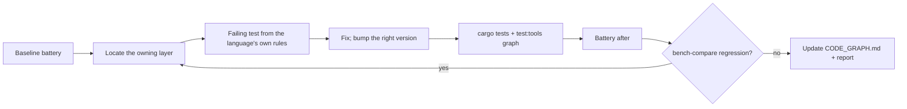

# Octocode graph dev

Change the graph engine behind `octocode graph` and the `graphBuild`/`graphQuery` tools, then prove the change with tests and the language battery. Precision first: an unresolved site with its reason beats a name-guess link.

tools: `$DEV` and `$OCTO` from [octocode-dev](../octocode-dev/SKILL.md) · `node skills-dev/octocode-graph-dev/scripts/graph-bench.mjs` · `cargo test` in `packages/octocode-native`
output: working-tree edits; battery runs and reports in `<repo>/.octocode/octocode-graph-dev/`

## Change the engine

1. When the change can move linking, recall or timing, run the battery first and keep its JSON as the baseline ([battery](references/battery.md)).
2. Locate the layer with the [engine map](references/engine-map.md): extraction, resolution, projection, format, query or detector. Contracts (schemas, descriptions, limits text) belong to core through the [contract pipeline](../octocode-dev/docs/DEVELOPMENT.md#contract-pipeline).
3. Write the failing case first. Per-language linking cases go in `ast_graph/link_tests/<language>.rs` and follow that language's name-resolution rules, not the oracle's text match.
4. Fix at the owner. A form the language rules cannot settle stays unresolved with a named reason, or links at `medium`/`low` with the reason it is not `high`.
5. Bump the version whose cached data the change invalidates ([engine map](references/engine-map.md#versions)).
6. Verify: the focused `cargo test` modules, the [CODE_GRAPH.md evaluation](../../packages/octocode-native/docs/engine/CODE_GRAPH.md#evaluation) commands, then `$DEV build:dev` and `$DEV test:tools graphBuild,graphQuery`.
7. Run the battery again and compare. When `bench-compare.mjs` exits 1, inspect the rows it names before anything else.
8. Update the owning docs: the evaluation table and per-language limits in [CODE_GRAPH.md](../../packages/octocode-native/docs/engine/CODE_GRAPH.md), and its open decisions when a choice was made or deferred.

## Judge a result

- Recall and precision come from a text oracle; a "miss" or "extra" is a lead until the source settles it. Check the oracle caveats in [battery](references/battery.md#reading-a-row) before claiming an engine defect.
- Precision must not drop for any row. A recall drop is acceptable only when it removes a name-guess link, and the report says so.
- `callLinkRate` and `coverage.linkage` measure extracted syntax sites, not semantic recall.
- Before claiming callers or absence, take the union with `lspSearch` callers: each finds calls the other misses.

## Resources

| When | Read or run | Why |
|---|---|---|
| Finding the file a change belongs to, or which version to bump | [engine-map.md](references/engine-map.md) | Layers, owners, tests and versions |
| Measuring a change, reading a row, adding a case | [battery.md](references/battery.md) | Battery run, oracle rules and caveats |
| Running the battery | [graph-bench.mjs](scripts/graph-bench.mjs) `--help` | One JSON row per grammar, every page followed |
| Comparing two runs (gate) | [bench-compare.mjs](scripts/bench-compare.mjs); after editing either script, `node --test` [bench-compare.test.mjs](scripts/bench-compare.test.mjs) (covers both) | Per-row deltas; exit 1 on a precision drop or new ingest failure |
| Saving or rendering a report | [render-report.mjs](scripts/render-report.mjs) | HTML view, manifest |
| Graph architecture, limits, per-language gaps, open decisions | [CODE_GRAPH.md](../../packages/octocode-native/docs/engine/CODE_GRAPH.md) | The owning design doc |

## Related skills

- Use `octocode-dev` for builds, the task runner, contract regeneration and release gates.
- Use `rust-best-practices` when a graph change opens a Rust design choice (ownership, memory, crate boundaries).
- Use `octocode-graph-view` when the goal is a rendered architecture view of a repository, not an engine change.
- Use `octocode-architect` when reviewing the graph modules' own structure.

## Output

Follow [output.md](output.md).
