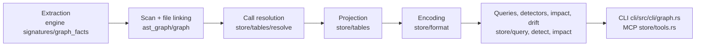

# Engine map

Load when locating the file a graph change belongs to, its tests, or the version it must bump.

Paths are under `packages/octocode-native/crates/`; `ast_graph/` is `runtime/src/tools/ast_graph/`, and bare `graph/`, `store/`, `link_tests/` and file paths in this table are under it. Each module opens with a `//!` line naming its job: read it before editing.

## Layers

| Change | Owner | Tests |
|---|---|---|
| What a file yields: declarations, imports, calls, receivers, arguments, macro bodies, test flags | `engine/src/signatures/graph_facts/` (per language: `c_family.rs`, `go.rs`, `python.rs`, `rust.rs`, `scala.rs`, `receiver/`); scan and reuse in `engine/src/fact_scan/` | `graph_facts/tests/`, `engine/src/fact_scan/tests/` |
| Which files are scanned, roles (test, generated, bundled), scope refusals and hints | `graph/scan.rs`, `classify.rs`, `graph/scope.rs` | `graph/tests/prune.rs`, `store/tests/limits.rs` |
| Import specifiers to files: tsconfig paths, workspaces, Cargo, go.mod, Python roots, packages | `graph/resolve.rs`, `aliases.rs`, `cargo.rs`, `packages.rs`, `js_paths.rs`, `linking.rs` (one record per grammar) | `graph/tests/resolution.rs`, `link_tests/imports.rs` |
| Per-file linking: exports, re-exports, CommonJS, paths | `graph/link.rs`, `graph/imports.rs`, `graph/exports.rs` | `link_tests/commonjs.rs`, `store/tests/reexports.rs` |
| One call site to its targets, by the language's binding rules | `store/tables/resolve/`: `linker.rs` (entry), `lexical.rs` (bare names), `choice.rs` (candidates), `classes.rs` (Java, C#), `go.rs`, `rust.rs`, `scala.rs`, `c_family.rs`, `es_members.rs`, `constructors.rs`, `inherited.rs`, `exports.rs` | `link_tests/<language>.rs`, `store/tests/call_recall.rs`, `resolution_round2.rs` |
| Tables, edges, witnesses, unresolved reasons, stats | `store/tables/` (`projector.rs`, `assemble.rs`, `edges.rs`, `stats.rs`, `c_definitions.rs`) | `store/tables/tests.rs`, `store/tests/evidence*.rs` |
| `graph.bin` sections and decode bounds | `store/format/`, `store/format.rs` | `store/tests/snapshots.rs`, `source_correspondence.rs` |
| Build and snapshot bounds (`scopeTooBroad`) | `ast_graph/limits.rs` (the only owner) | `store/tests/limits.rs` |
| Ingest, reuse, checkpoints, staleness | `store/ingest.rs`, `graph/checkpoint/`, `store/staleness.rs`, `freshness.rs` | `store/tests/ingest.rs`, `incremental.rs`, `stale.rs`, `graph/checkpoint/tests.rs` |
| Query ops, ranking, paging | `store/query/` (`find.rs`, `traverse.rs`, `evidence.rs`, `paging.rs`) | `store/tests/queries.rs`, `pagination.rs`, `find_ranking.rs` |
| `issues` detectors, cycles, dead code | `store/detect/`, `algorithms.rs` (the one cycle engine) | `store/tests/detectors.rs`, `store/tests/detectors/`, `link_tests/dead_code.rs` |
| `impact`, `drift` | `store/impact/`, `store/impact.rs`, `store/drift.rs` | `store/tests/impact.rs`, `impact_since.rs` |
| CLI text, flags, exit codes | `cli/src/cli/graph.rs` | `$DEV test:tools graphBuild,graphQuery` |
| MCP tool pages and snapshot selection | `store/tools.rs`; schemas and descriptions in core | `$DEV test:tools graphBuild,graphQuery` |

## Versions

Bump the one whose cached data the change makes wrong; a bump forces a rebuild, so do not bump for a pure query change.

| Constant | Where | Bump when |
|---|---|---|
| `GRAPH_FACTS_SCHEMA_VERSION` | `engine/src/signatures.rs` | Extracted facts change for the same source; extend its version comment |
| `ANALYSIS_VERSION` | `runtime/src/tools/ast_graph.rs` | Persisted linking semantics change without a format change |
| `FORMAT_VERSION` | `ast_graph/store/format.rs` | The `graph.bin` encoding changes; extend its version comment |

Tests compare against these constants, never a copied number, so a bump needs no test edits; a test that pins a literal version is a defect.
