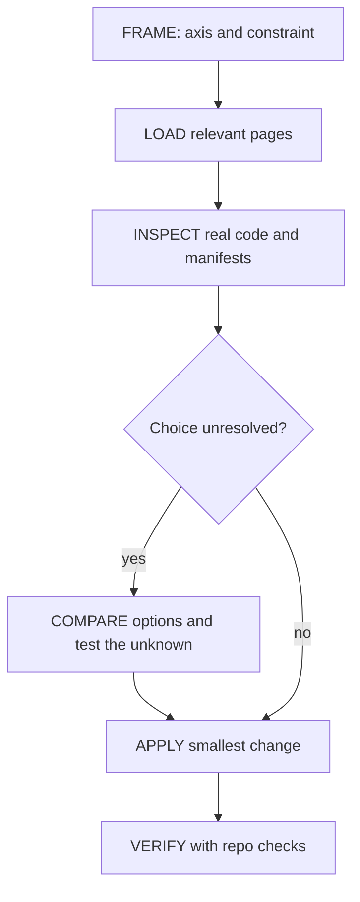

# Rust Best Practices

Use the [shared Octocode guide](references/octocode-usage.md) for source evidence. A settled mechanical edit needs only the repository's checks.

## Resources

Start with the decision area in play. Follow a page's cross-reference when the change crosses that boundary.

| When | Read | Why |
|---|---|---|
| Verify a claim or choose a crate | [Sources and crates](references/sources-and-crates.md) | Official sources and selection checks |
| Errors, ownership or async cleanup | [Idioms](references/idioms.md) | Conversions and lifecycle |
| Structs, enums, generics, traits or pointers | [Types and patterns](references/types-and-patterns.md) | Model the contract |
| Module boundaries or crate extraction | [Crate structure](references/crate-structure.md) | Ownership and dependency direction |
| Add a crate or change root manifest/features | [Workspace](references/workspace.md) | MSRV, lockfile and features |
| Compile time, build profiles or target size | [Build profiles](references/build-profiles.md) | Rebuild causes and measurements |
| Tests, dev loop or CI gate | [Testing and tooling](references/testing-and-tooling.md) | Select relevant checks |
| Hot paths, RSS or allocation | [Performance and memory](references/performance-and-memory.md) | Measure before changing |
| Unsafe, untrusted input or FFI | [Safety and FFI](references/safety-and-ffi.md) | Invariants, panics and threads |
| napi-rs signatures or platform packages | [napi](references/napi.md) | JS mapping and generated types |
| CLI, TUI or child processes | [CLI/TUI/subprocess](references/cli-tui-subprocess.md) | Streams, exits and cleanup |
| Parsing or generated contracts | [Parsing and codegen](references/parsing-and-codegen.md) | Source coordinates and one generator |

## Rules
- Read the real `Cargo.toml`, `src/` layout, and target code before advising; match the crate's edition, MSRV, and conventions.
- FRAME the requested behavior, owning crate, constraints, and success check. Use a Task contract when delegating. Inside Octocode, load `octocode-dev` first.
- COMPARE only an unresolved choice. For a consequential design choice, record an ADR: context, the existing approach against a viable alternative, decision, consequences (evidence, cost, a counterexample). Test the smallest unknown that can change the decision; mark unmeasured claims as unknowns. Broader scope exploration routes to `octocode-brainstorming`.
- Prefer std or an already-present dependency. Claim–evidence for a new crate: maintenance, license, and API each beside an upstream source link (`octocode-research`), not registry stars.
- Claim–evidence for idiom/API claims: cite the official canon (API Guidelines, Reference) by name; crate behavior comes from upstream source.
- Format on the edit. Run the repository's applicable Clippy gate before handoff (`references/testing-and-tooling.md`); inspect a lint's intent before changing behavior to satisfy it.
- Never change observable behavior while cleaning up; behavior-preserving cleanup belongs to `octocode-clean-agentic-code`.
- No performance claim without a `--release` benchmark or profile. `unsafe` only for a proven need, each block with a written safety invariant.
- Stay within the requested axis. Check existing authorization before adding dependencies, changing MSRV/edition or updating lockfiles; ask a Decision request only for scope it does not cover ([output.md](output.md)).
- Public tool types and limits follow the repository's contract generator. Native owns execution and response policy; host adapters convert values.
- Bound work without losing evidence: return a complete page and executable continuation. Disclose terminal limits; never silently clip results.
- VERIFY against the Definition of Done: the repository's build and test commands pass. After native changes, rebuild hosts and exercise the actual CLI or fresh MCP.

## Related
`octocode-dev`: Octocode build and contract pipeline · `octocode-research`: source evidence · `octocode-brainstorming`: unresolved scope and feasibility · `octocode-architect`: boundary decisions · `octocode-clean-agentic-code`: cleanup · `octocode-roast`: smell inventory · `octocode-eval-benchmark`: measure a change · `octocode-skills`: change this folder.

## Output
One answer in chat. Format and save path: [output.md](output.md).
