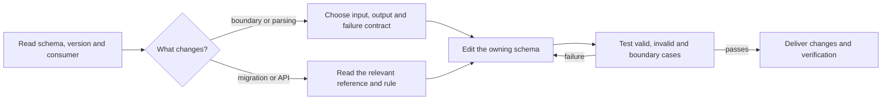

# Zod

Design and test Zod v4 schemas against the installed version and consumer contract. Use the project's source and current upstream documentation to resolve disagreements with this guidance.

## Working rules

- Parse untrusted input at the owning boundary; pass validated values inward. Preserve the repository's schema generator and avoid duplicate wire types.
- Choose `safeParse` for expected validation failures, `parse` when throwing is the intended contract; async refinements require the async parser. User callbacks can still throw.
- Choose unknown-key handling deliberately: `object` strips, `strictObject` rejects, `looseObject` preserves. Use `z.infer`, `z.input` and `z.output` for their respective sides of a transform.
- Load the relevant resource below before using a specialized API. Preserve the installed version, runtime behavior and TypeScript contract; do not migrate merely to match an example.
- Verify acceptance and rejection through the consumer, including transformed output and error paths. Keep sensitive raw input out of reported errors.

## Resources

Choose by the missing decision, not a fixed priority. References explain a topic; rules isolate a failure case. Read only the relevant entries.

| When | Read | Why |
|---|---|---|
| Pick primitive or format syntax | [Schema types](references/schema-types.md) | Types, strings, numbers, enums and dates |
| Choose parser, coercion or inferred type | [Parsing](references/parsing-and-inference.md); [safeParse](rules/parse-use-safeParse.md), [async](rules/parse-async-required.md), [inference](rules/parse-infer-types.md) | Match success and failure to the consumer |
| Compose objects or unions | [Composition](references/objects-and-composition.md); [unknown keys](rules/schema-object-unknowns.md), [tagged unions](rules/schema-union-discriminated.md), [coercion](rules/schema-coercion-pitfalls.md), [recursion](rules/schema-recursive-types.md) | Preserve structure and unknown-key behavior |
| Validate or transform values | [Refinements](references/refinements-and-transforms.md); [callback errors](rules/refine-never-throw.md), [validation vs conversion](rules/refine-vs-transform.md), [cross-field](rules/refine-cross-field.md), [pipes](rules/pattern-pipe.md) | Separate validation, conversion and staging |
| Format or customize errors | [Errors](references/error-handling.md); [messages](rules/error-custom-messages.md), [formatting](rules/error-formatting.md), [input privacy](rules/error-input-security.md) | Consumer shape and safe diagnostics |
| Compose large schemas or reduce bundle cost | [Shape spread](rules/perf-extend-spread.md), [reuse](rules/perf-reuse-schemas.md), [Mini](rules/perf-zod-mini.md) | Measure the relevant cost before changing APIs |
| Migrate existing v3 code | [String formats](rules/migrate-string-formats.md), [enums](rules/migrate-native-enum.md), [errors](rules/migrate-error-api.md) | Version-specific replacements |
| Add bidirectional or nominal types | [Advanced APIs](references/advanced-features.md); [brands](rules/pattern-branded-types.md), [codecs](rules/pattern-codecs.md) | Encode/decode and identity contracts |
| Place or evolve a schema | [Boundary architecture](references/boundary-architecture.md); [parsing boundary](rules/arch-boundary-parsing.md), [organization](rules/arch-schema-organization.md), [versioning](rules/arch-schema-versioning.md) | Ownership and compatibility |
| Add observability | [Structured errors](rules/observe-structured-errors.md), [metrics](rules/observe-error-metrics.md) | Useful diagnostics without raw input |
| Review a mistake or automate checks | [Anti-patterns](references/anti-patterns.md), [lint and CI](references/linter-and-ci.md) | Verify applicability before enforcing a rule |
| Test schemas | [Testing guide](references/testing.md), [test APIs](references/testing-api.md), [test anti-patterns](references/testing-anti-patterns.md) | Valid, invalid, boundary and integration cases |

## Related skills

Use `octocode-research` for unresolved source behavior, `octocode-architect` for boundary design, and `octocode-dev` for Octocode's generated contracts and checks.

## Output

Follow [output.md](output.md).
