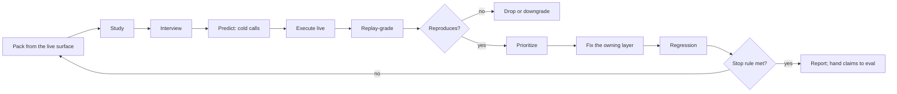

Load when smaller or faster models must understand and execute a protocol, tool surface, system prompt, or schema, and you need its gaps before shipping or before a measured eval.

## Fit

| Need | Use |
|---|---|
| Find ambiguous text, missing rules, silent failures, and wrong recovery paths | This loop |
| Prove a reliability, activation, tool-selection, or savings claim | `octocode-eval-benchmark` |
| Check a wording-only edit | [Verify](../SKILL.md#verify) |

An interview finds gaps; it does not prove an improvement. Hand claims to a behavioral eval once the loop stops.

## Loop



## Pack

- Exactly what the production agent receives: instructions and tool names, descriptions, and schemas dumped from the running server or loader, never from source. Add sample outputs only when production shows them; otherwise label the results an upper bound.
- Freeze the served artifact before the round: copy the server build, dump the pack from that copy, and run every call through it. A rebuild during the round would otherwise move the baseline.
- Runner: one literal command line in the brief. Shells such as zsh do not word-split a command stored in a variable. Use distinct exit codes for ok, rejected input and other errors, and mark any truncation the runner applies.
- Targets: a quiet tree or fixed fixtures. Concurrent edits to the searched files stale snapshots and read as false findings.
- One group per interviewee, by job (local text, structure and identity, remote reads, history, classification), plus one cross-cutting group for the instructions.
- 6–9 executable scenarios per group against real targets, including edge cases: missing path, empty result, paged or partial result, a field from another mode, an unavailable feature, injected text, a question that needs the user.
- Each round, replace about a third of the scenarios so fixes do not overfit.
- Keep each round's pack, answers and `graded.json` under `<workspace>/.octocode/octocode-agentic-prompts/tmp/<run>/round-<n>/`; the saved report links them.

## Interviewee brief

Spawn a fresh small-model agent per group per round, never one that saw an earlier round:

```text
You are interviewed on a protocol: the instructions and tool schemas in PACK.
Read every file in PACK before answering. Give reasoning for every answer and quote the
protocol text you rely on or find lacking. Edit nothing except files in OUT.

Part 1 (for the instructions, then each tool in group GROUP):
1. What did you understand: job, when to use, when not, inputs, outputs, next step?
2. What is unclear or ambiguous? Quote it.
3. Which assumptions could break?
4. Where is the protocol incomplete?
5. Which edge cases might you fail on?
6. When would you ask the user for clarification?
7. How would you measure success or failure of a call and of an answer?

Part 2, Phase A (cold): for each scenario in SCENARIOS, write the first calls you would make
and your predicted output to OUT/GROUP-calls.jsonl, one single-line JSON object per line,
concrete values only (describe chained steps in "expect"). Write the file before running anything.
Part 2, Phase B: run each call with RUNNER (read-only), then chained calls until answered or
blocked. Record the outcome, where real output differed from your prediction, what you changed,
which protocol text would have prevented the mistake, and the cited answer.

Final report sections: Understanding (2–4 lines per tool); Gaps table (Protocol text | Problem |
Effect on an agent | Proposed fix | Severity); Phase A vs B (cold valid | answered | changed);
When to ask the user; Success metrics; Confidence 0–10 per tool.
```

Cold-call line:

```json
{"scenario":"S2","step":1,"tool":"<tool>","input":{"queries":[{}]},"expect":"<predicted key fields and next action>"}
```

## Grade

- Replay every cold call yourself: `node <skill-folder>/scripts/interview-grade.mjs <round-dir> --cmd '<runner {tool} {input}>' --reject <regex>`. The runner must accept both substituted arguments. The grader skips steps whose `input` contains a `<…>` placeholder; exclude intended-error scenarios. Resolve malformed lines and ensure at least one gradable call before reporting valid-cold rate and rejection count per group.
- Phase B prediction misses are findings: the agent's model of the output was wrong.
- Self-rated confidence is a tiebreaker only; it moves less than behavior does.
- Before calling a missing lead or field a regression, compare with schema defaults applied: surfaces that omit default-valued fields make exact-match graders and agent predictions fail on correct output.

## Reproduce and prioritize

- Reproduce every High live before fixing; drop or downgrade what does not reproduce.
- Rank: silent wrong evidence > valid intent rejected > misleading error or recovery > undocumented output shape > wording.
- Weight recurrence: a gap raised by two independent agents or two rounds is real far more often than a single report.
- Separate three causes: contract (fix it), environment (missing provider, auth, gate: report it), model (agent ignored a correct rule: fix only by moving the rule to where that agent looked).
- Interviewees also see their own host's connected servers. A quote that appears nowhere in the pack is environment: check the pack before treating it as a contract conflict.

## Fix

- Owning layer per [tools](tools.md#layer-owners): field rule → field note; selection or next step → description; cross-tool order or trust → instructions; wrong error text, hint, or output → runtime.
- Put the rule where the failing agent looked; a field note beats a server-wide line for a field trap.
- Prefer a correct runtime error or recovery lead over more prose.
- Budget-neutral: each addition names what it removes; respect host caps on instructions and descriptions.
- Rerun contract tests and the previous round's failing calls after every batch.

## Repeat or stop

- Rebuild the pack from the fixed live surface; new agents; rotated scenarios.
- Stop when two rounds add no new High and valid-cold rate is flat; then measure with `octocode-eval-benchmark`.
- When a gap may be a model limit, rerun that group on a second small model family; to measure what the instructions are worth, run one round without them.

## Report

Follow [output.md](../output.md): a round metrics table (gradable calls, valid cold, rejections, confidence per group), `## Changes` per fix with the evidence that drove it, `## Findings` ranked by recurrence and severity, and decisions the owner must make.
