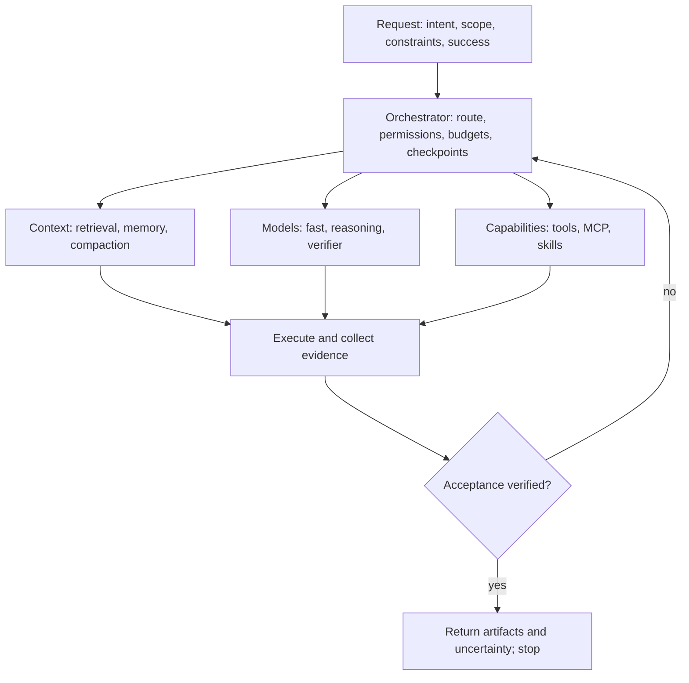

# Agent architecture

Load when choosing how to structure an agent or harness: its components, loop shape, the pattern for a problem, a reference control loop or an execution policy.

## Contents

- [The big picture](#the-big-picture)
- [Core concepts](#core-concepts)
- [Choose a pattern](#choose-a-pattern)
- [Reference control loop](#reference-control-loop)
- [Execution policy](#execution-policy)
- [Design principles](#design-principles)

## The big picture



Default: one bounded agent loop. Add agents only when the work genuinely benefits from specialization, parallelism or isolated context ([delegate only separable work](models-and-delegation.md#delegate-only-separable-work)).

## Core concepts

| Concept | Purpose |
|---|---|
| Agent loop | Observe → decide → act → evaluate |
| ReAct | Interleave reasoning and tool actions |
| Plan-and-execute | Separate planning from execution |
| Planner–executor | Specialized planning and action components |
| Router agent | Choose the model, tool, skill or subagent |
| Supervisor–worker | Delegate bounded tasks to specialist agents |
| Evaluator–optimizer | Critique and improve outputs |
| Reflection | Reassess work using new evidence |
| Human-in-the-loop | Request approval for consequential actions |
| Tool-calling agent | Execute typed external operations |
| Stateful agent | Keep task state between steps |
| Stateless agent | Reconstruct the needed state per request |
| Agent handoff | Transfer responsibility and relevant context |
| Checkpoint / resume | Persist progress across interruptions |
| Durable execution | Recover running workflows without blindly repeating actions |
| Agent sandbox | Isolate execution and limit permissions |
| Agent termination | Stop after success, failure or budget exhaustion |

## Choose a pattern

| Problem | Pattern | Why | Read |
|---|---|---|---|
| Simple, well-defined task | Direct model call | No orchestration overhead | — |
| Needs one external fact | Single targeted tool call | Minimal retrieval and latency | [Retrieval](retrieval-and-grounding.md) |
| Complex task with tools | Bounded agent loop | Observe and adapt to results | [Execution control](execution-control.md) |
| Long-running task | Checkpoint + compaction | Keep critical state across context limits | [Compaction](context-and-memory.md#compaction) |
| Many tools available | Tool discovery + routing | Avoid loading irrelevant schemas | [Tools](tools-and-mcp.md#capabilities-and-triggers) |
| Large repository | Hierarchical search + selective reads | Less context pollution | [Retrieval](retrieval-and-grounding.md#retrieval-techniques) |
| Large paginated API | Cursor pagination + evidence-based stopping | Skip unneeded pages | [Pagination](retrieval-and-grounding.md#pagination) |
| Stable repeated prompts | Prompt caching | Reuse the eligible prefix | [Prompt caching](context-and-memory.md#prompt-caching) |
| Repeated deterministic calculations | Computation cache | No duplicate processing | [Caching](context-and-memory.md#caching) |
| Persistent user or project knowledge | Validated external memory | Useful facts survive sessions | [Memory](context-and-memory.md#memory) |
| Mixed easy and hard workloads | Model cascade | Route by complexity and cost | [Escalation](models-and-delegation.md#escalation-policy) |
| Independent complex subtasks | Parallel specialist subagents | Isolated context, faster execution | [Delegation](models-and-delegation.md) |
| High-stakes output | Evidence + external verifier | Stronger correctness guarantees | [Grounding](retrieval-and-grounding.md#grounding) |
| Frequent hallucinations | Claim grounding + abstention | No unsupported assertions | [Grounding](retrieval-and-grounding.md#grounding) |
| Frequent unproductive tool calls | Progress-based stopping | Stop or change strategy | [Loop types](execution-control.md#loop-types) |
| Patchy coding changes | Reproduce → root cause → test | Coherent fixes | [Patchy behavior](execution-control.md#patchy-behavior) |
| Too much output | Structured return contract | Only decision-relevant information | [Return contracts](models-and-delegation.md#return-contracts) |

## Reference control loop

A framework-independent sketch of how the parts fit together, not an SDK:

```python
def run_agent(request, services, limits):
    task = define_task(request, success_criteria=True)
    state = load_checkpoint(task.id)
    budget = Budget(limits)
    while budget.can_continue():
        # Build only the context the next decision needs.
        context = select_context(task=task, state=state,
                                 token_budget=budget.context_allowance())
        model = route_model(task, context)          # by complexity and risk
        decision = model.decide(task=task, context=context,
                                available_tools=discover_relevant_tools(task))
        if decision.kind == "finish":
            verdict = verify_completion(task, state, decision)
            if verdict.passed:
                return build_result(verdict=verdict, state=state)
            state = record_failed_verification(state, verdict)  # evidence, not completion
            continue
        result = execute(decision, services)        # validated, authorized, idempotent
        state = update_state(state, decision, result)
        save_checkpoint(task.id, state)
        if not making_progress(state):
            return build_partial_result(state, reason="no progress")
    return build_partial_result(state, reason="budget exhausted")
```

A production version also needs durable action IDs, protection against repeating side effects after a crash, input and output validation, cancellation, tracing and approval policies.

## Execution policy

Implement and test the applicable behaviors below; these are policy decisions, not library settings.

| Concern | Owner and required behavior |
|---|---|
| Working context | [Context and memory](context-and-memory.md): select relevant evidence, keep a stable cacheable prefix, load detail on demand and preserve constraints, provenance and unfinished work through compaction. |
| Retrieval and calls | [Retrieval and grounding](retrieval-and-grounding.md): each significant call closes a named decision gap; stop when evidence suffices. |
| Tools | [Tools and MCP](tools-and-mcp.md): validate contracts, provide actionable errors and retain complete evidence behind executable continuations or resolvable references. |
| Execution | [Execution control](execution-control.md): prefer tested deterministic scripts, track progress, detect duplicates and cursor cycles, recover or replan on stalls, and stop at verified completion or an explicit boundary. |
| Models and workers | [Models and delegation](models-and-delegation.md): route by capability, consequence and cost; add bounded independent workers only for a demonstrated need. |
| Trust and effects | [Security](security.md): enforce validation, authorization, isolation and safe recovery at the executing boundary. |
| Proof and result | [Evaluation](evaluation.md) and [output](../output.md): measure verified outcomes, retain correctness and safety separately, and report uncertainty, verification and unchecked scope without unnecessary narration. |

## Design principles

Reuse verified results only while their complete input identity remains unchanged. Key reusable artifacts by content and recompute only changed inputs. Record enough execution context for deterministic replay. Prefer reversible, idempotent effects, with explicit recovery for effects that rollback cannot undo.
