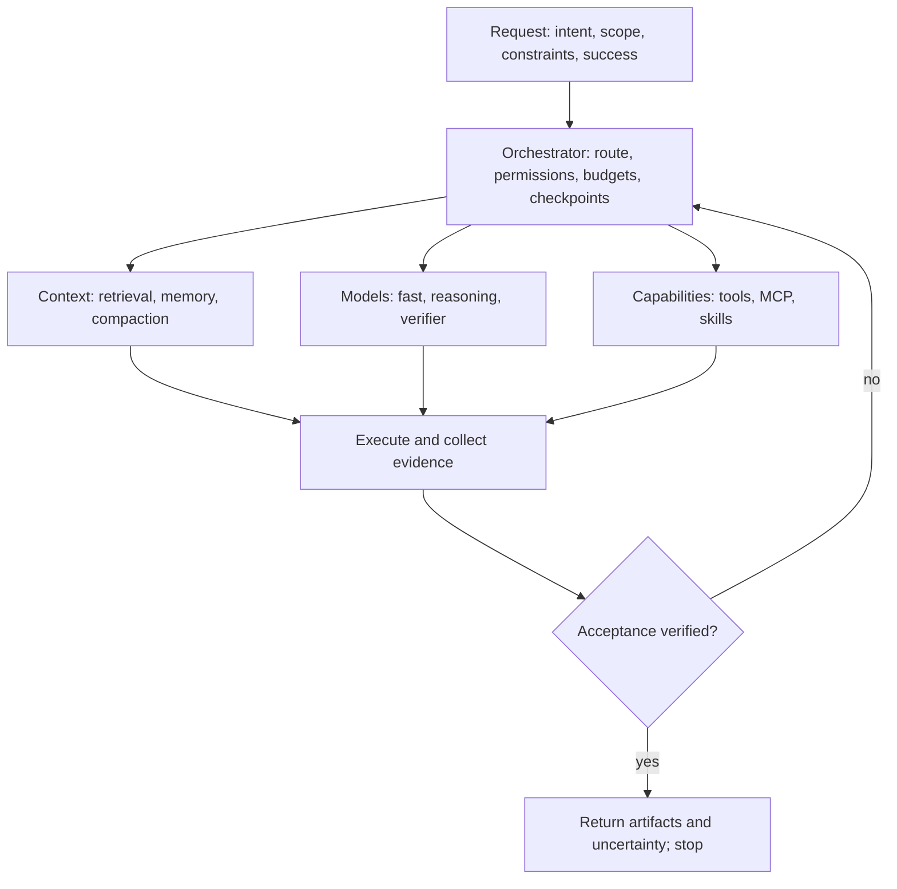

# Agent architecture

Load when choosing how to structure an agent or harness: its components, loop shape, the pattern for a problem, a reference control loop or an execution policy.

## Contents

- [The big picture](#the-big-picture)
- [Core concepts](#core-concepts)
- [Choose a pattern](#choose-a-pattern)
- [Reference control loop](#reference-control-loop)
- [Execution policy](#execution-policy)
- [Design principles](#design-principles)

## The big picture



Default: one bounded agent loop. Add agents only when the work genuinely benefits from specialization, parallelism or isolated context, and confirm on the real workload that several agents beat one strong agent.

## Core concepts

| Concept | Purpose |
|---|---|
| Agent loop | Observe → decide → act → evaluate |
| ReAct | Interleave reasoning and tool actions |
| Plan-and-execute | Separate planning from execution |
| Planner–executor | Specialized planning and action components |
| Router agent | Choose the model, tool, skill or subagent |
| Supervisor–worker | Delegate bounded tasks to specialist agents |
| Evaluator–optimizer | Critique and improve outputs |
| Reflection | Reassess work using new evidence |
| Human-in-the-loop | Request approval for consequential actions |
| Tool-calling agent | Execute typed external operations |
| Stateful agent | Keep task state between steps |
| Stateless agent | Reconstruct the needed state per request |
| Agent handoff | Transfer responsibility and relevant context |
| Checkpoint / resume | Persist progress across interruptions |
| Durable execution | Recover running workflows without blindly repeating actions |
| Agent sandbox | Isolate execution and limit permissions |
| Agent termination | Stop after success, failure or budget exhaustion |

## Choose a pattern

| Problem | Pattern | Why | Read |
|---|---|---|---|
| Simple, well-defined task | Direct model call | No orchestration overhead | — |
| Needs one external fact | Single targeted tool call | Minimal retrieval and latency | [Retrieval](retrieval-and-grounding.md) |
| Complex task with tools | Bounded agent loop | Observe and adapt to results | [Execution control](execution-control.md) |
| Long-running task | Checkpoint + compaction | Keep critical state across context limits | [Compaction](context-and-memory.md#compaction) |
| Many tools available | Tool discovery + routing | Avoid loading irrelevant schemas | [Tools](tools-and-mcp.md#capabilities-and-triggers) |
| Large repository | Hierarchical search + selective reads | Less context pollution | [Retrieval](retrieval-and-grounding.md#retrieval-techniques) |
| Large paginated API | Cursor pagination + evidence-based stopping | Skip unneeded pages | [Pagination](retrieval-and-grounding.md#pagination) |
| Stable repeated prompts | Prompt caching | Reuse the eligible prefix | [Prompt caching](context-and-memory.md#prompt-caching) |
| Repeated deterministic calculations | Computation cache | No duplicate processing | [Caching](context-and-memory.md#caching) |
| Persistent user or project knowledge | Validated external memory | Useful facts survive sessions | [Memory](context-and-memory.md#memory) |
| Mixed easy and hard workloads | Model cascade | Route by complexity and cost | [Escalation](models-and-delegation.md#escalation-policy) |
| Independent complex subtasks | Parallel specialist subagents | Isolated context, faster execution | [Delegation](models-and-delegation.md) |
| High-stakes output | Evidence + external verifier | Stronger correctness guarantees | [Grounding](retrieval-and-grounding.md#grounding) |
| Frequent hallucinations | Claim grounding + abstention | No unsupported assertions | [Grounding](retrieval-and-grounding.md#grounding) |
| Frequent unproductive tool calls | Progress-based stopping | Stop or change strategy | [Loop types](execution-control.md#loop-types) |
| Patchy coding changes | Reproduce → root cause → test | Coherent fixes | [Patchy behavior](execution-control.md#patchy-behavior) |
| Too much output | Structured return contract | Only decision-relevant information | [Return contracts](models-and-delegation.md#return-contracts) |

## Reference control loop

A framework-independent sketch of how the parts fit together, not an SDK:

```python
def run_agent(request, services, limits):
    task = define_task(request, success_criteria=True)
    state = load_checkpoint(task.id)
    budget = Budget(limits)
    while budget.can_continue():
        # Build only the context the next decision needs.
        context = select_context(task=task, state=state,
                                 token_budget=budget.context_allowance())
        model = route_model(task, context)          # by complexity and risk
        decision = model.decide(task=task, context=context,
                                available_tools=discover_relevant_tools(task))
        if decision.kind == "finish":
            verdict = verify_completion(task, state, decision)
            if verdict.passed:
                return build_result(verdict=verdict, state=state)
            state = record_failed_verification(state, verdict)  # evidence, not completion
            continue
        result = execute(decision, services)        # validated, authorized, idempotent
        state = update_state(state, decision, result)
        save_checkpoint(task.id, state)
        if not making_progress(state):
            return build_partial_result(state, reason="no progress")
    return build_partial_result(state, reason="budget exhausted")
```

A production version also needs durable action IDs, protection against repeating side effects after a crash, input and output validation, cancellation, tracing and approval policies.

## Execution policy

A policy that combines the pages of this skill; each flag names a behavior to implement and test, not a library setting.

```yaml
agent_policy:
  objective: verified_success
  attention:
    prefer_relevant_context: true
    load_full_resources_only_when_needed: true
    preserve_source_references: true
    deduplicate_context: true
  execution:
    prefer_existing_scripts: true
    generate_scripts_when_justified: true
    validate_generated_scripts: true
    require_evidence_for_claims: true
  tools:
    discover_on_demand: true
    require_operational_intent: true
    prefer_structured_results: true
    prefer_references_for_large_outputs: true
    support_bounded_pagination: true
    include_actionable_errors: true
  loops:
    track_progress: true
    detect_repeated_actions: true
    detect_cursor_cycles: true
    use_bounded_retries: true
    stop_on_verified_completion: true
    stop_or_replan_on_stall: true
  context:
    compact_when_needed: true
    preserve_decisions_and_evidence: true
    preserve_unfinished_work: true
    rehydrate_on_demand: true
  output:
    concise_by_default: true
    distinguish_facts_from_inferences: true
    report_verification_status: true
    report_material_uncertainty: true
    omit_unnecessary_process_narration: true
```

## Design principles

| Principle | Engineering implication |
|---|---|
| Attention first | Optimize information relevance, not context utilization |
| Reference first | Return summaries and resource handles before raw content |
| Paginate by default | Bound responses; fetch further pages only as needed |
| Actionable errors | Structured causes, retryability and recovery hints |
| Progress-aware loops | Detect stalls, duplicates, cycles and exhaustion |
| Reason-aware tool calls | Declare purpose, expected evidence and the decision supported |
| Script first, agent second | Deterministic programs for reproducible work; agents for ambiguous decisions |
| Evidence over confidence | Trust executable checks and authoritative sources over fluent answers |
| Question-driven retrieval | Every significant read resolves an identifiable gap |
| Result reuse | Do not recompute verified, unchanged state |
| Content-addressed artifacts | Reuse results keyed by complete content identity |
| Deterministic replay | Record enough execution context to reproduce behavior |
| Reversible actions | Prefer changes that can be rolled back safely |
| Idempotent execution | Retries must not duplicate effects |
| Incremental computation | Recalculate only what changed |
| Information gain | Prefer operations likely to change the next decision |
| Evidence completeness | Distinguish partial coverage from exhaustive verification |
| Separation of concerns | Keep planning, execution, verification and presentation distinct |
| State externalization | Store durable state outside the active context |
| Budget-aware routing | Choose models and tools by complexity and cost |
| Outcome-based evaluation | Measure verified completion, not agent activity |
| Tool-contract testing | Test pagination, errors, limits, revisions and permissions |

A bounded, evidence-driven, context-efficient agent that discovers relevant capabilities, retrieves the minimum sufficient information, acts coherently, recovers its state, verifies the result and terminates reliably beats both an enormous prompt and an unconstrained loop of model and tool calls.
