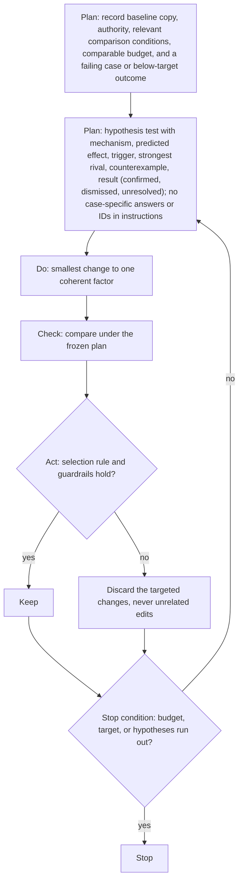

Load when iterating on a change with Keep or Discard, or picking the loop level to work at.

# Eval loop

## Keep/Discard loop

PDCA against the baseline; Keep or Discard is its act step.

- Keep outcomes and evidence for the comparison, including failures and retry cost.

- Parallel hypotheses: separate subject copies and trials; never report the luckiest attempt as pass@1.
- Noise hides the effect: improve measurement first; cheap proxies may guide development, never final verification.
- Check valid alternatives, neighboring edge cases, old successes; a higher score alone proves nothing.

## Loop levels

- **Experiment (inner)**: developer or optimizer mutates one file, prompt, or skill paragraph; solvers get task inputs only. KPI: primary metric.
- **Suite (middle)**: error-analyze traces; add or fix cases, criteria, failure categories; rebalance. KPI: top-failure coverage, regression stay-green rate.
- **Meta (outer)**: authorized maintainer improves program, skill, graders, budgets, harness; new baseline and sealed final check; development traces only. KPI: fewer repeated failure signatures.
- Before escalating, check development failures for sensor defects or missing coverage. Grow the suite only between experiments, from real failures.
- Inner loop flat: missing cases go to suite level, a bad program to meta; with no new hypothesis or failure mode, mine traces for recurrent search patterns and change the search strategy in code or program, not only optimizer-instruction wording (`instructions/`).
