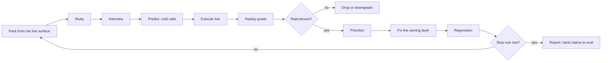

Load when smaller or faster models must understand and execute a protocol, tool surface, system prompt, or schema, and you need its gaps before shipping or before a measured eval.

# Cold interview

## Fit

| Need | Use |
|---|---|
| Find ambiguous text, missing rules, silent failures, and wrong recovery paths | This loop |
| Prove a reliability, activation, tool-selection, or savings claim | [Evaluation](evaluation.md) |
| Check a wording-only edit | [Verify](prompt-writing.md#verify) |

## Loop

## Pack

- Exactly what the production agent receives: instructions and tool names, descriptions, and schemas from the running server, never from source. For an MCP server, `node <skill-folder>/scripts/mcp-surface.mjs capture --cmd '<server command>' --out <round-dir>/pack.json` writes them ([measure the served surface](mcp-context.md#measure-the-served-surface)); hand that file to interviewees as PACK. Add sample outputs only when production shows them; otherwise label the results an upper bound.
- Freeze the served artifact before the round: copy the server build, capture the pack from that copy, and run every call through it. A rebuild during the round would otherwise move the baseline.
- Runner: one literal command line in the brief. Shells such as zsh do not word-split a command stored in a variable. Use distinct exit codes for ok, rejected input and other errors, and mark any truncation the runner applies.
- Targets: a quiet tree or fixed fixtures. Concurrent edits to the searched files stale snapshots and read as false findings.
- One group per interviewee, by job (local text, structure and identity, remote reads, history, classification), plus one cross-cutting group for the instructions.
- Executable scenarios per group against real targets, cover relevant edge cases: missing path, empty result, paged or partial result, a field from another mode, an unavailable feature, injected text, a question that needs the user.
- Add fresh scenarios when repeating the check so wording fixes do not overfit the original cases.
- Keep each round's pack, answers and `graded.json` in its [round folder](../output.md#saved-result); the saved report links them.

Then give each interviewee the [brief](interview-brief.md) and [grade and close the round](interview-grade.md).
