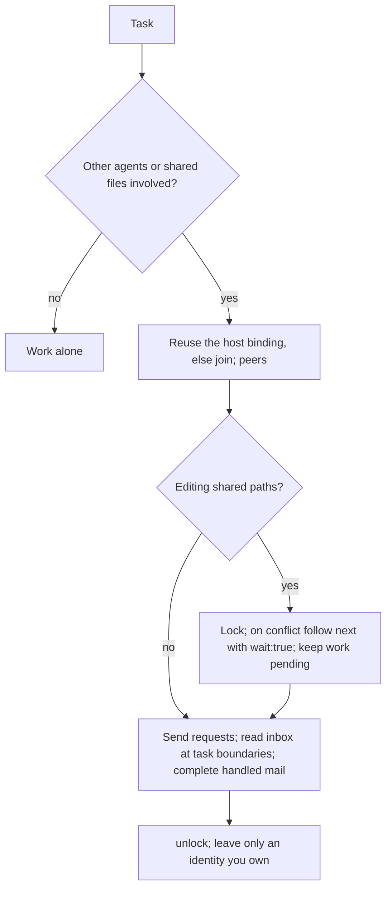

# Agents communication

Coordinates agents through a local SQLite database using the published `@octocodeai/octocode-agents-communication` package via `npx`. There is no remote cloud transport. Inside one Octocode or Pi team, use native coordination; Pi provides `coordinate`, `sendMessage` and `agent`. Use this package for agents outside that team. Pi's file tools honor leases in the default database and registered `--database` files (`DB.md`, under `referenceRoot`). Leases do not fence shell or OS writes.



## Run the CLI

```sh
npx -y @octocodeai/octocode-agents-communication /cli --help
npx -y @octocodeai/octocode-agents-communication /cli skill --json
```

- `skill --json` returns `instructions` (the operating guide), `packageRoot` and `referenceRoot`. Read `instructions` and follow it; this skill does not restate it. Its documentation filenames resolve under `referenceRoot`.
- Command inputs: `<command> --help` or `schema <command>`. Record formats: `schema types`, `schema type NAME` (no workspace, database or session flags).
- Both routes take `--workspace` (your checkout). `/cli` takes `--session ID` on every identity-bound call; without `/cli` the executable starts MCP, which binds the identity at launch with `--session ID` or `--managed --name NAME --vendor HOST`. A `--session required` error means neither was given.

## Situations the guide decides

| Situation | Guide section (`instructions`) |
|---|---|
| First call, finding peers, presence | Discover and choose work |
| Before editing a shared path | Edit with ownership |
| Sending, answering, handing off | Send and handle messages |
| Evidence, checkpoints, paging | Share evidence and continue reads |
| Delivery lost or uncertain | `OPERATIONS.md` under `referenceRoot` |

The guide owns the presence, lease, message and mail rules; read it before the first call. For uncertain delivery, run `health` and inspect the recipient first: a restart never authorizes replay.

## Commands

Every command with an example: `COMMANDS.md` under `referenceRoot`. `run` starts a worker (Claude, Codex, Pi) only when requested; `attach` joins an existing session. Grok: native session via `attach` and `listen`, or host hooks.

## Set up and recover

- Needs Node.js `^24.15.0` (its built-in SQLite, FTS5 included); no other interpreter, API key or `<HOME>/.octocode/.env` entry.
- No `--database`: the shared Octocode home database. Hooks and native delivery: the package's installation and host setup guides; this skill configures none.
- Incompatible store (`db info --json` shows `exists: true` and `compatible: false`): report it and use a fresh `--database`. `exists: false` is a database not created yet: `join` creates it. Never switch coordination tools silently.
- `npx` cannot resolve the package: report the registry or access error; a local executable proves only the runtime.

## Resources

| When | Read | Why |
|---|---|---|
| Render or list saved reports | [render-report.mjs](scripts/render-report.mjs) | HTML view, manifest |

## Related skills

- Use `octocode-agentic-prompts` when a handoff's wording or ownership is unclear.
- Use `octocode-research` when a handoff needs independent code evidence.
- Use `octocode-workflows` when an orchestrator selects actors, sequences work or merges evidence ([composition](../octocode-workflows/references/composition.md)).

## Output

Follow [output.md](output.md).
