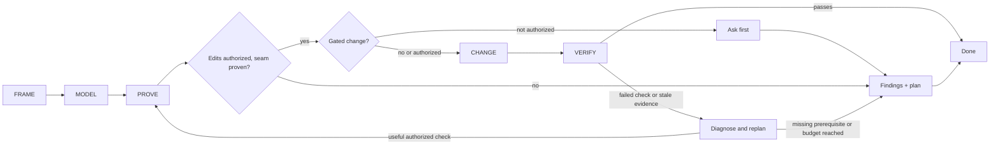

# Octocode Architect

Scale rigor to consequence; never invent layers, findings, or work.

Tools: [shared MCP/CLI guide](references/octocode-usage.md). Topology: `graphBuild` on `<dir>`, then `graphQuery` with the same `path` (persisted snapshot; `octocode schema graphQuery --view variants`).

## Steps

1. Frame: decision, benefit, scope, use case, contract owner. Pin the revision; baseline before claiming a gain.
2. Model: trace flows to their consumers, noting shapes, owners, invariants, failure modes; match coverage to the selected workflow.
3. Prove: per finding, Hypothesis test: claim, strongest rival, distinguishing check, result (confirmed, dismissed, or candidate: unresolved, naming the missing check); the only finding-status words.
4. Change: smallest change at the proven boundary, with a focused test that detects the failure.
5. Verify: production-path checks, affected wiring, exit status and payload errors; compare before/after on one measurement. In a selected workflow, use [shared verification](../octocode-workflows/references/verification.md) for artifact identity, one coverage ledger, and evidence-driven recovery.

## Workflow boundary

When choosing or coordinating a workflow, load `octocode-workflows`: its [composition contract](../octocode-workflows/references/composition.md#orchestrator-and-actor-contract) owns roles, handoffs, the ledger and recovery. Load its [whole-system traversal](../octocode-workflows/references/single-actor-traversal.md) or [runtime surgery](../octocode-workflows/references/runtime-surgery.md) only for that procedure.

Architect keeps the proof steps, [gates](#gates) and [change discipline](references/change-discipline.md). Apply the [critical-path procedure](references/analysis.md#explore-the-graph-and-find-critical-paths) and [review angles](references/checks.md#review-angles) to affected code, preserving healthy invariants and disproof. Research owns tool semantics and live schemas.

## When making a claim

- Label rules declared, observed, or inferred; each [view](references/analysis.md#model-the-wiring) answers a different question.
- Name styles, patterns, roles, and transports with [concepts](references/concepts.md): a name is declared intent, the mechanism is observed; rule out the look-alike before the finding, and report a pattern only with its consequence.
- Apply the [shared evidence rules](references/evidence.md) for static, runtime, and measured claims.
- Caller counts and absence claims come from the union of the graph and `lspSearch callers`: each misses callers the other finds (one trait method: graph 50, LSP 37, union 70; LSP call hierarchy skips calls inside closures, the graph misses types brought in by `use super::*`).
- Distinguishing checks use distinct IDs, paths, versions, roots and assert the specific failure; when a sharper fixture rejects a finding, keep the disproof.
- Topology edges are syntactic candidates; an edge or style preference is no defect, a type-only cycle no runtime proof. Run the [coverage checks](references/analysis.md#choose-the-narrowest-evidence-lane) before a completeness or absence claim.

## Gates

| When | Do |
|---|---|
| Scope, flow, symbol identity, runtime impact, or measurement unresolved | Report a candidate, not a defect. |
| Public-contract rewire, cross-package move, schema/storage migration, delete, or rename | Ask first unless that exact scope is authorized, as a Decision request: options, tradeoffs, recommendation, default if no answer. |
| Cleanup beyond the change | Clean only what the change caused or touches; broader refactoring needs evidence, an acceptance sensor, authorization. |
| Bookkeeping | Update only what the repo contract requires (docs, manifests, versions, lockfiles, changelogs, snapshots); regenerate derived files, never hand-edit. |
| Reachable path unimplemented | Fail explicitly; tests prove outcomes, not calls. |
| Others' uncommitted work | Coordinate on overlapping paths; never stash, reset, overwrite, or discard it. |

## Resources

| When | Read | Why |
|---|---|---|
| Layers, flows, blast radius, task decomposition; topology, cycles, dead code, duplication, hot paths | [analysis](references/analysis.md) | Evidence lanes, coverage, proof |
| Protocol, architecture, bugs, algorithms, efficiency, memory, modularity, or cleanup review | [checks](references/checks.md) | Healthy patterns, failure hypotheses, and distinguishing evidence |
| Before any source edit | [change-discipline](references/change-discipline.md) | Safe moves, slice verification |
| Naming a style, pattern, role, or transport; an ambiguous or look-alike term; mapping a smell to a graph detector or a layout to a layering claim | [concepts](references/concepts.md) | Vocabulary with distinguishing evidence, look-alikes, decision guide |
| Workflow roles, runtime acceptance, shared coverage, interruption, or failed check | [workflow composition and verification](../octocode-workflows/references/composition.md) | Workflow-owned roles, ledger, identity, and recovery |
| Structural discovery or semantic impact tracing in a workflow | [AST and LSP workflows](../octocode-workflows/references/ast-lsp-workflows.md) | Workflow technique; Research owns tool semantics |
| Consequential result | [output.md](output.md#decision-record) | Decision record fields |
| Saving or rendering a report | [render-report.mjs](scripts/render-report.mjs) | HTML view, manifest |

## Related skills

- Use `octocode-graph-view` when a saved graph brief or requested interactive view, with retained evidence, would help.
- Use `octocode-research` when repo, GitHub, package or symbol facts or live tool schemas are needed.
- Use `octocode-rfc-generator` when a decision needs a reviewed document.
- Use `octocode-clean-agentic-code` when the change is behavior-preserving removal.
- Use `octocode-workflows` when sustained or coordinated execution must be chosen and composed.
- Use `octocode-agents-communication` when a selected workflow needs transport identities, leases or messages.

## Output

Follow [output.md](output.md).
