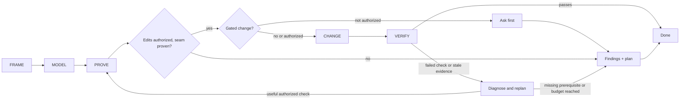

# Octocode Architect

Scale rigor to consequence; never invent layers, findings, or work.

Tools: [shared MCP/CLI guide](references/octocode-usage.md). Topology: `npx -y octocode graph ingest <dir>`, then `graph query` (persisted snapshot; `graph --help`).

## Steps

1. Frame: decision, benefit, scope, use case, contract owner. Pin the revision; baseline before claiming a gain.
2. Model: trace flows to their consumers, noting shapes, owners, invariants, failure modes; match coverage to the selected workflow.
3. Prove: per finding, Hypothesis test: claim, strongest rival, distinguishing check, result (confirmed, dismissed, or candidate: unresolved, naming the missing check); the only finding-status words.
4. Change: smallest change at the proven boundary, with a focused test that detects the failure.
5. Verify: production-path checks, affected wiring, exit status and payload errors; compare before/after on one measurement. In a selected workflow, use [shared verification](../octocode-workflows/references/verification.md) for artifact identity, one coverage ledger, and evidence-driven recovery.

## Workflow boundary

For an explicit workflow, coordinated work, whole-system audit, runtime surgery, handoff, or choice of method, load `octocode-workflows`. Its [composition contract](../octocode-workflows/references/composition.md#orchestrator-and-actor-contract) owns role selection, actor handoffs, one ledger, recovery, and user-facing orchestration.

Within a workflow, Architect owns Frame → Model → Prove → Change → Verify for code-boundary work, [gates](#gates), and [change discipline](references/change-discipline.md). Research owns Octocode tool semantics and live schemas. Apply this skill's [critical-path procedure](references/analysis.md#explore-the-graph-and-find-critical-paths) and [review angles](references/checks.md#review-angles) to affected code; record healthy invariants alongside proven defects and candidates.

Use Workflow's [AST/LSP techniques](../octocode-workflows/references/ast-lsp-workflows.md), [single-actor traversal](../octocode-workflows/references/single-actor-traversal.md), [runtime surgery](../octocode-workflows/references/runtime-surgery.md), and [verification](../octocode-workflows/references/verification.md) when the selected workflow calls for them. They do not replace this skill's architecture proof or authorization gates.

## When making a claim

- Label rules declared, observed, or inferred; each [view](references/analysis.md#model-the-wiring) answers a different question.
- Apply the [shared evidence rules](references/evidence.md) for static, runtime, and measured claims.
- Distinguishing checks use distinct IDs, paths, versions, roots and assert the specific failure; when a sharper fixture rejects a finding, keep the disproof.
- Topology edges are syntactic candidates; an edge or style preference is no defect, a type-only cycle no runtime proof. Run the [coverage checks](references/analysis.md#choose-the-narrowest-evidence-lane) before a completeness or absence claim.

## Gates

| When | Do |
|---|---|
| Scope, flow, symbol identity, runtime impact, or measurement unresolved | Report a candidate, not a defect. |
| Public-contract rewire, cross-package move, schema/storage migration, delete, or rename | Ask first unless that exact scope is authorized, as a Decision request: options, tradeoffs, recommendation, default if no answer. |
| Cleanup beyond the change | Clean only what the change caused or touches; broader refactoring needs evidence, an acceptance sensor, authorization. |
| Bookkeeping | Update only what the repo contract requires (docs, manifests, versions, lockfiles, changelogs, snapshots); regenerate derived files, never hand-edit. |
| Reachable path unimplemented | Fail explicitly; tests prove outcomes, not calls. |
| Others' uncommitted work | Coordinate on overlapping paths; never stash, reset, overwrite, or discard it. |

## Resources

| When | Read | Why |
|---|---|---|
| Layers, flows, blast radius, task decomposition; topology, cycles, dead code, duplication, hot paths | [analysis](references/analysis.md) | Evidence lanes, coverage, proof |
| Protocol, architecture, bugs, algorithms, efficiency, memory, modularity, or cleanup review | [checks](references/checks.md) | Healthy patterns, failure hypotheses, and distinguishing evidence |
| Before any source edit | [change-discipline](references/change-discipline.md) | Safe moves, slice verification |
| Workflow roles, runtime acceptance, shared coverage, interruption, or failed check | [workflow composition and verification](../octocode-workflows/references/composition.md) | Workflow-owned roles, ledger, identity, and recovery |
| Structural discovery or semantic impact tracing in a workflow | [AST and LSP workflows](../octocode-workflows/references/ast-lsp-workflows.md) | Workflow technique; Research owns tool semantics |
| Consequential result | [output.md](output.md#decision-record) | Decision record fields |
| Saving or rendering a report | [render-report.mjs](scripts/render-report.mjs) | HTML view, manifest |

## Related skills

- `octocode-research`: repo, GitHub, package, symbol facts; owns tool choice and live schemas.
- `octocode-rfc-generator`: reviewed decision document.
- `octocode-clean-agentic-code`: behavior-preserving removal.
- `octocode-workflows`: choose and compose sustained or coordinated execution; retains generic orchestration and verification.
- `octocode-agents-communication`: transport identities, leases, and messages for a selected workflow.

## Output

Follow [output.md](output.md).
