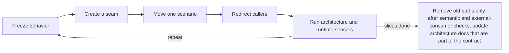

Load when about to edit source: a proven fix, a requested design improvement, or an agent's slice. A slice is done only when behavior and repository state agree.

# Change discipline

## Refactor

- No refactor while a candidate's impact or acceptance check is undefined.

Safe moves (finding → move; guardrail):
- Mixed responsibility → extract one cohesive capability behind the existing call shape; characterization tests.
- Wrong-way dependency → consumer-owned port, infrastructure in an adapter; contract test, negative dependency check.
- Leaky transport/storage/view type → boundary value or DTO at the edge; serialization, validation, compatibility tests.
- Hidden orchestration or effects → expose the use-case boundary and effect owner; success, error, retry, timeout, cancellation.
- Repeated policy → centralize only proven shared knowledge and change pressure; keep divergent edge cases.
- Over-wide interface → focused capabilities from real consumer groups; no capability loss.
- Measured repeated work → fix I/O, computation, or cache/lifetime ownership; same benchmark conditions and limits.
- Harmful runtime cycle (not type-only) → break the least stable edge (inversion, events, moved responsibility); initialization and integration checks.

- Boundaries: cut by capability, volatility, and ownership, not technical nouns; dependencies point toward stable policy; construction stays at few composition roots; transactions, retries, cancellation, failure, and observability each get an owner. Prefer duplicated simple syntax over abstracting unrelated concepts.
- Migrate in reversible vertical slices, not layer rewrites:

- A seam exposing an unproven assumption: back to [checks](checks.md#algorithms) or [analysis](analysis.md).

## Delete junk and unify

- Within authorized cleanup scope, use `octocode-clean-agentic-code` for the [removal bars](../../octocode-clean-agentic-code/references/code-smells.md); this architecture skill still owns boundary choice, dependency direction, and verification. A request to review alone does not authorize broad deletion.
- **Prove removal.** Start with AST or graph candidates, resolve identity and consumers with LSP, then check exports, registries, configuration, scripts, generated consumers, persisted protocols, and external use. Unused imports, stale wrappers, unreachable branches, debug leftovers, and obsolete dependencies are candidates, not automatic deletions. Keep useful diagnostics, compatibility required by a live contract, and tests that expose a failure.
- **Prove unification.** Compare semantics, invariants, defaults, errors, lifetime, and change pressure across every site. Similar syntax, names, or type shapes do not prove one responsibility. Preserve distinct domain identities and version boundaries when their meaning differs.
- **Choose one owner.** Put shared policy in the layer that owns it and direct callers there. Update the existing source of truth and regenerate derived forms; do not introduce a second canonical schema, a generic dumping ground, forwarding aliases, or a permanent parallel implementation.
- **Complete the migration.** Move consumers in verifiable slices, check each path, then remove redundant code, imports, dependencies, configuration, and links that are proven obsolete. Re-resolve references and inspect the resulting graph for new cycles or widened coupling.
- **Verify the result.** Run affected builds and contract/runtime checks, including previous critical paths. State which responsibility now has one owner, what was removed, and what evidence preserves behavior. Reduced line count alone is not proof of cleaner architecture or better efficiency.

## Verify the slice

- In a selected workflow, use [shared verification](../../octocode-workflows/references/verification.md) to assert loaded artifact identity, update the coverage ledger, and diagnose failures before another change.
- The first failing assertion fails for the intended reason.
- Never stub the dependency the test claims to prove.
- Run the narrowest checks, widen with affected scope, compare with the baseline.
- Passing assertion text in a non-zero process is a failure.
- Release acquired resources; preserve generated-code ownership.
- Optimization: record the metric.
- Remove dead imports and obsolete code the change created or exposed; fix affected formatting, stale comments, naming drift. Broader cleanup and bookkeeping: [gates](../SKILL.md#gates).

## Done

Definition of Done: the owned interface behaves as intended on normal and named edge paths; every remaining failure has a class and attribution evidence. Report per the [decision record](../output.md#decision-record) (low-risk: slice, impact, verify).
