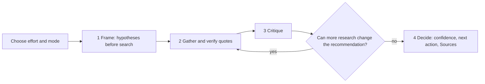

# Octocode Brainstorming

**Start:** read this lobby, map the task to the references it names, and read each one the task needs before acting. Recommend from checked sources. Trace each fact to a verbatim quote on the cited page and label inference. A single factual lookup belongs in direct research. Each phase's actions, gates, checkpoints and scripts are in [phases](references/phases.md).

## Choose the effort

State the lowest effort that can change the decision and why; the user can change it. Raise one level for conflicting verified evidence or a missing deciding source; drop one if early searches settle it.

| Effort | When | How |
|---|---|---|
| `low` | Gist, usual practice or a reversible choice with established guidance | Gather and verify directly, or use one bounded evidence actor, then answer. |
| `medium` | Several plausible directions, or a request for sources alone | Gather directions sequentially in direct work. If orchestrated, separate gathering and critique. |
| `high` | Costly, hard to reverse, for other decision-makers or explicitly deep | Checkpoint before gathering. Assign distinct deciding directions in an orchestrated run. Apply the [debate and asset gates](references/phases.md). |

## Modes and directions

| Request | Mode | Start with |
|---|---|---|
| Help thinking, including named options | Think together | User's view and options, deciding questions, riskiest assumption |
| Test an idea | Validate | Supporting case, strongest objection and failure cases, prior art or alternatives |
| Open problem | Find ideas | Promising approaches, adjacent fields, constraints or unmet needs |
| Best practice | Find resources | Official guidance, practitioner experience, pitfalls and counterexamples |
| Choice between named options | Compare | One direction per option plus adoption constraints |

Give each direction a different [thinking lens](references/critical-thinking.md#thinking-lenses). In [Think together](references/critical-thinking.md#thinking-with-the-user), ask one question if the user's view is missing, show the [framing](output.md#think-together) before dispatch and research only sub-questions that affect the choice. Select only thinking modes that can change the recommendation; definitions are in [mental models](references/mental-models.md#choose-the-lens).

| Intent | Thinking mode | Action / check |
|---|---|---|
| Challenge a proposal | Inversion / Second-Order | Seek the strongest failure case and what follows the initial outcome. |
| Resolve uncertainty | Bayesian / Knightian | Compare rival predictions; update from evidence and keep unsupported odds unknown. |
| Preserve useful options | Optionality / Via Negativa | Test the smallest reversible option and remove complexity that adds no deciding value. |

## Output and neighbors

Follow [output.md](output.md); render or find prior work with [render-report.mjs](scripts/render-report.mjs). End every interim and final response with Sources, and link ledgers, verification files and state under `tmp/<run>/`. Use `octocode-research` for code evidence, `octocode-scraping` for a saved corpus or failed fetch, `octocode-chrome-devtools` for rendered pages, `octocode-rfc-generator` for a decision document, `octocode-agentic` for a measured experiment and `octocode-workflows` when coordinating actors.
