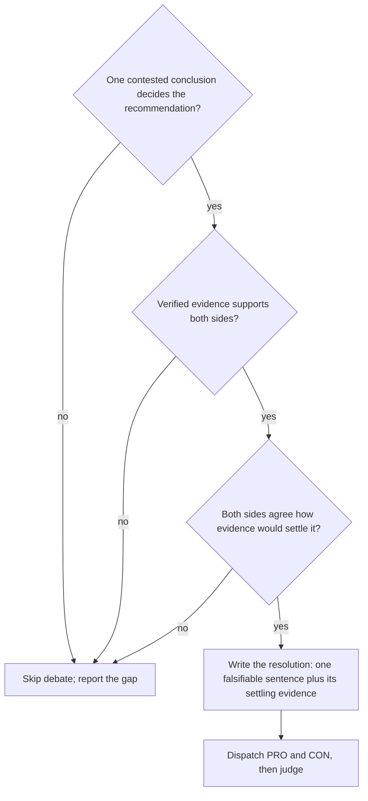

Load when thinking a question through with the user, framing hypotheses, choosing directions, judging verified claims, or briefing critics or debaters.

# Critical thinking

## Thinking with the user

How-to for [Think together](../SKILL.md#modes-and-directions):

- The user's view first, including what they already ruled out.
- Refine each user idea before adding yours: its strongest form, riskiest assumption, cheapest test.
- Generate your own options per lens before reading search-result lists; label them as yours.
- Diverge, then converge: options without judging, then merge, cut, and rank against the user's criteria.
- Say what is still unknown.

## Decompose, then recompose

- Split into sub-questions that together decide it, each answerable alone and naming its settling evidence; mark each known, assumed, or to research.
- Decompose only the parts that matter.
- Right sub-answers can compose wrongly: [recompose](../SKILL.md#4-decide).

## Hypotheses before search

Write them before the first query, with your expected answer: two to four, the leading answer, its strongest rival, and "no difference" or "depends on a named condition". Treat each as a hypothesis test: claim, strongest rival, refuting check, result (survived, refuted with claim ids, or untested).

- A hypothesis nothing could refute is a framing: sharpen or drop it.
- Seek evidence likely under one hypothesis and unlikely under the others; evidence fitting all is context. Try to refute the leading one first.
- Unknown space: one exploratory pass, then hypotheses. Test generated ideas, yours included, for feasibility.

## Thinking lenses

Pick lenses that can change the decision; each becomes a direction or a question inside one.

| Lens | Question | Typical evidence |
|---|---|---|
| Incentives | Who gains or loses, and how would each respond? | Pricing, licensing, governance, adoption stories |
| Base rates | How often do similar attempts succeed, across reference classes? | Surveys, postmortems, benchmarks, issue history |
| Mechanism | Why would it work; what must be true? | Specs, primary studies, source code |
| Failure cases | Where did it fail, under which conditions? | Incident reports, critiques, negative results |
| Adjacent fields | Who solved the same structure elsewhere? | Other-domain work, labeled analogy |

## Search like a fact-checker

- Check on other pages who is behind a source: owner, funding, whether it sells what it praises.
- Quote the original study, spec, or release; if unreachable, note `secondary` and lower confidence.
- Corroborate with an independent source, not the same story syndicated.
- Conflicts: report them; resolve by source quality, never by count.
- Citations in AI search answers are leads only.
- Stop when varied searches add no sources; "no evidence found" is valid.

## Independence and incentives

- Delphi: independent first positions (each worker or critic commits before seeing another's), then share; keep dissent.
- Workers reading the same sources count as one source.
- Resolve disagreement with distinguishing evidence, not a majority vote; debate only when the [gate](#debate-when-and-how) holds.
- Critics never gathered the evidence they check; they check evidence, not agreement.
- Weigh by the author's stake: vendors, method authors, and advocates show a claim exists, not that it is true.

## Judging without bias

Judges, the parent included, favor by position, format, and length.

- Compare in both orders; a flip means unresolved, never pick.
- Score one criterion at a time, then combine; never ask "which is better overall".
- Ignore markdown, length, citation count, and tone.
- More judges or debate do not remove shared bias.
- A verdict matching your expected answer: look once more for the strongest verified claim against it.

## Calibrated confidence

| Confidence | Evidence required |
|---|---|
| `high` | Two or more independent primary sources agree, the conditions match the question, and no strong counterevidence stands |
| `medium` | One primary source, or several secondary sources with one origin, or primary support with unresolved counterevidence |
| `low` | Only secondary, vendor, community, trend, or single-preprint support; or a prescription inferred from evidence that never tested it |

State confidence with its because (the claim ids behind the level) and the check that would move it.

## Traits as procedures, not personas

Brief checkable actions, not personas or "be unbiased": open-mindedness is varied searches and claims that challenge the direction; humility is confidence with its reason and the evidence that would change it; self-questioning is a search for what contradicts the conclusion; evidence discipline is URL plus verbatim quote, with a paraphrase that adds nothing.

## Checks for critics and the judge

| Check | Ask |
|---|---|
| Quote, not paraphrase | Does the quote say what the claim says, with nothing added? |
| Exact source | Is the cited URL the verified page (abstract ≠ full text)? |
| Original source | Original study or release, not a page citing it? |
| Comparator | Better than what? A weak baseline is not your alternative. |
| Conditions | Which task, judge, information? Results can flip. |
| Population | Human study used for models, or the reverse? Neither transfers. |
| Independence | Shared paper, authors, or mirror? Count one study once. |
| Base rate | Success rate across reference classes, not a few successes? |
| Effect size | How large? Significant can be small. |
| Design | Correlation, mediation, or experiment? Only experiments show cause. |
| Status and date | Peer-reviewed, preprint, or summary? Dated? |
| Diagnosticity | Likelier under one hypothesis? If not, it decides nothing. |
| Incentive | Does the source gain? Then it needs independent support. |
| Counterevidence | What cuts against it, and which is stronger? Resolve by quality, never votes or eloquence. |

Premortems, competing hypotheses, and "consider the opposite" surface counterevidence; they never prove a conclusion.

## Debate: when and how

Dispatch and judge per the [debater and judge briefs](briefs.md#debater-brief).

Next: [briefs](briefs.md); report per [output](../output.md).
