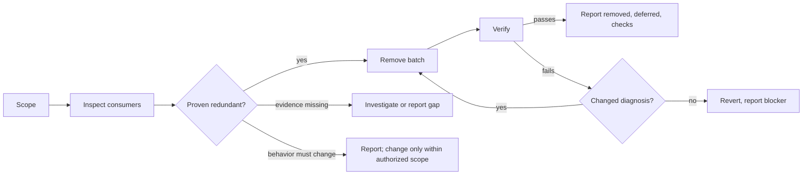

# Octocode clean agentic code

Remove redundant code and instructions; preserve observable behavior and useful contracts.

## Workflow

1. Scope: requested paths and result; reuse existing authorization; ask only about effects outside it.
2. Inspect candidates, contracts, consumers. Hypothesis test each: claim (redundant), strongest rival (live reference, entrypoint, config, dynamic or external use), distinguishing check (semantic references prove identity; topology gives leads; empty search proves nothing), result (confirmed: batch it; unresolved: defer; dismissed: keep).
3. Remove proven redundancy in reviewable batches, one owner per duplicate; update callers and links; regenerate lockfiles and derived artifacts with their generator.
4. Verify: Definition of Done = relevant checks run and read, coverage thresholds kept, checks pass, unrun checks named. Bounded retry: repair an introduced failure only from a changed diagnosis. If evidence cannot distinguish a safe repair: revert the batch, report an [SBAR](references/agent-defects.md#escalation-protocol) blocker.

## Judgment calls

- Bug fix or design change → explain; continue only within authorized scope, preserving outcomes and contracts (instructions too).
- Error masking, stubs, test or grader gaming → report as an [SBAR](references/agent-defects.md#escalation-protocol); never delete the symptom, weaken a check, or widen a mask.
- File size or pattern match alone → a lead, not a verdict.
- Text or config read by a runtime, parser, or external user → keep until that contract deliberately changes.
- Secret → redact, report for rotation; removing the reference does not fix it.

## Resources

| When | Read | Why |
|---|---|---|
| Repository evidence needs Octocode | [MCP/CLI guide](references/octocode-usage.md) | Discovery, invocation, complete reads, recovery |
| Dead, duplicate, or speculative code; kludges, suppressions, redundant types or dependencies, god files, spaghetti | [code-smells](references/code-smells.md) | Signals, delete bars |
| Agent-written code: audit order, error masking, stubs, supply chain, credentials | [agent-defects](references/agent-defects.md) | Residue vs defects |
| Test debt, weak oracles, gamed tests or CI, replacement tests | [tests](references/tests.md) | Signals, test rules |
| Stale or duplicate comments, docs, instructions, config | [text-config-hygiene](references/text-config-hygiene.md) | Keep or remove bars |

## Related skills

- `octocode-research`: prove callers and effects.
- `octocode-architect`: new branches, wrappers, unclear ownership, unresolved boundary, or design change.
- `octocode-agentic-prompts`: instruction change alters behavior.
- `octocode-skills`: skill packaging, activation.
- For an orchestrated multi-actor task: [octocode-workflows composition](../octocode-workflows/references/composition.md).

## Output

Follow [output.md](output.md); use [render-report.mjs](scripts/render-report.mjs) when HTML is requested.
