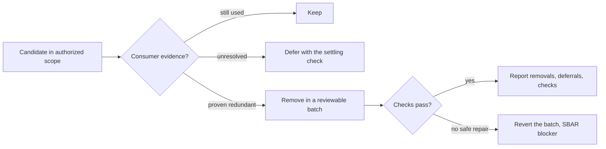

# Octocode clean agentic code

**Start:** read this lobby, map the task to the references it names, and read each one the task needs before acting. For each candidate in the authorized scope, identify the behavior removal could break and the evidence that would reveal it. Check callers, public entrypoints, config, dynamic loading and external consumers. Use [Octocode discovery and exact reads](references/octocode-usage.md) or `octocode-research` to trace effects. Confirm symbol identity with semantic references. Graph edges, file size, pattern matches and empty searches alone cannot prove redundancy.

| Candidate | Decision |
|---|---|
| [Dead or duplicate code](references/code-smells.md) | Remove proven redundancy in reviewable batches. Keep one owner, update callers and links, and regenerate derived files and lockfiles with their generator. Keep live code. Defer unresolved cases with the check that would settle them. |
| [Comments, instructions or configuration](references/text-config-hygiene.md) | Keep text and configuration with a parser, runtime or external consumer until its contract deliberately changes. If cleaner wording changes agent behavior, use `octocode-agentic`. For skill packaging or activation, use `octocode-skills`. |
| [Agent leftovers or defects](references/agent-defects.md) | Report error masking and reachable stubs as [SBAR blockers](references/agent-defects.md#escalation-protocol). Keep these out of removal batches. Redact exposed credentials and report them for rotation. |
| [Weak tests or grader gaming](references/tests.md) | Report confirmed gaming as an SBAR blocker. Preserve the behavioral oracle and coverage floors. Never hide a failure by weakening a check or widening a mask. |

## Thinking modes

| Intent | Thinking mode | Action / check |
|---|---|---|
| Remove complexity | Via Negativa | Prove the supported consumer behavior survives removal. |
| Judge a cleanup gain | Goodhart | Check behavior and guardrails before counting removed lines or calls. |
| Limit removal risk | Optionality / Inversion | Identify what deletion could break and verify a reversible batch. |

Consumer evidence decides removal; the [shared guide](references/mental-models.md) supplies further lenses.

Explain bugs or design changes separately. Reuse existing authorization and ask only about effects outside it. For new branches, wrappers or unresolved ownership, use `octocode-engineer`. Coordinate multiple actors with `octocode-workflows`.

Run and read the relevant checks for each batch. Repair an introduced failure only when new evidence changes the diagnosis. If a safe repair cannot be established, revert that batch and report an SBAR blocker. Report [removals, deferrals and checks](output.md), including unrun checks. Use the [renderer](scripts/render-report.mjs) for requested HTML.
