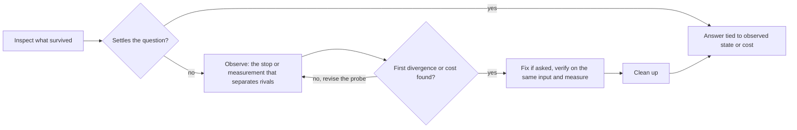

# Octocode Debugging

**Start:** read this lobby, map the task to the references it names, and read each one the task needs before acting. Let the user’s question determine what evidence would settle it. An existing traceback might already explain a failure. A live stall can disappear on restart. Launching under a debugger or profiler can reveal startup behavior.

For an incorrect result, ask **where the state first diverged**. A conditional breakpoint can isolate the affected request. A data watchpoint can identify the write that changed its value. For a performance question, ask **what the measurement counts**. CPU samples locate running code, wall time includes waits, and allocation profiles can describe churn or retention. Choose the scope and tool that fit the question.

## Procedure

1. **Inspect what survived** (traceback, dump, log, saved profile) before recreating the failure.
2. **Observe**: pick the measurement or stop that separates the rival explanations. On a live target, verify its identity first, account for the effect of pausing it, and resume or detach anything you stopped.
3. **Fix** where the state first diverged, when the task asks for a fix. Verify with the same input, environment and measurement that showed the failure; compare before and after on the same window.
4. **Clean up**: stop the processes you started, remove temporary breakpoints, `debugger;` statements, logs and unsupported experimental edits, and keep the evidence the answer cites.

In commands, `skill` is this skill's absolute folder, `out` an existing capture directory, `pid` a verified target and `seconds` the observation window. A capture window is an experiment parameter, not a timeout for normal application work. Check installed tools and their `--help` for supported events and permissions; do not install profilers or change host permissions implicitly. Preserve the raw recording and its diagnostics.

## Thinking modes

| Intent | Thinking mode | Action / check |
|---|---|---|
| Separate rival causes | Bayesian / Inversion | Pick an observation that distinguishes the causes or disproves the suspected failure. |
| Follow changing state | OODA | Refresh the target state and revise the next probe after each observation. |
| Prevent recurrence | Antifragility | Replay the failure after repair and check nearby cases before retaining a lesson. |

## Optional references

| What you’re investigating | Where to look |
|---|---|
| A wrong value, exception, hang or crash | [Debugger techniques, dumps and replay](references/debugger-techniques.md) · [Controlled experiments, reproductions and bisecting](references/experiments.md) |
| CPU, memory, I/O, scheduling or latency | [Profiling, live targets and runtime gotchas](references/profiling.md) · [Who is using the machine](references/host-usage.md) · [Browser and GPU timelines](references/gpu.md) · [Full-stack requests](references/experiments.md#follow-a-full-stack-request) |
| Runtime-specific commands | [Native debugging](references/native.md) · [Rust profiling](references/rust-profiling.md) · [Go](references/go.md) · [Node debugging](references/node.md) and [profiling](references/node-profiling.md) · [Python debugging](references/python.md) and [profiling](references/python-profiling.md) |
| A long log, test run, CI log or other command output | Save it under the workspace and ask `clasify` a typed question before reading it; `localSearch` the saved file for a known marker. [Tool usage](references/octocode-usage.md) |
| The code behind a frame, log line or symbol | Octocode local tools: `localSearch` for the text, `localFetch` at the line, `lspSearch` callers or references for who reaches it. [Tool usage](references/octocode-usage.md) |
| Sharing a finding | [Output options](output.md) · [Optional HTML renderer](scripts/render-report.mjs) |

Answer in the form the user needs. Tie a diagnosis to the observed state or cost and say what remains uncertain when it affects the conclusion. Use [additional thinking models](references/mental-models.md) only when they change the next probe.
