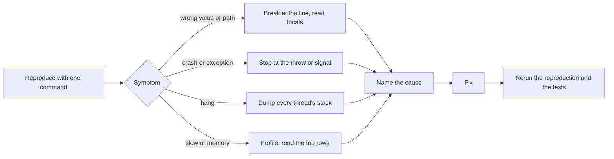

# Octocode Debugging

Establish the failing workload, predict what would distinguish a cause from its strongest rival, then capture real values and costs. Focus Node and Rust investigations on the measured symptom. Run unattended debuggers in batch mode with closed stdin and an explicit experiment budget. Use interactive Chrome or profiler UIs when the task needs visual inspection; always stop recording and resume paused targets before detaching.

## Reason → act → observe

Use [controlled experiments](references/experiments.md): state a hypothesis and rival, predict a difference, run one probe, inspect the artifact, then update the hypothesis. Repeat until the reproduction and a regression check establish the cause. The reference covers structured logs, bounded reproduction loops, spikes and browser–Node–Rust correlation.

Use the [investigation prompts](references/investigation-prompts.md) to turn a debugging or profiling request into an executable investigation. Before changing behavior, preserve a failing reproduction or regression test. After an unsuccessful fix, update the hypothesis from new evidence instead of stacking speculative changes. If reproduction is unavailable, report the uncertainty and the next discriminating probe.

## Reproduce first

Find the smallest command that shows the failure: one test, one input file, one request. Run it once without a debugger and keep its output; it is the check you rerun after the fix. When the failure is intermittent, loop it (`for i in $(seq 20); do <cmd> || break; done`) before attaching anything.

For stepping and locals, build native code with debug information and without optimization (`-g -O0`, `cargo build` without `--release`, `go build -gcflags=all="-N -l"`). For performance measurements, keep production optimization and add symbols; debug-build costs are not production bottlenecks.

## Pick the tool for the language

| Program              | Stop and inspect                                                         | Read                                 |
| -------------------- | ------------------------------------------------------------------------ | ------------------------------------ |
| C, C++, Rust, Swift  | `lldb -b -o "b file.c:12" -o run -o "frame variable" -o bt -- ./prog`    | [native](references/native.md)       |
| Go                   | `dlv` when installed, or stack dumps with `SIGQUIT`                      | [native](references/native.md)       |
| Python               | `python3 -m pdb -c "b file.py:12" -c c -c "p x" -c q prog.py </dev/null` | [python](references/python.md)       |
| Node, TypeScript     | `node scripts/node-break.mjs --break file.ts:12 -- file.ts`              | [node](references/node.md)           |
| Slow or memory-heavy | The language's profiler, then a top-N summary                            | [profiling](references/profiling.md) |

The scripts are in this skill's `scripts/` directory; `<skill>` in the references stands for the skill's directory, which loading the skill reports. Linux has `gdb -batch -ex ...` where macOS has `lldb -b -o ...`.

## Wrong value or wrong path

Break on the line where the value is first wrong, not where it is used. Print the locals and the stack, and when the line runs many times add a condition (`file:line:condition` in node-break, `breakpoint set -f file -l line -c cond` in lldb, `b file:line, cond` in pdb) or cap the pauses. Walk backwards: if the input to that line is already wrong, move the breakpoint to its producer and run again. Each run is cheap; prefer several narrow runs over one run that prints everything.

## Crash or exception

Let the program stop where it fails: lldb stops on the signal and runs the `-k` commands, `pdb` enters post-mortem on an uncaught exception, node-break pauses with `--exceptions all` (the first exception event is usually the one; caught ones also appear). Read the innermost frame from your own code, not the library frame on top, and print the arguments that reached it.

## Hang

Dump every thread's stack while it hangs, twice a few seconds apart: frames that stay the same are where it is stuck. Use `sample <pid> 3` on macOS, `gdb -p <pid> -batch -ex "thread apply all bt"` or `py-spy dump --pid <pid>` on Linux, `faulthandler.dump_traceback_later` in Python, and `--timeout` in node-break. A wait on a lock, a pipe or a socket points at the other side: find what should have released or written it.

## Slow or memory-heavy

Read [profiling](references/profiling.md) before recording. Name the workload, runtime, headless/visible mode and duration; separate startup, idle and active phases. Start with wall time and the process tree, then choose CPU call stacks, allocations/retention, event-loop/GC, I/O or browser/GPU traces from the observed symptom. For a comprehensive request, cover each dimension or explicitly record why it is unavailable. The [Node metrics preload](scripts/node-metrics.mjs) adds process CPU, memory, resource counters and main-thread loop/GC timing to a launched Node workload.

Inspect both self cost and inclusive callers. Sampling does not count exact invocations, and elapsed waiting is not CPU work. Test the leading hotspot against a rival explanation before changing code, then repeat the same workload. Do not claim a leak from one heap sample or a speedup from one run.

## Rules

- Always set a timeout or a cap (node-break `--timeout` and `--max-hits`, `faulthandler`, a bounded loop); a debugger waiting for input stalls the session.
- Run batch debuggers with closed stdin (`</dev/null`). Keep stdin/TTY for a terminal workload whose rendering you are measuring; run long captures in the background with a bounded workload or external timeout. Stop only processes you started.
- Check tool availability before recording. Do not install tools, escalate privileges, signal peer sessions or expose an inspector without authorization. Profiles can contain source paths and user data; keep them local. Heap snapshots pause the process and can require roughly twice its heap; ask before taking one on a live session.
- Remove temporary `debugger;` statements, `breakpoint()` calls and debug prints before you finish, and check with a search.
- State the cause with the evidence: the line, the value you saw and the value it should have been.
- After the fix, rerun the original reproduction and the affected tests.

## Resources

| When                                      | Read                                       | Why                                                        |
| ----------------------------------------- | ------------------------------------------ | ---------------------------------------------------------- |
| Debugging C, C++, Rust, Swift or Go       | [native](references/native.md)             | lldb and gdb batch commands, crashes, attach, hangs, cores |
| Debugging Python                          | [python](references/python.md)             | pdb batch runs, post-mortem, pytest, hangs                 |
| Profiling Rust servers, threads or async tasks | [Rust profiling](references/rust-profiling.md) | Optimized symbols, native attach, allocations and span timelines |
| Planning probes, chasing spikes or full-stack latency | [experiments](references/experiments.md) | Hypothesis loop, logs, request correlation and visual lanes |
| Visualizing a Node metrics capture | [metrics-report.mjs](scripts/metrics-report.mjs) | Offline HTML CPU/memory/GC timeline and complete measurement table |
| Capturing native stacks from a Node or Rust PID | [native-capture.sh](scripts/native-capture.sh) | Bounded macOS sample / Linux perf attach; no target signals |
| Research basis and tool boundaries | [sources](references/profiling-sources.md) | Official guidance and the decisions it supports |
| Debugging Node or TypeScript              | [node](references/node.md)                 | node-break options and output, tests, transformed code     |
| Profiling CPU, memory, timing, processes, I/O or GPU | [profiling](references/profiling.md) | Choose captures, interpret evidence and name coverage gaps |
| Measuring Node CPU, memory, event-loop and GC | [node-metrics.mjs](scripts/node-metrics.mjs) | Preload that writes local JSONL without changing stdout |
| Breaking inside a Node program            | [node-break.mjs](scripts/node-break.mjs)   | Runs the inspector protocol and prints each pause as JSON  |
| Reading a `.cpuprofile` or `.heapprofile` | [profile-top.mjs](scripts/profile-top.mjs) | Prints the heaviest functions by self or total cost        |

## Related skills

- Use `octocode-research` when the question is what the code does or who calls it, before running anything.
- Use `octocode-chrome-devtools` for browser console/network/Performance evidence, and dedicated Node DevTools for a Node inspector target; capture native Rust separately.
- Use `octocode-eval-benchmark` when a speedup must be proven against a baseline over repeated runs.

## Output

Follow [output.md](output.md).
