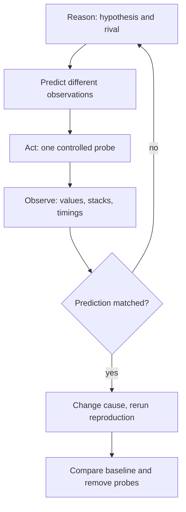

Load for intermittent bugs, uncertain causes, full-stack investigations or spike analysis.

# Reason, act, observe



For each iteration record: **hypothesis → rival → predicted difference → command/probe → observed artifact → decision**. Mark unmeasured fields unknown. Logs establish order/values; a profiler establishes sampled work; neither alone proves causation. Prefer a falsifying experiment over adding more probes.

| Observation | Leading hypothesis | Rival | Discriminating action |
|---|---|---|---|
| Latency rises, one core busy | CPU work blocks progress | GC / native work | Same-window JS and native stacks + GC metrics |
| Latency rises, CPU low | I/O wait | Queue, lock or CPU throttling | Queue/lock/request spans + container CPU throttling counters |
| RSS rises, JS heap stable | Native/external allocation | Allocator retention / mappings | External bytes + native allocations + mapping evidence |
| Heap rises then falls | Allocation churn | Retained objects | Repeat equal lifecycles; compare surviving objects/retainers |
| Threads increase | Pool growth / blocked workers | Legitimate concurrency | Thread stacks, request concurrency, queue depth |
| Spike absent under debugger | Timing-sensitive race | Different input/warmup | Capture original seed/order and low-overhead event probes |

## Add useful probes

Log structured records to stderr or the existing diagnostics sink. Include monotonic elapsed time, wall-clock anchor, PID/thread/task/request ID, phase, input size, expected/actual state, queue depth and duration. Use IDs/counters rather than whole objects or secrets. Log at boundaries; sample repetitive events and record the sampling policy. Avoid synchronous per-item logging in a hot path, and compare probe-off runs for perturbation.

Node boundary probe (use your logger's error handling in real code):

```js
const started = performance.now();
try { return await operation(); }
finally {
  console.error(JSON.stringify({ event: 'operation_end', pid: process.pid,
    requestId, durationMs: performance.now() - started }));
}
```

Use a counter for exact invocations, conditional breakpoints/logpoints for one failing input, and Rust `tracing` spans for async causality. A probe must not evaluate an expensive/mutating expression and change the failure. Remove temporary probes and rerun the original test.

## Reproduction loops and spikes

Choose an attempt count or wall-clock budget for the experiment. Save each attempt's seed, concurrency, input size, duration, exit status and request ID; preserve the first failing input and its output. Do not retry non-idempotent external writes. A failure disappearing after retries is not a fix. Keep a finite reproducer separate from the real application's workload limits.

Use a repeatable schedule: idle → warmup → equal work cycles → cleanup → idle. Capture before, during and after the suspect phase. Choose sample resolution relative to the expected burst; 1-second interval averages cannot reveal the shape of a 10-ms spike. Faster sampling adds overhead. A blocked Node loop delays JavaScript metrics collection; use native sampling/OS measurements for the missing window. Cumulative histogram p99/max describe the whole recording, not a per-window spike. Do not difference quantiles; collect/reset a separate windowed histogram if needed, and state its semantics.

## Full stack: join by request, not by guess

Capture the browser interaction with `octocode-chrome-devtools`: Performance trace, network waterfall and selected requests. Attach a dedicated Node DevTools session to the backend; capture Rust separately with native stacks and request spans. Propagate a request/trace ID across browser → Node → Rust → storage; use existing OpenTelemetry instrumentation if available. Keep backend clocks/offsets explicit: monotonic clocks from separate processes do not share an origin. Request IDs and span parentage establish causality; matching chart shapes alone do not.

| Lane | Evidence | Visual |
|---|---|---|
| Browser | Input, long task, layout/paint, network request | Performance timeline + waterfall |
| Node | Request/queue spans, loop/GC, V8 and native stacks | Dedicated Node Performance + metrics timeline |
| Rust | Request spans, thread stacks, allocation stacks | Native flamegraph + Perfetto span lanes |
| Storage / remote | Connection, query/remote-call timing, retries | Distributed trace / request timing table |

Compare the critical request path, not the sum of overlapping async spans. Separate queue wait, service work and response transfer. A CPU flamegraph aggregates stacks: its width is sample weight, not chronological order. Use a flame chart or span timeline when event order matters.
