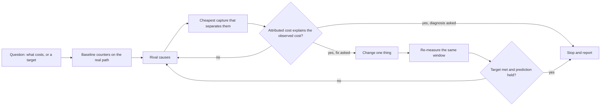

Load for any CPU, wall-time, I/O or memory cost question: the loop every capture follows, and how to verify a live target before attaching.

# Profile a running workload

## The profiling loop

1. State the question as a measurement: "where do the 800 ms of the search call go" or "heap after GC flat over 50 cycles". A diagnosis needs no target: it stops when attribution explains the cost. Ask for a target only before optimizing, and record the measured baseline it is compared with.
2. Go from coarse to fine: OS counters first (CPU time, RSS, I/O bytes, context switches), then a sampler, then allocation tracking or instrumentation on the narrowed phase only. Each capture must shrink the set of rivals; if it does not, [pick another measurement](profiling-readings.md) or a [platform capture](profiling-platforms.md).
3. Change one variable per iteration. Keep build, input, warmup, concurrency and host load equal ([host usage](host-usage.md)). A change of two things explains neither.
4. Prefer several equivalent cycles to one run: they show slope and spread. Keep a window long enough to include the event, since rare stalls and tail latency need it. A difference is real only when it exceeds the run-to-run spread: let the [run comparison](profiling-runs.md#compare-builds-on-a-shared-host) decide. A cost that grows with input size shows only across sizes: measure at three or more (say 2, 10 and 40 KB), one row per run with `size` and the metric, then run `node "$skill/scripts/compare-runs.mjs" --file "$out/sizes.csv" --growth size`. Its `nearestPower` is 0 for constant, 1 for linear and 2 for quadratic cost, `exponent` the fitted log-log slope; one size shows only constants.
5. Compare captures with a diff tool: `go tool pprof -base`, `perf diff`, heap snapshot comparison, `tracemalloc` `compare_to`.
6. Stop narrowing when the attributed frames, waits or bytes add up to most of the observed cost. By Amdahl's law, a frame with 5% of the time caps its fix at 5%.
7. Account for the observer: instrumenting profilers inflate many small calls; allocation tracking and snapshots slow and pause the target. Confirm a final gain on an uninstrumented run.
8. Record for each capture the command, build or revision, input, window, cycle count and file. Reuse a capture instead of re-recording it; a capture with unknown conditions cannot be compared.
9. When no available measurement can separate the remaining rivals, report them with the missing capability instead of looping.

Memory questions (GC, heap, references, allocators, struct layout) follow the same loop with [memory profiling](memory-profiling.md).

## Identifying a live target

When attaching by PID, verify the instance from the profiler’s PID namespace. For example, on Linux or macOS, `ps -p "$pid" -o pid=,ppid=,lstart=,comm=` shows the parent, start time and executable. A reused PID or a launcher that delegates to workers can lead you to the wrong process. An OS thread ID identifies a thread. A runtime task or span ID can follow work that migrates between threads.

For a timing question, an existing request ID, frame number or phase marker can locate the relevant window. Monotonic clocks measure elapsed time within their clock domain.
