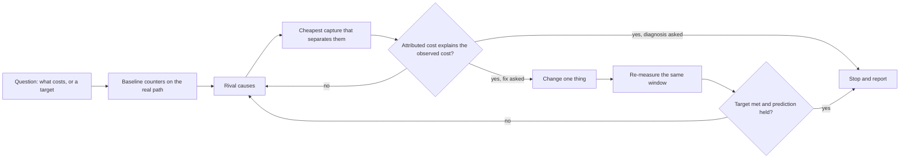

# Profile a running workload

## The profiling loop

1. State the question as a measurement: "where do the 800 ms of the search call go" or "heap after GC flat over 50 cycles". A diagnosis needs no target: it stops when attribution explains the cost. Ask for a target only before optimizing, and record the measured baseline it is compared with.
2. Go from coarse to fine: OS counters first (CPU time, RSS, I/O bytes, context switches), then a sampler, then allocation tracking or instrumentation on the narrowed phase only. Each capture must shrink the set of rivals; if it does not, change what you measure.
3. Change one variable per iteration. Keep build, input, warmup, concurrency and host load equal ([host usage](host-usage.md)). A change of two things explains neither.
4. Prefer several equivalent cycles to one run: they show slope and spread. Keep a window long enough to include the event, since rare stalls and tail latency need it. Call a difference real only when it exceeds the run-to-run spread. A cost that grows with input size shows only across sizes: measure at three (say 2, 10 and 40 KB) to tell linear from quadratic; one size shows constants.
5. Compare captures with a diff tool: `go tool pprof -base`, `perf diff`, heap snapshot comparison, `tracemalloc` `compare_to`.
6. Stop narrowing when the attributed frames, waits or bytes add up to most of the observed cost. By Amdahl's law, a frame with 5% of the time caps its fix at 5%.
7. Account for the observer: instrumenting profilers inflate many small calls; allocation tracking and snapshots slow and pause the target. Confirm a final gain on an uninstrumented run.
8. Record for each capture the command, build or revision, input, window, cycle count and file. Reuse a capture instead of re-recording it; a capture with unknown conditions cannot be compared.
9. When no available measurement can separate the remaining rivals, report them with the missing capability instead of looping.

Memory questions (GC, heap, references, allocators, struct layout) follow the same loop with [memory profiling](memory-profiling.md).

## Compare builds on a shared host

Keep the old build runnable beside the new one, where it still resolves its dependencies, and alternate rounds (old, new, old, new) with the same driver and input. Other work on the host moves wall time and RSS between rounds more than many fixes do, so decide on per-process CPU time and on deterministic counters: bytes allocated or calls made per operation, file and bundle sizes. Report every round's numbers, not only the best. When a fix comes with a test, run that test against the base revision (a separate worktree, or the file from the base commit) to see it fail; an index that tooling stages on its own is not a baseline.

## Drive an interactive program

A terminal UI or REPL runs reproducibly in a private terminal server (`tmux -L <name>`, never the user's own server) with an isolated home and a scripted local backend in place of the network service (a fake model or API whose reply length and pacing the input chooses). End each operation with a unique marker in the output and wait for that marker plus the program's idle indicator before the next one; poll the screen (`tmux capture-pane -p`) rather than sleeping. Take process CPU and RSS (`ps -o time=,rss= -p "$pid"`) around each phase, and the runtime's own profiles from a separate run with the same script, since profilers inflate the counters. Stop the server and the backend when done.

## Identifying a live target

When attaching by PID, verify the instance from the profiler’s PID namespace. For example, on Linux or macOS, `ps -p "$pid" -o pid=,ppid=,lstart=,comm=` shows the parent, start time and executable. A reused PID or a launcher that delegates to workers can lead you to the wrong process. An OS thread ID identifies a thread. A runtime task or span ID can follow work that migrates between threads.

For a timing question, an existing request ID, frame number or phase marker can locate the relevant window. Monotonic clocks measure elapsed time within their clock domain. If you need a comparison, consider which differences in warmup, workload or concurrency could account for the result.

## Pick the next measurement

| Question | Measure in the selected window | How to read it |
|---|---|---|
| Which resource limits progress? | Completed operations/s and latency alongside resource utilization, queue depth or throttling, and errors | Look at the busiest worker, core or device. An average across the host can hide a saturated worker. |
| Who consumed CPU? | Per-process and per-thread user + system CPU deltas, then on-CPU call stacks | CPU % = 100 × ΔCPU time / Δelapsed in the same units. Here 100% is one core. State the tool's denominator. Parent counters generally exclude children. |
| Why was runnable work delayed? | Scheduler wakeup → scheduled-in delay, runnable queue and container CPU quota/throttling | Separate time waiting for CPU from time asleep on a lock or I/O. Check the workload's cgroup and available cores. |
| Where did elapsed time go? | Queue, lock, I/O and dependency spans, plus stacks from the stalled interval | Find who can satisfy the wait. Repeated identical idle stacks alone do not establish a deadlock. |
| Did memory grow? | RSS, managed/native live bytes and allocation sites across equivalent cycles | Compare survivors after cleanup. RSS includes mappings and allocator reserves. Summing worker RSS can double-count shared pages. |
| Is it disk, network or storage? | Bytes and operations at the boundary, queue depth, service/wait duration, retries | Separate connection-pool wait, DNS/connect/TLS, first byte and transfer. Cached I/O can leave block counters flat. Confirm remote time with a downstream span. |

For tail latency, report the number of completed operations, errors/timeouts and the distribution by phase. A p99 from a handful of requests has little resolution.

For sampled stacks, **self** is weight in the leaf and **inclusive** includes its callees. Read both on the same interval. Inclusive rows overlap. Count calls explicitly when frequency matters. Check for lost events, missing symbols, empty windows and profiler overhead before interpreting differences. A flame graph groups stack weights. A flame chart or trace preserves event order. [USE method](https://www.brendangregg.com/usemethod.html) · [Off-CPU analysis](https://www.brendangregg.com/offcpuanalysis.html) · [Flame graphs](https://www.brendangregg.com/flamegraphs.html)

## Profiling gotchas by runtime

| When the recording looks surprising | What can explain it and how to tell |
|---|---|
| **Python** · A function has thousands of “hits” | Check which profiler wrote the file. cProfile counts calls. A statistical sampler counts observations and can see one long call many times. Both can write pstats. [Python profiling](python-profiling.md) |
| **Node.js** · Event-loop utilization is near 100% while CPU is quiet | A synchronous wait, such as waiting for a child process, can keep the loop occupied. Compare process CPU deltas over the same window and inspect the blocking frame. Worker isolates have their own loops. [Node performance hooks](https://nodejs.org/api/perf_hooks.html) |
| **Go** · Mutex contention exceeds the recording’s wall time | Several goroutines can wait on one holder concurrently. The mutex profile charges their accumulated delay to the holder’s unlock stack. A goroutine dump or execution trace can identify the waiters. [Go profile semantics](https://pkg.go.dev/runtime/pprof) |
| **Rust / Tokio** · An async span appears busy throughout an await | An entered span guard held across suspension can attribute unrelated work on that worker to the span. Instrumenting the future scopes span entry to its polls. A poll can itself block. Use thread CPU samples to establish CPU cost. [Tracing spans](https://docs.rs/tracing/latest/tracing/span/index.html) |
| **Native code** · Caller chains stop early or contain implausible frames | An optimized binary may omit frame pointers. Matching symbols resolve names. Recovering callers also requires a compatible unwinding method, such as DWARF call graphs on supported Linux builds. [perf call graphs](https://man7.org/linux/man-pages/man1/perf-record.1.html) |
| **JVM** · JFR shows few lock or I/O events during a slow operation | Check the recording’s enabled events and duration thresholds. Many short waits can contribute latency while each falls below the threshold. [JFR performance diagnostics](https://docs.oracle.com/en/java/javase/25/troubleshoot/troubleshoot-performance-issues-using-jfr.html) |
| **.NET** · Events disappear during a burst | EventPipe can drop events when its buffer fills. Check the capture diagnostics and enabled providers before interpreting the gap as idle time. A narrower provider selection can reduce event loss. [dotnet-trace buffering](https://learn.microsoft.com/en-us/dotnet/core/diagnostics/dotnet-trace) |
| **Browser** · A long task has no JavaScript caller frames | DevTools can record high-level events with JS sampling disabled. Check the capture settings before attributing the task to layout or paint. [Chrome Performance settings](https://developer.chrome.com/docs/devtools/performance/reference#disable-js-samples) |
| **GPU** · A host API call lasts microseconds while the frame takes milliseconds | Submission returns while work is queued: follow it to device execution and the completion the frame waits for. [GPU timelines](gpu.md) |
| **Full stack** · Summed spans exceed request latency | Spans nest, overlap and repeat across retries: follow the dependency that gates completion. [Request correlation](experiments.md#follow-a-full-stack-request) |

## Platform captures

The [capture script](../scripts/native-capture.sh) `bash "$skill/scripts/native-capture.sh" "$pid" "$seconds" "$out/stacks"` attaches to one verified, authorized PID (not a process tree) and neither stops nor signals it. It uses macOS `sample` or Linux `perf`, refuses an existing output directory, and fails visibly on permission or tool errors. It records PID/PPID, command name, duration and diagnostics. In `process.txt`, RSS is KiB and `%cpu` is OS-reported, not a capture-window measurement. Verify process identity before and after the capture; discard it if the PID was reused or the process exited early. macOS `sample` includes sleeping threads: pair it with process CPU deltas or Instruments Time Profiler for on-CPU attribution.

| Platform | Live target | Launch or inspect |
|---|---|---|
| macOS | The capture script takes periodic native thread stacks, including threads at rest. Pair these with CPU deltas. | Use Instruments Time Profiler on a launched app for CPU attribution. Inspect thread and time range. Use System Trace for scheduling if available. |
| Linux | `pidstat -t -u -w -p "$pid" 1 5` shows threads, CPU and context switches. The capture script uses perf on a PID. Check its event and process coverage. A host CPU average can hide a worker starved by its cgroup quota. | `perf record --call-graph dwarf -o "$out/perf.data" -- ./app` then `perf report --stdio -i "$out/perf.data"`. For scheduler latency use a scheduling trace. For cgroup v2 check deltas in the target's `cpu.stat`. |
| Windows | Select the relevant WPR profile and record the affected interval. System-wide ETW collection can include other processes. | Stop and save the ETL, then filter by process, thread and interval in WPA. CPU Usage (Sampled) shows stacks. With scheduling events, CPU Usage (Precise) can distinguish a thread ready for CPU from one blocked on a dependency. |

[Linux perf record](https://man7.org/linux/man-pages/man1/perf-record.1.html) · [pidstat](https://man7.org/linux/man-pages/man1/pidstat.1.html) · [Linux cgroup v2](https://docs.kernel.org/admin-guide/cgroup-v2.html) · [Apple Instruments](https://developer.apple.com/tutorials/instruments) · [Windows Performance Recorder](https://learn.microsoft.com/en-us/windows-hardware/test/wpt/windows-performance-recorder) · [WPA CPU analysis](https://learn.microsoft.com/en-us/windows-hardware/test/wpt/cpu-analysis)

## Other managed runtimes

- **JVM.** For a live JVM with JDK diagnostic access, check `jcmd "$pid" help JFR.start`, then `jcmd "$pid" JFR.start name=investigation settings=profile duration=30s filename="$out/run.jfr"` using an absolute path writable by the target. For a launch, put `-XX:StartFlightRecording=settings=profile,filename=run.jfr,dumponexit=true` before the application arguments. Inspect the recording with JDK Mission Control or `jfr summary run.jfr`. Compare execution samples with GC, parks and monitor events enabled in that recording. [JDK diagnostic commands](https://docs.oracle.com/en/java/javase/25/docs/specs/man/jcmd.html) · [JFR tool](https://docs.oracle.com/en/java/javase/25/docs/specs/man/jfr.html)
- **.NET.** With dotnet-trace installed, use `dotnet-trace collect -p "$pid" --duration 00:00:00:10 -o "$out/run.nettrace"`, or `dotnet-trace collect -o "$out/run.nettrace" -- dotnet App.dll` for a finite launch. Check the tool's profiles/providers before capture. Inspect sampled managed stacks and runtime events in the trace. For a hang, `dotnet-stack report -p "$pid"` gives a point-in-time managed stack for each thread. [dotnet-trace](https://learn.microsoft.com/en-us/dotnet/core/diagnostics/dotnet-trace) · [dotnet-stack](https://learn.microsoft.com/en-us/dotnet/core/diagnostics/dotnet-stack)
- **Other runtimes.** OS counters and stacks still locate the busy or waiting process. Use the runtime's supported sampler or request spans when native symbols stop at a VM, JIT or executor. Label what remains opaque.
