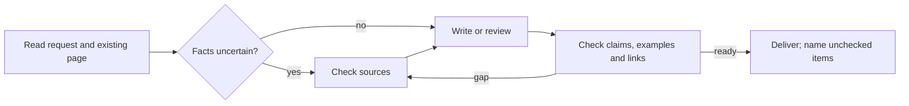

# Octocode Documentation
Write or review the requested document with verified facts and a useful next step for its reader.

## Workflow

1. Read the requested page, nearby conventions and relevant sources. Infer the reader and goal; ask only when missing information changes the content or destination. A named document authorizes editing it.
2. Verify changed claims about commands, paths, APIs, settings and behavior against code, contracts and tests. For wording-only edits, preserve meaning without a broad investigation. If sources disagree, resolve from evidence or state the discrepancy.
3. Write at the owning path; return findings for a review. Lead with the answer, put conditions beside actions, and arrange steps in execution order. Match the reader's task; no mode labels or page-type classification is required.
4. Use short paragraphs, lists for steps, tables for comparisons, and diagrams only when they clarify relationships. Keep each fact in its owning page and link to it. Choose Mermaid by the question using the [shared format chooser](references/report-output.md#choose-the-format); explain its takeaway and draw only evidenced relationships.
5. Check changed facts, commands, examples and links; run the project's documentation check. Correct failures, then report what changed and what remains unverified. Never imply an example ran when it was only read.

## Writing rules

- Follow the user, then project style, local convention and this skill. Preserve verified meaning.
- Use concrete verbs, consistent terms and descriptive links. Keep prerequisites before steps and expected results beside examples.
- Use the smallest document that serves the reader; split only when it improves navigation or ownership. Do not force a taxonomy or a fixed section template onto shipped docs.
- Link stable source paths; use line anchors for review findings. Explain behavior without copying implementation. Omit unsupported claims or name their uncertainty and impact.

## Resources (load only as needed)

| When | Read | Why |
|---|---|---|
| Repository evidence needs Octocode | [MCP/CLI guide](references/octocode-usage.md) | Search, exact reads, recovery |
| Evidence spans files, or writing an ADR or agent instructions | [Write and verify](references/write.md) | Source checks and specialized conventions |
| Detailed wording or style review | [Style guide](references/style-guide.md) | Editorial rules and optional word lookup |
| Delivering or saving the result | [output.md](output.md) | Response and saved-report contract |
| Rendering a saved report | [render-report.mjs](scripts/render-report.mjs) | Shared Markdown viewer and catalog |

## Related skills

Use `octocode-research` for unresolved code evidence, `octocode-rfc-generator` for an open design decision, `octocode-agentic-prompts` when wording controls agent behavior, and `octocode-skills` for skill packaging. Use [workflow composition](../octocode-workflows/references/composition.md) only when coordinating multiple actors.

## Output

Follow [output.md](output.md); shipped documents keep their own format. Report BLUF with evidence and verification gaps.
