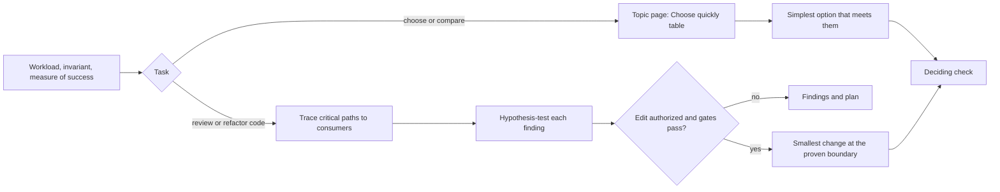

# Octocode Engineer

**Start:** read this lobby, map the task to the references it names, and read each one the task needs before acting. A thinking checklist, a lookup and a review method for any engineering choice, from a hash map to a service boundary. Name the workload, the invariant and the measure of success first, pick the simplest option that meets them, and prove it with a check. Steps, claim rules and edit gates are in the [review method](references/review-method.md). Select only the thinking modes relevant to the decision ([definitions](references/mental-models.md)). Each topic page starts with a **Choose quickly** table: problem, starting point, what to watch; read detail tables only for the candidates being weighed.

## Think it through

| Intent | Thinking mode | Action / check |
|---|---|---|
| Define success | Goodhart | Required outcome, beneficiary, excluded scope and the check that a proxy cannot replace |
| Characterize workload | Bayesian / Knightian | Size, growth, skew, concurrency, latency, durability and retention; distinguish measured facts from unknown assumptions |
| Protect invariants | Inversion / Tail Risk | Uniqueness, ordering, isolation, effects, memory safety, trust and dependency direction; trace harmful violations |
| Choose options | Via Negativa / Lindy | Compare viable candidates, including the simplest maintained approach |
| Weigh consequences | Optionality / Second-Order | Correctness, latency, throughput, memory, operational cost, reversibility and downstream effects |
| Challenge failure assumptions | Black Swan | Mid-write crash, duplicates, partitions, overload, clock skew and malformed input; name untested conditions |
| Prove and improve | OODA / Antifragility | Pick a deciding benchmark, property/load test, sanitizer, restore drill or boundary check; replay failures and affected contracts |

## Resources

| When | Read | Why |
|---|---|---|
| Choosing a lookup structure, index, sort, join or range-query structure; estimating complexity | [Data structures and algorithms](references/data-structures.md) | Costs, caveats and a verified reverse-lookup pattern |
| Caching, storage engines, approximate counting, replication, consistency, integrity, data pipelines and governance | [Data systems](references/data-systems.md) | Eviction, LSM and MVCC internals, sketches with error bounds, consensus, outbox, sagas, CDC and event time |
| Threads, async, locks, atomics, memory ordering, concurrency bugs | [Concurrency](references/concurrency.md) | Primitives, failure catalog, model choice, a sanitizer-checked ordering example |
| Allocation, ownership, references, memory safety, CPU caches, latency numbers, profilers | [Memory and performance](references/memory-and-performance.md) | Allocators, ownership by language, hardware costs and the tools that find each bug class |
| Overload, resilience, capacity math, API evolution, security and identity, SRE, deployment, code design, debugging method | [Systems and delivery](references/systems-and-delivery.md) | Patterns with their watch points, formulas with worked numbers |
| Choosing or governing an architecture: quality attributes, multi-tenancy, fitness functions, metrics, review checklist, principles | [Architecture](references/architecture.md) | Measurable requirements and executable structural rules |
| Naming a style, pattern, role, transport or mechanism; testing, debugging and bug vocabulary | [Concepts](references/concepts.md#contents) | Look-alikes, a decision guide and distinguishing evidence |
| Choosing or comparing folder organization | [Repository layouts](references/repository-layouts.md) | Optional examples; verify the actual dependency rule |
| Tracing critical paths, modelling wiring, choosing an evidence lane (graph, LSP, AST), ranking proof | [Analysis](references/analysis.md) | Tool lanes with their coverage limits and the controls for look-alike signals |
| Reviewing protocols, contracts, data flow, algorithms, efficiency, resources or modularity in code | [Checks](references/checks.md) | Review angles with the defect each one finds |
| Refactoring, deleting or unifying code | [Change discipline](references/change-discipline.md) | Seams, slices, verification and removal bars |
| Matching proof to a claim; using Octocode tools and live schemas | [Evidence](references/evidence.md), [MCP/CLI guide](references/octocode-usage.md) | What each kind of evidence can and cannot prove |
| Writing the answer, review, [decision record](output.md#decision-record) or saved report | [Output](output.md), [render-report.mjs](scripts/render-report.mjs) | BLUF, design answer, report contract, accepted HTML or manifest |

Neighbors: `octocode-research` for repository, package or symbol facts; `octocode-debugging` to observe a failing or slow program; `octocode-workflows` for roles, [verification](../octocode-workflows/references/verification.md), [whole-system traversal](../octocode-workflows/references/single-actor-traversal.md), [runtime surgery](../octocode-workflows/references/runtime-surgery.md) and [AST/LSP techniques](../octocode-workflows/references/ast-lsp-workflows.md) (without it, use [analysis](references/analysis.md) and [verification](references/change-discipline.md#verify-the-slice)); `octocode-agentic` for agent identities, leases, messages and fair benchmarks; `octocode-graph-view` for a saved graph; `octocode-rfc-generator` for a decision document; `octocode-clean-agentic-code` for behavior-preserving removal; `octocode-brainstorming` for open options; `octocode-pr-review` for a merge verdict.
