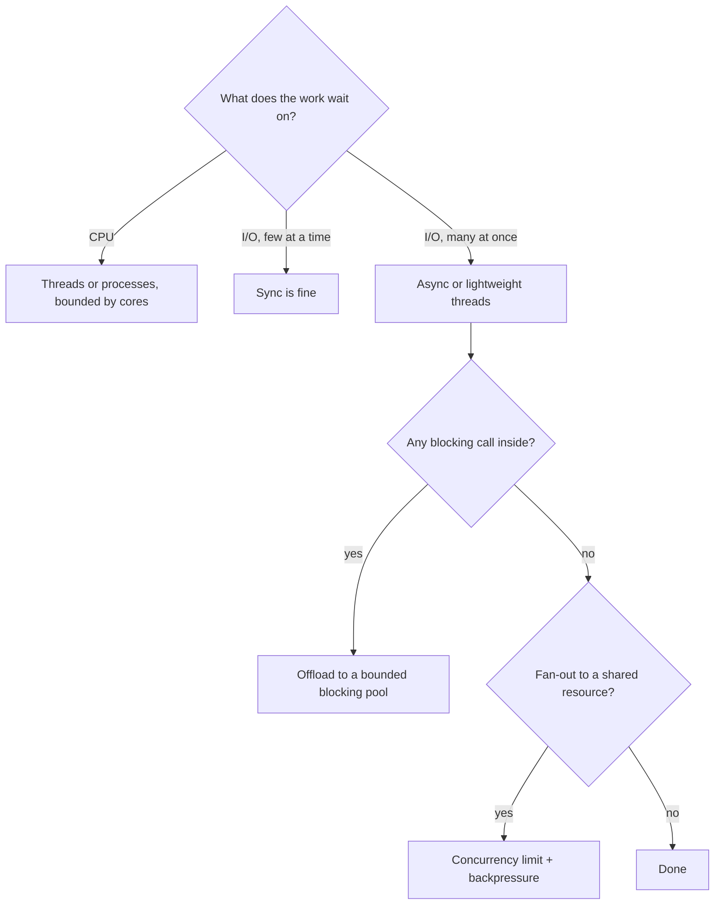

Load when choosing between blocking and async code, reviewing a file or socket path, deciding whether to stream or return a full result, or limiting how fast or how wide work runs. Network protocols are in [network](network.md); overload patterns in [reliability and overload](systems-reliability.md#reliability-and-overload) and rate-limit algorithms in [rate limiting](systems-reliability.md#rate-limiting-algorithms).

Read next: [models, cost and async hazards](io-models-async.md) for an I/O model, durability or blocking calls in async code; [streaming](io-streaming.md) for stream versus full result; [throttling](io-throttling.md) for rate, concurrency and backpressure limits.

# I/O, streaming, async vs sync, throttling

## Choose quickly

| Situation | Start with | Why |
|---|---|---|
| CLI, script or job with dependent sequential steps | Plain sync code | Simplest stack traces and error flow; async adds nothing when nothing waits in parallel |
| Many concurrent waits on sockets, HTTP or databases | Async, goroutines or virtual threads | One OS thread per blocked call does not scale to thousands |
| CPU-bound work | Threads or processes sized to cores | Async does not add cores; a CPU loop on an event loop stalls every task |
| Async service that must call a blocking API | Bounded blocking pool at that call | Keeps the loop free and caps the threads |
| Many independent calls to one provider | Bounded concurrency, paced from the provider's limit headers | Unbounded fan-out exhausts sockets and triggers 429s |
| Result size unbounded or larger than memory | Stream or paginate with a resumable cursor | Bounded memory and earlier first result |
| Small result the caller needs whole | Return it complete | One atomic answer, simple retries |
| Bursty UI or file-watcher events | Debounce or throttle the handler | One run per burst or per interval instead of one per event |

## Prove the claim

| Claim | Evidence |
|---|---|
| "It is I/O bound" | Wall time well above CPU time; off-CPU stacks in the wait; bytes and operations at the boundary (`strace -c`, `iostat`, per-phase spans) |
| "Async made it faster" | Higher throughput at the same latency budget and concurrency, or lower latency for overlapped waits; loop delay p99 not worse |
| "Nothing blocks the loop" | Event-loop delay and utilization under load; no sync I/O frames in CPU samples of the loop thread |
| "The throttle holds" | In-flight and rate counters under a burst stay at the limit; 429 count; queue wait vs service time |
| "The stream is complete" | End marker received; item count or checksum matches; no gaps or duplicates across resumed pages |
| "The write is durable" | `fsync` (and directory `fsync`) on the path (`strace -f -e trace=fsync,fdatasync,rename,renameat,renameat2`) plus a power-loss style test (hard VM reset, `dm-flakey` or `dm-log-writes`); killing the process only proves the replace is atomic, since the page cache survives it |

Use `octocode-debugging` for the measurement itself: profiling, off-CPU analysis and loop timing.
