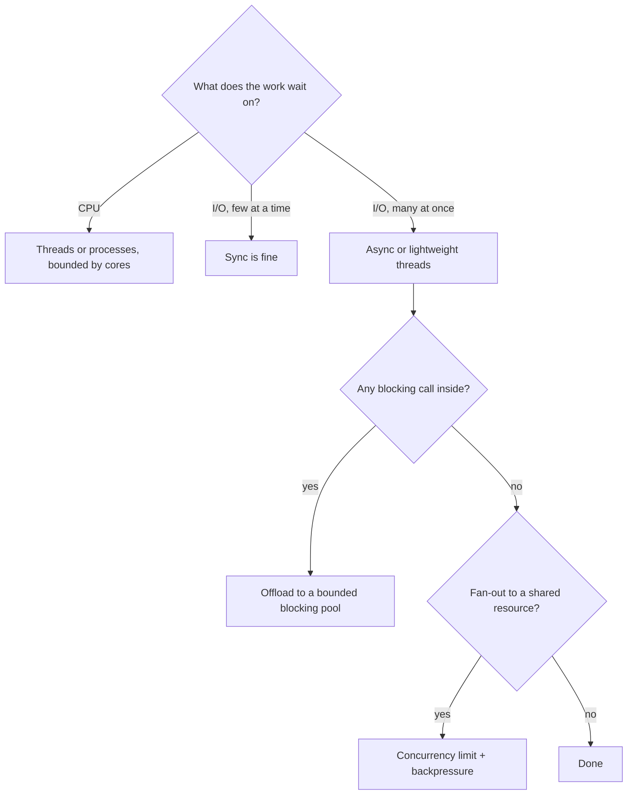

# I/O, streaming, async vs sync, throttling

Load when choosing between blocking and async code, reviewing a file or socket path, deciding whether to stream or return a full result, or limiting how fast or how wide work runs. Network protocols are in [network](network.md); rate-limit algorithms and overload patterns in [systems and delivery](systems-and-delivery.md#reliability-and-overload).

## Choose quickly

| Situation | Start with | Why |
|---|---|---|
| CLI, script or job with dependent sequential steps | Plain sync code | Simplest stack traces and error flow; async adds nothing when nothing waits in parallel |
| Many concurrent waits on sockets, HTTP or databases | Async, goroutines or virtual threads | One OS thread per blocked call does not scale to thousands |
| CPU-bound work | Threads or processes sized to cores | Async does not add cores; a CPU loop on an event loop stalls every task |
| Async service that must call a blocking API | Bounded blocking pool at that call | Keeps the loop free and caps the threads |
| Many independent calls to one provider | Bounded concurrency, paced from the provider's limit headers | Unbounded fan-out exhausts sockets and triggers 429s |
| Result size unbounded or larger than memory | Stream or paginate with a resumable cursor | Bounded memory and earlier first result |
| Small result the caller needs whole | Return it complete | One atomic answer, simple retries |
| Bursty UI or file-watcher events | Debounce or throttle the handler | One run per burst or per interval instead of one per event |

## I/O models

| Model | Completion signal | Fits | Watch |
|---|---|---|---|
| Blocking | The call returns when done; the thread waits | Simple code, modest concurrency | One thread per in-flight operation |
| Non-blocking + readiness (`epoll`, `kqueue`) | Kernel reports "ready", the program retries the syscall | Sockets, pipes | Not for regular files: `select`/`poll` always report them ready, `epoll_ctl` rejects them (`EPERM`), so file I/O still blocks the thread |
| Completion (`io_uring`, IOCP) | Kernel reports "done" | Files and sockets, batched submissions | Buffers must stay valid until completion; cancellation is asynchronous too |
| Thread-pool offload | A worker runs the blocking call | File I/O in libuv, `tokio::fs`, `asyncio.to_thread` | The pool size caps concurrency: libuv's default 4 threads are shared by `fs`, `dns.lookup`, `crypto` and `zlib` (`UV_THREADPOOL_SIZE`) |
| Memory-mapped (`mmap`) | Page faults load data on touch | Random reads of large read-mostly files | Faults block the thread invisibly; I/O errors arrive as `SIGBUS`, not return codes |

## I/O cost and correctness

| Concern | Rule | Watch |
|---|---|---|
| Syscall overhead | Buffer small writes; batch with `writev`/`readv`, `BufWriter`, `io_uring` batches | Flush at message and exit boundaries; an unflushed buffer is lost on crash |
| Partial reads and writes | Loop until the full count or EOF; a socket or pipe read returns what is available | Frame messages (length prefix or delimiter); one read is not one message |
| Durability | `write` reaches the page cache; `fsync`/`fdatasync` makes it durable; after creating or renaming a file, `fsync` its directory too | After an `fsync` error on Linux, dirty pages can be dropped and a retried `fsync` can succeed: treat the first error as data loss ([PostgreSQL fsync errors](https://wiki.postgresql.org/wiki/Fsync_Errors)) |
| Atomic replace | Write a temp file in the same directory, `fsync`, `rename` over the target, `fsync` the directory | `rename` across filesystems fails (`EXDEV`): write the temporary file on the target filesystem; a cross-filesystem move is never atomic |
| Sequential vs random | Prefer sequential, large blocks; sort or batch random reads | Read-ahead helps only sequential access |
| Page cache | Repeated reads hit memory | A benchmark after the first run measures the cache: state warm or cold |
| Direct I/O (`O_DIRECT`) | Bypass the page cache when the application caches itself | Buffer, offset and length alignment rules |
| Chatty access | One query or request per item (N+1) | Batch endpoints, `IN` lists, dataloader-style coalescing |
| Descriptor and pool limits | Budget file descriptors (`ulimit -n`), pool sizes and ephemeral ports | `EMFILE` and port exhaustion appear only under fan-out |
| Network and overlay filesystems | NFS, SMB and container overlays change `fsync`, lock, rename and mtime semantics | Test durability and locking on the real mount |

## Streaming vs full results

| Property | Full (buffered) result | Streamed or paged result |
|---|---|---|
| Memory | Grows with the result on both sides | Bounded by the chunk or page |
| First useful byte | After all work finishes | After the first chunk |
| Errors | Status reflects the whole result | Status is sent before later failures: report errors in band (final record, trailer, error event) and mark the stream complete or incomplete |
| Consistency | One snapshot | Each chunk may see newer data unless a snapshot, version or cursor pins it |
| Retry | Repeat the request | Resume from a cursor, offset, `Range` or last event id; restarting duplicates work |
| Consumer | Parses one document | Must handle partial lines, chunk boundaries and early termination |
| Backpressure | Not needed | Required end to end, or the fastest stage buffers everything |
| Caching, compression | Straightforward | Proxies and compression can buffer the whole stream unless configured not to |

Rules:

1. Stream when size is unbounded, a person or agent acts on early results, or the producer is slower than the consumer. Return whole when results are small, must be atomic, or every consumer needs all of them before acting.
2. A stream or page sequence must be lossless: prove no gaps and no duplicates through the last item, and give an explicit end marker so truncation is detectable. A silently short result is worse than an error.
3. Paginate with opaque cursors over a stable, unique sort key (add a tie-breaker such as the id), not offsets: inserts and deletes shift offsets, and equal keys skip or repeat rows.
4. Keep the total or `hasMore` honest: say when a count is a floor.
5. Use line-delimited framing (NDJSON, SSE, length-prefixed records) so a consumer can process each record without the rest.
6. Honour the stream's backpressure: Node `write()` returning `false` means wait for `drain`; prefer `stream.pipeline()`, which also propagates errors and cleanup.
7. Cancel the producer when the consumer stops (client disconnect, `AbortSignal`, dropped receiver); otherwise abandoned streams keep consuming downstream capacity.

## Async vs sync hazards

| Hazard | Symptom | Fix |
|---|---|---|
| Blocking call in async code (sync `fs`, `requests` in asyncio, `std::fs` or `std::thread::sleep` in Tokio, a CPU loop) | Event-loop delay; unrelated requests on that loop or worker share the p99 spike | Use the async API, or offload to a bounded pool (`spawn_blocking`, `asyncio.to_thread`, worker threads) |
| Sync over async (`.Result`, `.Wait()`, `futures::executor::block_on` on a runtime thread; Tokio's `block_on` there panics instead) | Deadlock under a single-threaded context; thread-pool starvation | Async all the way up, or one explicit runtime boundary on a dedicated thread |
| Async over sync (an async signature wrapping a blocking call) | Looks concurrent, still holds a thread per call | Document it; bound the pool behind it |
| Lock held across `await` | Tasks queue behind a suspended holder; a `std::sync::Mutex` guard across `.await` makes a Tokio future non-`Send` | Copy out and release before awaiting; use an async mutex only when the hold must span an await |
| Sequential awaits of independent work | Latency is the sum instead of the maximum | Start them together and await as a group, with a concurrency bound |
| Unbounded fan-out (`Promise.all` over every item, a goroutine per item, `asyncio.gather` over a huge list) | Socket and descriptor exhaustion, 429s, memory spikes | Semaphore, `p-limit`, `errgroup.SetLimit`, `buffer_unordered(n)`, `asyncio.Semaphore` |
| Fire-and-forget without an owner | Unhandled rejections, lost errors, work after shutdown | Structured concurrency: task groups, nurseries, `asyncio.TaskGroup`; track and await every task |
| Missing cancellation | Abandoned requests keep consuming downstream | Pass `AbortSignal`, `CancellationToken` or Go's request context through every await and blocking point |
| Virtual-thread pinning | Carrier threads blocked by waiting virtual threads | JDK 24+ no longer pins on `synchronized` ([JEP 491](https://openjdk.org/jeps/491)); native frames still pin |

Runtime notes: Go code looks synchronous because the runtime parks goroutines on its network poller, while blocking file syscalls still occupy an OS thread. CPython's GIL limits CPU parallelism in threads (see [concurrency models](concurrency.md#concurrency-models)); asyncio debug mode (`PYTHONASYNCIODEBUG=1`) logs callbacks slower than `loop.slow_callback_duration`. Synchronous versus asynchronous communication between services is a transport choice: see [communication](concepts.md#communication).

## Throttling

| Mechanism | Applied by | Controls | Use |
|---|---|---|---|
| Rate limit | The provider or server | Requests per time window | Protect a resource ([algorithms](systems-and-delivery.md#rate-limiting-algorithms)) |
| Client-side throttle (pacing) | The caller | Its own send rate | Stay under a provider's quota; smooth bursts |
| Concurrency limit | Either side | Requests in flight | Protect real capacity; adapts to latency automatically |
| Backpressure | Consumer to producer | Buffer occupancy | Bounded queues, stream pause and resume, credit-based flow |
| Debounce | Event source | One run after a quiet period | Search boxes, resize, file-watcher saves |
| Throttle (event) | Event source | At most one run per interval | Scroll, progress updates |
| Request coalescing (single flight) | Cache or caller | Identical in-flight requests share one call | Cache-miss stampedes on hot keys |
| Batching | Caller | Several items per call | Amortize per-call cost; adds up to the batch window in latency |

Rules:

1. Prefer a concurrency limit for internal capacity: by Little's law, in-flight ≈ throughput × latency ([capacity](systems-and-delivery.md#capacity-and-estimation)). A rate limit ignores how long each request holds the resource.
2. Put the limit at the scarce resource and share it: process-local limiters multiply by the instance count. One limiter per provider credential across workers.
3. Pace from the provider's signals: `429` or `503` with `Retry-After`, rate-limit headers, secondary limits. A fixed `sleep` between calls is neither a limit nor adaptive.
4. Retries, retry budgets, fairness, load shedding and adaptive (AIMD) limits are in [reliability and overload](systems-and-delivery.md#reliability-and-overload).
5. Debounce with a trailing call so the last event is handled, and flush or cancel pending timers on dispose: a forgotten timer is a leak and can fire after shutdown.
6. Measure queue wait separately from service time: throttling shows as growing wait with flat service time.

## Prove the claim

| Claim | Evidence |
|---|---|
| "It is I/O bound" | Wall time well above CPU time; off-CPU stacks in the wait; bytes and operations at the boundary (`strace -c`, `iostat`, per-phase spans) |
| "Async made it faster" | Higher throughput at the same latency budget and concurrency, or lower latency for overlapped waits; loop delay p99 not worse |
| "Nothing blocks the loop" | Event-loop delay and utilization under load; no sync I/O frames in CPU samples of the loop thread |
| "The throttle holds" | In-flight and rate counters under a burst stay at the limit; 429 count; queue wait vs service time |
| "The stream is complete" | End marker received; item count or checksum matches; no gaps or duplicates across resumed pages |
| "The write is durable" | `fsync` (and directory `fsync`) on the path (`strace -f -e trace=fsync,fdatasync,rename,renameat,renameat2`) plus a power-loss style test (hard VM reset, `dm-flakey` or `dm-log-writes`); killing the process only proves the replace is atomic, since the page cache survives it |

Use `octocode-debugging` for the measurement itself: profiling, off-CPU analysis and loop timing.
