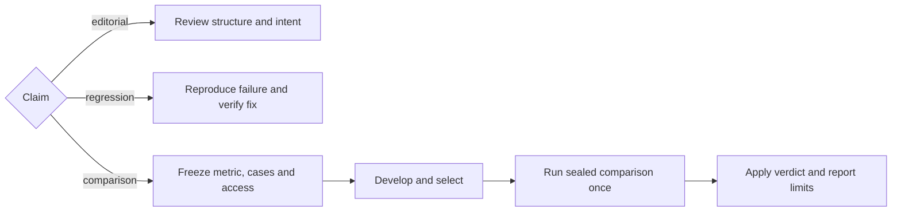

# Octocode eval benchmark

Match the evidence to the claim; reserve sealed comparisons for behavioral gains.

## Pick the depth

| Claim | Evidence |
|---|---|
| Editorial or structural | Review intent, links, examples, checks; editorial result, behavior unmeasured |
| Deterministic regression | TDD: a check fails before the fix, passes after; verify affected contracts; no sealed benchmark |
| Comparative or reliability | Safeguards below on representative cases; sample and budget scale with consequence, uncertainty |

## Comparative evaluation safeguards

- Freeze the [KPI contract](references/design.md#kpi-contract) before comparing; a harness, suite, or grader change is a new version, so rerun both arms.
- Isolate workers; no evaluator material or hints reach solvers ([harness](references/harness.md#roles-and-access)).
- Development iterates, validation selects, the sealed test confirms once with both arms under identical conditions ([splits](references/design.md#splits-and-exposure)); pick the candidate before opening final results.
- Prefer deterministic outcome checks; test graders and calibrate judges before freezing ([grading](references/grading.md)).
- Failures, Unknowns, errors, retries, and cost stay in the denominator and report.
- The deployment instruction is the subject; answer-specific coaching is leakage.
- `Keep` is provisional, `Discard` not final ([loop](references/loop.md#keepdiscard-loop)); final verdicts: `Accept`, `Revert`, `Inconclusive`, `Invalid` ([verdict](references/design.md#verdict)).
- Stop condition: a second Inconclusive or Invalid final run; then report the limit and the next measurement needed.
- Public benchmarks orient; representative private tasks decide ([public benchmarks](references/design.md#public-benchmarks)).

## Resources

| When | Read | Why |
|---|---|---|
| Repository evidence needs Octocode | [MCP/CLI guide](references/octocode-usage.md) | Discovery, invocation, complete reads, recovery |
| Planning a comparison | [design](references/design.md) | KPI, cases, splits, verdicts |
| Choosing graders or judges | [grading](references/grading.md) | pass@k, judge calibration |
| Runner, suite or run-folder layout, leakage, multi-agent subject | [harness](references/harness.md) | Folders, run identity, access, clean lab |
| Iterating, diagnosing, claiming | [loop](references/loop.md) | Keep/Discard, diagnosis |
| Does a host load the right skill? | [skill-activation](references/skill-activation.md) | Host runs, scoring |
| Rendering or listing reports | [render-report.mjs](scripts/render-report.mjs), per [output.md](output.md) | HTML, manifest |

## Related skills

- `octocode-research`: behavior and data behind a measurement.
- `octocode-agentic-prompts`: instruction fixes after an observed failure.
- `octocode-skills`: skill structure, descriptions; activation tests stay here.
- For an orchestrated multi-actor evaluation: [octocode-workflows composition](../octocode-workflows/references/composition.md).

## Output

Follow [output.md](output.md) for the response, run folder, and rendering.
