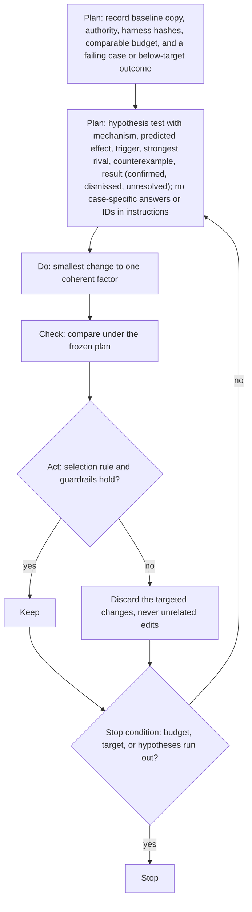

Load when iterating on a change, picking a loop level, diagnosing suspicious results, or reporting what a change proved.

## Keep/Discard loop

PDCA against the baseline; Keep or Discard is its act step.

- Every pass keeps raw outcomes, cost, error categories, every hypothesis.

- Parallel hypotheses: separate subject copies and trials; never report the luckiest attempt as pass@1.
- Noise hides the effect: improve measurement first; cheap proxies may guide development, never final verification.
- Check valid alternatives, neighboring edge cases, old successes; a higher score alone proves nothing.

## Loop levels

- **Experiment (inner)**: developer or optimizer mutates one file, prompt, or skill paragraph; solvers get task inputs only. KPI: primary metric.
- **Suite (middle)**: error-analyze traces; add or fix cases, criteria, failure categories; rebalance. KPI: top-failure coverage, regression stay-green rate.
- **Meta (outer)**: authorized maintainer improves program, skill, graders, budgets, harness; new baseline and sealed final check; development traces only. KPI: fewer repeated failure signatures.
- Before escalating, check development failures for sensor defects or missing coverage. Grow the suite only between experiments, from real failures.
- Inner loop flat: missing cases go to suite level, a bad program to meta; with no new hypothesis or failure mode, mine traces for recurrent search patterns and change the search strategy in code or program, not only optimizer-instruction wording (`instructions/`).

## Diagnose failures

Results fail, fluctuate, or look too good: check the measurement before the solver. After Action Review: intended (task contract); happened (preserve task, inputs, actual worker prompt, environment, answer, trace, grader output, versions; reproduce under the same budget; record retries); why different (first violated contract; test a rival; findings can overlap); next (the owner and fix in the table).

| Cause | Owner | Look for or check | Next |
|---|---|---|---|
| Task | task owner | unsolvable from worker-visible inputs, or hidden tests need an unstated path, API, phrasing | clarify; new dataset version |
| Reference or test | grader owner | rejects valid alternatives, accepts deliberately wrong outputs, ignores final state | fix, validated on independent labels |
| Judge | evaluator | order swaps, domain labels, evidence checks, Unknown and error rates | [recalibrate](grading.md#calibrate-a-judge) or pin |
| Infrastructure or fixture | harness owner | control task, clean replay, resource and timeout logs | restore reproducibility; new environment record; paired rerun |
| Leakage or grader exploitation | controller | exports, tool reads, history, shared state, answer retrieval | invalidate evidence, close access, rotate exposed final tasks, rerun in a verified clean lab |
| Solver defect | developer | sound task and grader, trace violates a supported requirement | patch the smallest general mechanism, harness unchanged |
| Sampling noise, thin coverage | — | paired task-level uncertainty, per-slice results, infrastructure covariance | follow the frozen sampling plan or report Inconclusive |

- Grader-only fix: regrade sealed outputs if they hold all required evidence and the task is unchanged. Question, fixture, worker context, or environment changed: rerun both arms; version the before/after labels.
- Resource limits: record guarantees and hard limits; measure whether more headroom removes crashes or enables stronger search.

## Claim and report

- Editorial review: freeze rating dimensions and anchors first; label the rating subjective, not a measured gain.
- Never invent held-out scores or claim release acceptance from reading prose.
- Separate source review, maintenance checks, development measurements, sealed comparisons; flag unmeasured behavior.
- Explain stops or direction changes that affect interpretation; record lessons only when results support them.
- After the verdict, feed failures to [case building](design.md#cases-from-failures).
- Definition of Done: the reader can judge the result and its limits.
