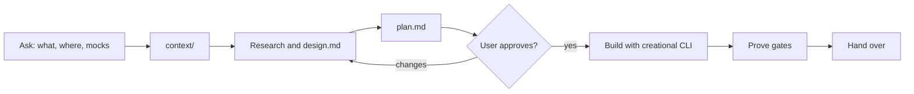

# Octocode Generate

Build what the user means, the way each tool works today. Scaffolders, boilerplates and SDKs change monthly: every command, flag and version comes from a lookup made in this run, never from memory. The scripts ([detect](scripts/detect-workspace.mjs), [versions](scripts/check-versions.mjs), [templates](scripts/apply-template.mjs), [verify](scripts/verify-project.mjs)) run as `node <skill-folder>/scripts/<name>.mjs` (Node 20+, JSON output, `--help`). Use a script for the step it covers; when the framework's own command does that step, run that command instead. A change to an existing app rather than a new project belongs to the `octocode-engineer` skill.

The project goes in `<target>`, a new folder asked for in step 1 (default `<workspace>/<slug>`, where `<workspace>` is the folder you work from). Its documents live beside it in `<workspace>/.octocode/octocode-generate/<slug>/`: `context/` (the user's mocks, screenshots, specs, links and your research notes), `design.md` and `plan.md`. Keep them outside `<target>`: scaffolders refuse a folder that is not empty.

## Flow

1. **Ask.** Ask the [intake](references/intake.md) questions through the host's question tool (AskUserQuestion or its equivalent): what the user is building, for whom, where it runs, its core features, the target folder, and mocks or references. Defaults per kind of project: [presets](references/presets.md). Save what they give to `context/`. Run `detect-workspace.mjs <target>`: an existing repository's conventions win.
2. **Research.** Use GitHub through Octocode and the web ([research](references/research.md)) to find the current creational CLI or boilerplate, the closest official example and the SDK usage. Choose from the catalogs: [web and monorepos](references/stacks-web.md), [mobile, desktop and games](references/stacks-apps.md), [services, CLIs, libraries and AI](references/stacks-services.md), [creational CLIs](references/boilerplates.md), [leading boilerplates](references/boilerplate-catalog.md). Features come from [libraries](references/libraries.md) and [frontend libraries](references/libraries-frontend.md); hosted services (analytics, monitoring, payments, auth, email) from [integrations](references/integrations.md), and databases and platforms (Firebase, Wix, Base44) from [backends](references/integrations-backends.md); tooling from [toolchain](references/toolchain.md), [lint and test tools](references/toolchain-lint-test.md) and [package managers](references/package-managers.md).
3. **Design.** Write `design.md` from the [design template](assets/design.md): product, flows, screens, visual style taken from the mocks, data model, architecture and API, each row citing its source.
4. **Plan.** Write `plan.md` from the [plan template](assets/plan.md): stack and runner-up per costly choice, the exact commands, integrations and env vars, minimal tests, evidence. Check dependencies with `check-versions.mjs [--project <target>] <specs>`: npm, `crates:`, `pypi:`, `go:`, `maven:`, `nuget:`, `rubygems:`, `packagist:`, `pub:`, `hex:` and `jsr:` in their own range syntax, with a ready pin each. Add `missingPeers` when the package manager is Yarn; the package manager's dry run settles transitive peers.
5. **Approve.** Show both documents' paths with a short summary and ask the [approval question](references/intake.md#approve). Revise and ask again until approved. Nothing that runs third-party code or writes project files happens before this approval.
6. **Build.** Create with the approved creational CLI or boilerplate, non-interactively. Fill gaps by hand or with `apply-template.mjs <target> <templates> --pm <pm>`: dry run first, it never overwrites, `--list` shows the templates, and [toolchain](references/toolchain.md#gates-per-ecosystem) names the set per stack. Install the exact resolved versions. Build each feature from `design.md` with a small test.
7. **Prove.** Format once, then `verify-project.mjs <target>`, which derives gates for 12 ecosystems (`--gate <gate>=<command>` sets a gate's command for anything else). Fix failures at their cause. When a fix leaves the same failure and no new evidence, ask the user. For a web app or API, start the dev command in the background, wait for its ready line, request the URL, then stop it by PID; for a mobile or desktop app, the platform build (`npx expo export`, `flutter build`) is the proof.
8. **Hand over.** Write the README run section and an `AGENTS.md` with the dev and gate commands, mark both documents `Built`, then report.

Write only the tests the [test rule](references/toolchain-lint-test.md#test) names. Keep the user oriented: one line when each step starts, and on failure, what broke, why and the next step.

| Safeguard | Rule |
|---|---|
| Effects | Never commit, push, deploy or create cloud resources or repositories unasked; `git init` only in a new, empty folder. |
| Secrets | `.env` stays git-ignored; `.env.example` documents every variable; keys never appear in code or the plan; `context/` stays local. |
| Scaffolder extras | Agent files (`AGENTS.md`, skills, `.claude/settings.json`), telemetry, git init or install hooks that a CLI or boilerplate adds go in the plan, with the opt-out flag passed unless the user wants them. |

Return the context folder path, what was created, the gate results, each decision with its evidence, next steps (dev command, env to fill) and anything not run. Done when the user approved the design and plan and every gate passes, or the failing gate and its blocker are reported.
