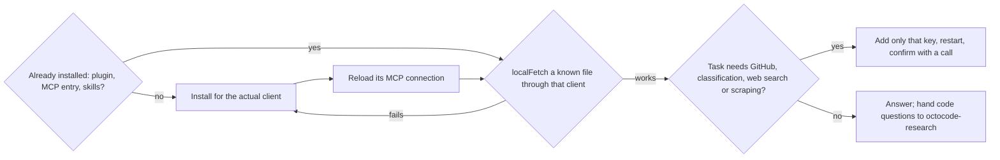

# Get started with Octocode

**Start:** read this lobby, map the task to the references it names, and read each one the task needs before acting. [Octocode](https://github.com/bgauryy/octocode) searches local code, GitHub repositories and history, and package registries. Its [tools](https://github.com/bgauryy/octocode/blob/main/docs/OCTOCODE_TOOLS.md) read files, inspect syntax and navigate symbols. An AI client calls them through [MCP](https://github.com/bgauryy/octocode/blob/main/docs/OCTOCODE_MCP.md). The [CLI](https://github.com/bgauryy/octocode/blob/main/docs/OCTOCODE_CLI.md) runs the same research tools in a terminal and manages setup. [Skills](https://github.com/bgauryy/octocode/blob/main/skills/README.md) guide an agent through tasks such as research or code review. Each `SKILL.md` gives the name, description and instructions the agent reads when the skill applies. Supporting files hold details. Optional tools and services have their own installation requirements.



## Install and verify

Reuse the existing installation. A plugin may already supply both MCP and skills. The npm launchers require Node.js 22+. The standalone native binary runs without Node, though optional skill scripts may need it.

```bash
npx -y octocode --help                       # run without a global install
npm install -g octocode                      # optional global CLI
npx -y octocode install --list               # check client IDs and existing MCP entries
npx -y octocode install --ide cursor         # if missing, use the actual client ID
npx -y octocode skill list                   # discover public skills
npx -y octocode skill install octocode-research --platform codex --global
```

Choose the actual skill platform. For a project install, replace `--global` with `--project-dir /absolute/project`. A globally enabled plugin still applies elsewhere. Reload the client's MCP connection and verify it by reading a known file **through that client**. For example, where `README.md` exists, call `localFetch` with `{"queries":[{"path":"README.md","ranges":[{"startLine":1,"endLine":1}]}]}` and check the returned line. Local reads require neither a GitHub login nor a provider key.

## Configure and deliver

Local tools need no keys. GitHub tools use `octocode auth login`; any other key is typed by the user into `octocode config set <KEY> --stdin`. `octocode config list` shows every setting with its value, source and default. Folders, precedence, each key and its commands are in [configure](references/configure.md). Ask before saving anything, then answer per [output.md](output.md).

| Intent | Thinking mode | Action / check |
|---|---|---|
| Install | Via Negativa | Reuse the existing installation or plugin; add only what the task needs. |
| Claim it works | Goodhart | Installed or listed is not working: only a successful call through the client proves the connection. |
| Change a setting or key | Optionality | Prefer a reversible step (`config unset` restores the default); keep secrets out of chat and version control. |
