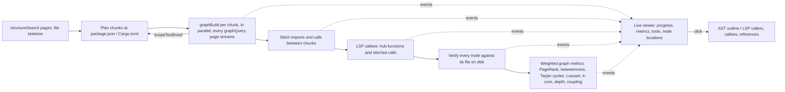

# Octocode Graph View

Map the requested repository scope, keep every graph page as evidence, and separate structural leads from proven behavior.

## Work the requested scope

1. Run `scripts/preflight.mjs` from the target workspace; disclose missing layers and their effect.
2. Live view (default when a person will watch): `node <skill>/scripts/serve.mjs <section>` prints a local URL and opens it. Headless (agents, CI): `node <skill>/scripts/build.mjs <section>`. Both run the same pipeline and write the same result; flags and behavior: [commands](references/commands.md).
3. Read `brief.txt` first, then `data.json` for the rows behind a claim. Every node and edge carries `loc` (path, absolute path, line or lines), and every node carries `check`: its file exists, every declaration and edge line falls inside it, and it has not changed since the snapshot (`ok`, `stale`, `missing`, `lines`). Rebuild before relying on a node whose check is not `ok`.
4. Verify a lead before claiming it: exact source read, LSP identity and callers, a Hypothesis test for a defect ([evidence](references/evidence.md)). A graph or LSP label alone is triage.
5. Write agent notes for each page in the build's `wiki.notesNeeded` (the communities holding most of the PageRank) from the source you verified, with `wiki.mjs note` ([wiki](references/wiki.md)); nothing else writes them, so until then `wiki.mjs lint` reports `empty-notes`.
6. Add `model.json` beside `data.json` only when layers, runtime edges or flows answer the task ([modeling](references/modeling.md)); rerun `render.mjs`.
7. Deliver per [output.md](output.md).

## Preserve meaning and evidence

- Import edges are syntax-derived; calls carry provenance: `graph` (syntax linkage), `stitched` (exact name through an import between chunks, medium), `both` (graph and LSP agree), `lsp` (only the language server reports it). Take the union before claiming a caller count or absence: each engine misses calls the other finds.
- Every page is kept: raw graph pages under `chunks/<id>/tmp/evidence/`, every event in `events.jsonl`; the viewer pages its lists ("Show more") and never drops rows. Report unbuilt chunks, files in no chunk, unresolved imports between chunks and skipped LSP.
- Chunks follow package manifests so the viewer fills in early; `--whole` ingests one snapshot when cross-package linkage matters more than early feedback. Splitting a Rust module tree loses calls the single snapshot links; crates stay whole because each has its own Cargo.toml.
- Do not change repository source as part of visualization. Rust build scripts run project code: never enable `rustContext.buildScripts` without asking.

## Resources

| When | Read | Why |
|---|---|---|
| Build, serve, replay, flags, events | [commands](references/commands.md) | Exact commands, result layout, event protocol, script owners |
| Explain architecture beyond imports | [modeling](references/modeling.md), [model schema](scheme/model.json) | Evidence-backed overlay for the brief |
| Prove a consequential finding | [evidence](references/evidence.md) | Match claim to proof |
| Deliver the result | [output.md](output.md) | Paths, coverage, what to report |
| Answer viewer chat, refresh after edits | [chat](references/chat.md) | Inbox and channel modes, reply.mjs, security and limits |
| Ask the graph (impact, path, cycle, callers, top) | [query](references/query.md) | Query language, strong vs weak edges, results that highlight on the graph |
| Read, write or lint the code wiki (one page per community) | [wiki](references/wiki.md) | Page layout, notes conventions, freshness, lint kinds |

## Related skills

- `octocode-research` settles source and symbol claims; `octocode-architect` owns dependency, layering and refactor decisions.

## Output

Follow [output.md](output.md); report BLUF with claim–evidence and explicit gaps.
