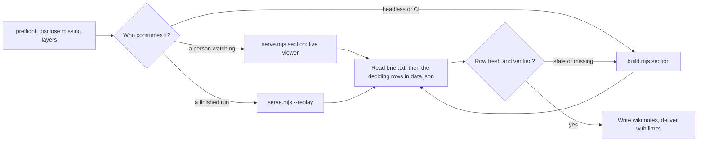

# Octocode Graph View

**Start:** read this lobby, map the task to the references it names, and read each one the task needs before acting.

## Build the requested scope

Run from the target workspace. Start with `node <skill>/scripts/preflight.mjs` and disclose missing layers and their effect. Leave repository source untouched. Rust build scripts execute project code, so ask before enabling `rustContext.buildScripts`.

| Need | Command |
|---|---|
| A person will watch | `node <skill>/scripts/serve.mjs <section>` opens the viewer. Give the printed URL for live progress and on-demand AST outlines or LSP callers, callees and references. |
| Headless build or CI | `node <skill>/scripts/build.mjs <section>` writes the same graph, events and briefs. |
| Reopen a finished run | `node <skill>/scripts/serve.mjs --replay <result-dir>` |

The pipeline pages `structureSearch`, builds chunks in parallel at `package.json` and `Cargo.toml` boundaries, then stitches imports and calls. It preserves Rust crate boundaries where possible and attempts to split a chunk on `scopeTooBroad`. Use `--whole` when cross-package linkage matters more than early results. Splitting a Rust module tree can lose calls. See [commands](references/commands.md) for flags, phases, metrics and script owners.

## Check a finding

1. Read `brief.txt` for measured facts, then inspect the deciding rows in `data.json`. Nodes and edges carry `loc` with paths and lines. Check the file's `check.status` and `verification.staleCheck` before relying on a row. Rebuild for `stale`, `missing` or out-of-range `lines`. Disclose a failed freshness check.
2. Imports are syntax evidence. For calls, `via` distinguishes graph linkage (`graph`), LSP alone (`lsp`) or agreement (`both`). A viewer edge labeled `stitched` was bound by exact name through a cross-chunk import; look for `stitched-import` in the saved call's `resolution`. Treat that name match as medium confidence. LSP probes hub functions and stitched call sources. For counts or absence, inspect the union and its coverage; verify consequential claims with an exact source read, symbol identity and LSP callers. Test a defect hypothesis using the [evidence rules](references/evidence.md).
3. Write source-backed agent notes for every page listed in `wiki.notesNeeded` with `wiki.mjs note`. Run `wiki.mjs lint` to find `empty-notes` and stale pages. See [wiki operations](references/wiki.md). If the task needs layers, runtime edges or flows, add a [model overlay](references/modeling.md) matching the [schema](scheme/model.json) alongside `data.json`, then run `render.mjs` again.
4. Deliver according to [output.md](output.md). The viewer pages rows with “Show more”; every raw graph page is under `chunks/<id>/tmp/evidence/` and events are in `events.jsonl`. Report unbuilt or split chunks, files outside chunks, unresolved cross-chunk imports, skipped LSP and partial results beside the claims they limit.

| Intent | Thinking mode | Action / check |
|---|---|---|
| Trust a call edge | Bayesian | Weigh `via`: `both` agrees, `graph` or `stitched` alone is a name match; confirm with LSP callers and an exact read. |
| Read a ranking or count | Goodhart | A rank or count covers only built chunks; inspect coverage, split and unbuilt chunks before concluding. |
| Rely on a saved run | OODA | Recheck `check.status` and `verification.staleCheck`; rebuild when the tree moved. |

Use [graph queries](references/query.md) for impacts, paths, cycles, callers and rankings, or [chat and refresh](references/chat.md) to answer through the viewer or update it after edits. Use `octocode-research` to settle code or symbol claims and `octocode-engineer` for layering or refactor decisions.
