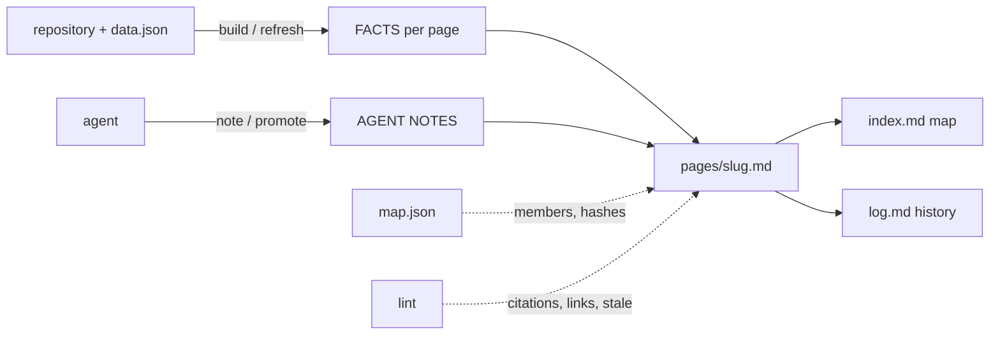

Load when reading, writing, promoting into or linting the code wiki of a graph result.

# Code wiki

The wiki applies the LLM Wiki pattern to code. The repository and the tool evidence in `data.json` are the raw sources and stay read-only. Each Louvain community of the weighted file graph is one page. Scripts keep each page's facts exact; agents write the prose. `index.md` is the map: read it first, then the pages it points to. No embeddings are needed.

## Files under `<out>/wiki/`

| File | Holds | Written by |
|---|---|---|
| `index.md` | Pages ranked by summed PageRank: slug, label, size, PageRank, notes state, one-line summary; stale and empty pages; orphaned pages | every build, note and promote |
| `pages/<slug>.md` | Header line, FACTS, AGENT NOTES | FACTS: build; notes: `note`/`promote` only |
| `pages/isolated.md` | Every file in no community (communities of one) | build |
| `log.md` | Append-only history: builds and refreshes (with the changed files), pages created, updated, marked stale, orphaned or removed, and the reason; notes written; promotions | every operation |
| `map.json` | Per slug: community id, label, size, PageRank, members (PageRank order), the manifest path of package members, and the notes baseline (`notes.at`, a content hash per member) | build, note, promote |

## Operations

Run from the workspace: `node <skill>/scripts/wiki.mjs <command> <out> ...`. In the live viewer, use the same operations through `reply.mjs wiki` or the channel's `wiki_*` tools ([chat](chat.md)), so the open drawer updates.

| Operation | Command | Effect |
|---|---|---|
| Ingest | runs inside every build and refresh (`pipeline.mjs` finishRun); `wiki.mjs build <out> [--changed a,b]` reruns it from `data.json` | Recomputes FACTS for every page and rewrites only pages whose content changed; marks notes stale; emits a `wiki` event |
| Query | `wiki.mjs read <out> index`, `read <out> <slug>`, `read <out> --file <path>` | Prints the page; `--file` finds the page that holds the file |
| Write | `wiki.mjs note <out> <slug> "markdown"` (`-` reads stdin, `--from <file>` reads a file) | Replaces the AGENT NOTES and makes them fresh against the members' current content |
| Promote | `wiki.mjs promote <out> <slug> "answer" --source "<where it came from>"` | Appends `**Promoted <date> from <source>:** answer`; keeps earlier notes and their freshness baseline |
| Lint | `wiki.mjs lint <out> [--root <repo>] [--top N] [--json]` | Lists issues, one per line; exits 1 when it finds any |

## Page layout

1. `# <community label>` (the deepest shared folder, with the top file when two communities share a folder).
2. Header line: `**Notes:** none yet | fresh (written <date>) | stale: N members changed since the notes were written <date>: <files>`, then `**orphaned**` when no community matches, the community id, the size and the slug.
3. `## Facts`, regenerated on every build; never edit it. It holds size, inside and across weight, chunks and purity, the file-check counts, and these sections:
   - Members by PageRank: every member with `path:1`, language, PageRank, betweenness, in and out weight, depth, k-core, cycle id, check status and line count. No member is left out.
   - Links out and Links in: other pages as `[[slug]]` with summed production weight, file-edge count and the strongest edge as `path:line → path:1`. Test-only edges are excluded, following the weight rule.
   - Cycles: each cycle with members here, its size, weight, languages and chunks.
   - File-check problems: members whose `check` is not `ok`.
   - Most-called symbols: production call sites into symbols declared here, with the declaration `path:line`, sites from other pages and the number of callers. The section shows the first 20 and says how many more `data.json` `calls` holds.
4. `## Agent notes`: the text between `<!-- notes:start -->` and `<!-- notes:end -->`, kept verbatim across builds.

## Writing notes

- Write purpose, how the page's code works, its invariants and its gotchas. Do not restate the facts table.
- Start with one sentence that says what the page is. `index.md` shows that first sentence as the page summary.
- Every claim cites `path:line` (or `path:start-end`) relative to the repository root, for example `scripts/pipeline.mjs:175`. Read the source before citing it: lint checks that the file exists and that the line is inside it, but not what the line says.
- Label inferences as inferences. A graph or LSP edge is a lead; prove behavior with the evidence rules ([evidence](evidence.md)).
- Link other pages with `[[slug]]`; `[[index]]`, `[[log]]` and `[[isolated]]` always exist.
- Promote an answer when it is verified and will matter again, such as a chat reply or a proven caller set. Give `--source` the place it came from (`chat 12`, `lspSearch callers`).

## Freshness and identity

- **Stale notes.** When notes are written, map.json records a content hash of every member. A later build or lint compares the hashes with the files on disk. A member that changed, appeared or disappeared makes the notes stale, and the page header and `index.md` name the files. A refresh also passes the files it found changed. Revisit stale pages first: read the changed files, then rewrite the notes. Writing fresh notes resets the baseline.
- **Stable slugs.** Louvain renumbers communities on every run. Each new community takes the previous page it overlaps most, judged by Jaccard share of members (at least 0.25; best share first, ties by size). That page keeps its slug and notes. A new community gets a slug from its label.
- **Orphans.** A previous page that no community takes stays as **orphaned** when it has notes, listing its last members. Without notes it is removed, and the log records it. Move what still holds into the pages that own those files now, then clear the orphan's notes with `note <out> <slug> ""`. The next build removes it.

## Lint issue kinds

| kind | Meaning | Fix |
|---|---|---|
| `citation-file` | A notes citation names no file under the root | Correct the path or drop the claim |
| `citation-line` | The cited line is past the end of the file | Re-read the source and cite the current line |
| `broken-link` | `[[slug]]` names no page | Use a slug from `index.md` |
| `missing-page` | A community in `data.json` has no page, or its page predates the current graph | `wiki.mjs build <out>` |
| `missing-file` | map.json lists a page whose file is gone | `wiki.mjs build <out>` |
| `orphaned` | No community matches the page | Move the notes, then clear them |
| `stale-notes` | A member changed since the notes were written | Revisit and rewrite the notes |
| `empty-notes` | One of the pages that together hold half of the PageRank has no notes (`--top N`: the first N pages) | Write their notes first |

## Script owners

| When | Read |
|---|---|
| API (`buildWiki`, `readPage`, `pageOf`, `writeNotes`, `promote`, `lintWiki`) and the CLI | [wiki.mjs](../scripts/wiki.mjs) |
| FACTS sections from data.json | [wiki-facts.mjs](../scripts/wiki-facts.mjs) |
| Page, orphan and index markdown | [wiki-render.mjs](../scripts/wiki-render.mjs) |
| map.json, slugs and matching, hashes, notes markers, log | [wiki-store.mjs](../scripts/wiki-store.mjs) |
| Lint rules | [wiki-lint.mjs](../scripts/wiki-lint.mjs) |
| Viewer drawer | [live-wiki.js](../assets/live-wiki.js), [live-wiki.css](../assets/live-wiki.css) |
| Tests | [wiki.test.mjs](../scripts/wiki.test.mjs) |
