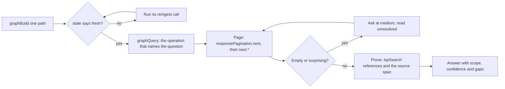

# Octocode Graph

**Start:** read this lobby, map the task to the references it names, and read each one the task needs before acting. The graph is a syntax snapshot of one scope: file, symbol and package nodes joined by `imports`, `calls`, `uses`, `inherits`, `passes` and `contains` edges. It shows **where to inspect**. It does not prove what runs or what breaks.

Call the tools over MCP (`graphBuild`, `graphQuery`) or the CLI: `OCTO='node packages/octocode/out/octocode.js'` from the Octocode checkout, then `$OCTO graphBuild '{"queries":[{"path":"src"}]}'` and `$OCTO schema graphQuery` for the exact fields.

## Question → operation

| Question | Operation |
|---|---|
| Size, coverage, unresolved reasons | `stats` (`view:"details"` for the breakdown) |
| Find a node ID | `find` with `target` words, then `node` |
| What a file imports / who imports it | `deps` / `dependents` (`depth`, `view:"files"\|"modules"`) |
| Who calls / what it calls | `callers` / `callees` on a symbol ID |
| How A reaches B | `path` with `target` and `to` |
| Most depended on | `hubs` (`rankBy:"degree"` default, `rankBy:"pageRank"` for importance weighted by sites) |
| Import loops | `cycles` (`runtime` says whether a loop runs at module load) |
| Dead code, choke points, layering | `issues` (`detectors`, `minTier`, `baseline`) |
| What depends on a change | `impact` with `target`, `changed` or `since` |
| Structural change since a snapshot | `drift` with `baseline` |
| Files that change together in Git | `cochange` with a file `target` |
| Every occurrence behind an edge, or why a call stayed unlinked | `witnesses` / `unresolved` |

| Intent | Thinking mode | Action / check |
|---|---|---|
| Read an empty answer | Bayesian | Absence or a coverage gap? Ask again at `medium` and read `unresolved` before concluding. |
| Rank by a number | Goodhart | `sites`, `pageRank` and co-change measure different things; none is a probability or a runtime frequency. |
| Claim breakage or dead code | Inversion | Name the consumer the graph cannot see (dynamic dispatch, registration, config), then check it. |

## Prove, then answer

Use the **same `path`** for build and every query; scope, freshness, long builds, confidence levels, weights and gaps are in [build and read](references/build-and-read.md). A graph row is a lead. Before citing callers, absence or dead code, run `lspSearch` references at the row's `path`, `symbolName` and `line`, and read the source span. For a co-change pair with `linked:false`, look for the hidden contract (shared config, schema, generated code) in the source. Answer per [output.md](output.md). Neighbors: `octocode-graph-view` renders a whole-repository graph with briefs and a viewer; `octocode-research` settles one symbol or behavior with LSP and source; `octocode-engineer` decides what to do about a cycle, hub or boundary.
