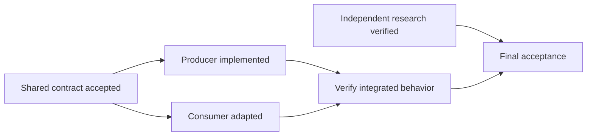

Load when mapping producer and consumer dependencies, checking a plan before dispatch, or finding what a changed input makes stale.

# Dependency graph

Represent only dependencies that change readiness. Each node names an output, its owner and acceptance; each edge names the input the consumer requires. Keep the graph in the existing plan or tracker; to check it, write it as `plan.json` (tasks with `id`, `owner`, `inputs`, `output`, `scope`, `status`; the full shape is in `--help` of [dep-graph](../scripts/dep-graph.mjs)) under `<workspace>/.octocode/tmp/octocode-orchestrator/<run>/`.

Parallel readiness does not authorize overlapping writes: if producer and consumer share a mutable boundary, give it one owner or serialize their changes. Independent research can finish and be integrated while implementation continues. The join needs current evidence from each required predecessor; receiving all reports is insufficient.

Before dispatch, run `node <skill-folder>/scripts/dep-graph.mjs --plan <plan.json>`. Dispatch only tasks in `ready`. Exit 1 means the plan has defects to resolve first: `missingProducers` (find the producer or the existing artifact; keep that consumer pending and continue independent ready tasks), `writerConflicts` (one owner or a dependency between the two tasks), `cycles` and `neverReady` (with the cause and chain). Exit 2 names the field `plan.json` gets wrong. A dependency cycle needs a revised boundary: combine coupled work under one owner, establish a shared interface first, or identify the initial input for an explicitly iterative refinement. Keep that feedback loop separate from the prerequisite graph; do not wait for every task in a cycle to finish first.

After a shared input changes, run `node <skill-folder>/scripts/dep-graph.mjs --plan <plan.json> --changed <task-or-artifact>`. Every task in `stale` used the old input: mark its evidence stale, redirect it if running, and recheck it on the current inputs. Evidence of tasks not listed stays valid. Update `status` in `plan.json` as results are verified, then rerun to release the next `ready` tasks. On reassignment or resume, [resume from current state](recovery.md#resume-from-current-state) with the existing graph and task handles before dispatching anything.
