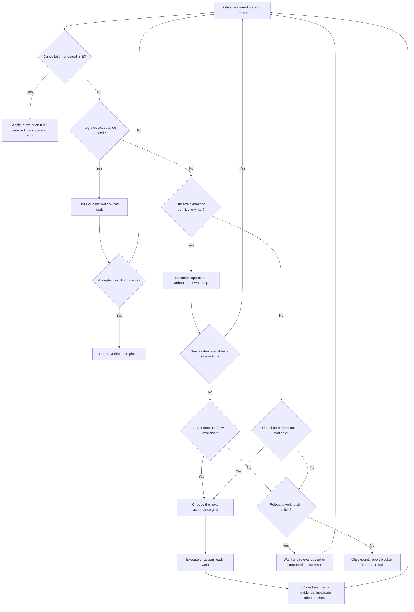

Load when deciding how to decompose work or what to do after new evidence arrives.

# Choose and run a loop

Choose by dependencies and the next acceptance gap. A role is a duty, not a requirement for another agent.

| Situation | Execution shape | Deciding condition |
|---|---|---|
| One bounded question or tightly coupled change | Direct execution with tools | Additional coordination has no distinct evidence or capability to contribute. |
| Known dependent stages | Sequential workflow ([dependency graph](dependency-graph.md)) | The preceding artifact satisfies the next stage's input contract. |
| Independent evidence lanes or disjoint changes | Parallel assignments, then integration | Each lane has a useful output and clear ownership; verify their combined result. |
| Research discovers new questions | [Adaptive research](adaptive-research.md) | Assign the next material uncertainty after integrating current evidence. |
| A concrete acceptance check fails | [Implement → evaluate → repair](evaluate-repair.md) | Feedback identifies an actionable defect against stable acceptance. |
| Execution was interrupted | Reconcile → [resume](recovery.md#resume-from-current-state) | Current artifacts and operation state establish what can safely continue. |

## Execution graph

The feedback loop operates on observations, not a fixed number of rounds. Recheck cancellation and actual host/user limits at each decision boundary, including before dispatch or a wait.

Cancellation stops owned work and reconciles effects using permitted capabilities. An actual limit preserves known state and unresolved work; neither path claims completion. If the host permits no further calls, provide the handoff in the response without claiming a persisted checkpoint or a stopped worker. A new observation can resume a blocked path, but elapsed time alone supplies no missing authority or evidence. A failed acceptance check returns a concrete defect to its owner; it does not release dependent work.
