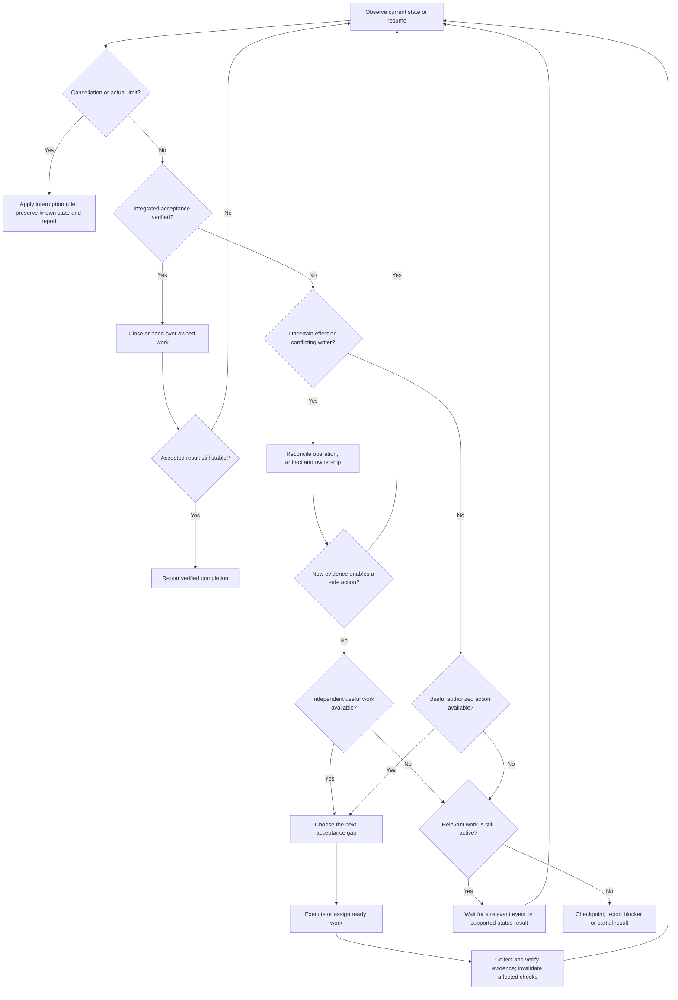
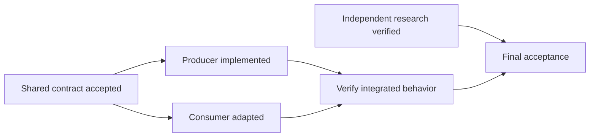

# Choose and run a loop

Load when deciding how to decompose work or what to do after new evidence arrives. Choose by dependencies and the next acceptance gap. A role is a duty, not a requirement for another agent.

| Situation | Execution shape | Deciding condition |
|---|---|---|
| One bounded question or tightly coupled change | Direct execution with tools | Additional coordination has no distinct evidence or capability to contribute. |
| Known dependent stages | Sequential workflow | The preceding artifact satisfies the next stage's input contract. |
| Independent evidence lanes or disjoint changes | Parallel assignments, then integration | Each lane has a useful output and clear ownership; verify their combined result. |
| Research discovers new questions | Adaptive research | Assign the next material uncertainty after integrating current evidence. |
| A concrete acceptance check fails | Implement → evaluate → repair | Feedback identifies an actionable defect against stable acceptance. |
| Execution was interrupted | Reconcile → resume | Current artifacts and operation state establish what can safely continue. |

## Execution graph

The feedback loop operates on observations, not a fixed number of rounds. Recheck cancellation and actual host/user limits at each decision boundary, including before dispatch or a wait.

Cancellation stops owned work and reconciles effects using permitted capabilities. An actual limit preserves known state and unresolved work; neither path claims completion. If the host permits no further calls, provide the handoff in the response without claiming a persisted checkpoint or a stopped worker. A new observation can resume a blocked path, but elapsed time alone supplies no missing authority or evidence. A failed acceptance check returns a concrete defect to its owner; it does not release dependent work.

## Dependency graph

Represent only dependencies that change readiness. Each node names an output, its owner and acceptance; each edge names the input the consumer requires. Keep the graph in the existing plan or tracker; to check it, write it as `plan.json` (tasks with `id`, `owner`, `inputs`, `output`, `scope`, `status`; the full shape is in `--help` of [dep-graph](../scripts/dep-graph.mjs)) under `<workspace>/.octocode/octocode-orchestrator/tmp/<run>/`.

Parallel readiness does not authorize overlapping writes: if producer and consumer share a mutable boundary, give it one owner or serialize their changes. Independent research can finish and be integrated while implementation continues. The join needs current evidence from each required predecessor; receiving all reports is insufficient.

Before dispatch, run `node <skill-folder>/scripts/dep-graph.mjs --plan <plan.json>`. Dispatch only tasks in `ready`. Exit 1 means the plan has defects to resolve first: `missingProducers` (find the producer or the existing artifact; keep that consumer pending and continue independent ready tasks), `writerConflicts` (one owner or a dependency between the two tasks), `cycles` and `neverReady` (with the cause and chain). Exit 2 names the field `plan.json` gets wrong. A dependency cycle needs a revised boundary: combine coupled work under one owner, establish a shared interface first, or identify the initial input for an explicitly iterative refinement. Keep that feedback loop separate from the prerequisite graph; do not wait for every task in a cycle to finish first.

After a shared input changes, run `node <skill-folder>/scripts/dep-graph.mjs --plan <plan.json> --changed <task-or-artifact>`. Every task in `stale` used the old input: mark its evidence stale, redirect it if running, and recheck it on the current inputs. Evidence of tasks not listed stays valid. Update `status` in `plan.json` as results are verified, then rerun to release the next `ready` tasks. On reassignment or resume, reconcile the existing graph and task handles rather than starting duplicate work.

## Adaptive research

Frame the question as a decision and identify what evidence could change it. Start broad enough to find the owning sources, then deepen the relevant branches. For code, follow entry → implementation → state/output → consumers; use exact reads to confirm search or graph leads.

Split independent uncertainties, not arbitrary document counts. Each research assignment names the question, source scope, expected evidence and what would settle it. Retain source identity, contradictory evidence, coverage gaps and executable continuations. A concise worker answer may reference large artifacts; it must not hide missing pages behind a claim of completeness.

After each return, reconcile claims against the source and the strongest plausible alternative. Ask what decision changed, what remains unknown, and whether another observation can settle it. Reassign only the unresolved question. Repeated queries over unchanged evidence need a different hypothesis, scope or source; a productive continuation remains useful work.

Synthesize when the evidence satisfies the requested scope and acceptance. If a required source or check is inaccessible, name that limitation and what would resolve it. Do not turn open-ended research into endless collection, or an explicit completeness request into a sample.

## Evaluate and repair

Establish the oracle before producing the artifact. Give a verifier the requirement and raw inputs, with independent derivation where feasible. A second agent is useful only if it supplies a distinct check; two copies of the producer's summary do not establish independence.

Feedback must identify the unmet criterion, deciding evidence and an actionable correction or distinguishing check. Send the defect to its owner. Preserve the original failure signal; changing the oracle needs evidence from the owning requirement, not a desire to make the result pass.

After repair, check the affected boundary and consumers on the integrated artifact. Reuse unaffected, current evidence. Repeated failure without a revised explanation calls for diagnosis or replanning, not another identical build or another reviewer repeating the same criticism.

The coordinator remains accountable for final acceptance even when workers report success. Measure benefits against a comparable direct-execution baseline before claiming that additional agents improve quality, latency or cost.
