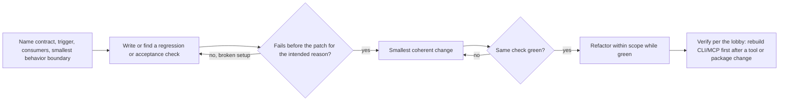
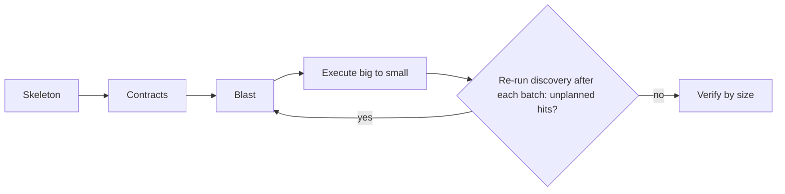

Load for behavior changes and refactors. Tool choice and calls: [tool flow](tool-flow.md).

## Change impact

### Behavior change: RED, GREEN, REFACTOR

- Enhancement: freeze baseline and target first. Trivial reversible edit: a direct check; skip a test that mirrors its text.
- Before patching, read exact source and local patterns; graph/LSP impact when imports or symbols cross boundaries.
- No compatibility shims, legacy aliases, or duplicate paths unless required. Remove obsolete owned paths, update consumers, preserve unrelated edits, one owner per public contract.

### Refactor: SKELETON, CONTRACTS, BLAST, EXECUTE, VERIFY

- Skeleton: structure, graph dependencies/dependents, symbols on entry points and move targets.
- Contracts: behavior to preserve; interfaces authorized to change.
- Blast: graph dependents/path/cycles + LSP references/callers + text/AST across code, tests, scripts, configs, docs.
- Execute: real moves (not copies), path literals from a proven hit list, renames via semantic identity.
- Verify by size; scale execution, never evidence quality:

| Size | Scope | Verify |
|---|---|---|
| S | up to 3 files or one symbol | targeted check |
| M | one package | package test + typecheck + lint |
| L | cross-package | graph dependents/cycles, root build, final search for old names |

Report per [output](../output.md#response).
