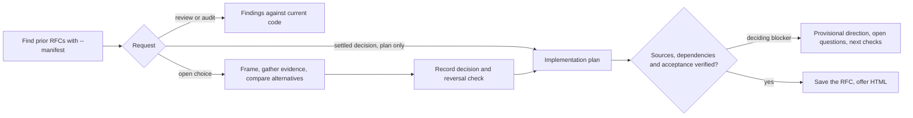

# Octocode RFC Generator

**Start:** read this lobby, map the task to the references it names, and read each one the task needs before acting. Keep the decision and its implementation plan in one RFC. Produce additional deliverables only on explicit request. For a settled decision and a plan-only request, write one plan. An RFC does not authorize implementation.

| Trigger / stage | Action | Completion check |
|---|---|---|
| Existing decision or review | Find prior RFCs with `--manifest` ([commands](references/report-output.md#render-and-retrieve)); revise the selected RFC or mark it `Superseded`. [Audit existing RFCs](references/workflow.md#audit-an-existing-rfc) against current code. | Review-only returns findings; reuse authorization for scoped saves/edits. |
| Open choice | Frame problem, users, current behavior, goals and constraints. Use [evidence workflow](references/workflow.md) and [MCP/CLI guide](references/octocode-usage.md); compare viable alternatives, including status quo when useful. | Record ADR context, decision, header `status`, consequences, supporting evidence and reversal check. |
| Implementation plan | Order by dependency; name each change, compatibility, check, rollout and rollback. Use a Premortem for risky plans and a [diagram](references/checklist.md#diagrams) or example for difficult boundaries. | Success is observable; text preserves the meaning. |
| Readiness | Verify sources, dependencies, acceptance and project checks; follow [closure rules](references/checklist.md#before-declaring-ready). | Resolve deciding blockers or deliver provisional direction, open questions and next checks. |

## Thinking modes

| Intent | Thinking mode | Action / check |
|---|---|---|
| Decide with incomplete evidence | Bayesian / Knightian | State what would invalidate the proposal and keep unsupported likelihoods unknown. |
| Choose a rollout | Optionality / Second-Order | Compare a reversible trial and its downstream consequences. |
| Challenge acceptance | Inversion / Goodhart / Tail Risk | Trace harmful failures; keep containment independent from success scores. |

Use the [shared guide](references/mental-models.md) for definitions and deciding checks.

Continue while a useful evidence check remains. Only a consequential disagreement surviving source review without a direct test may warrant [optional clasify review](references/workflow.md#optional-clasify-review); only that branch needs a classification key.

## Output

Follow [output.md](output.md) for the required sections and [delivery](output.md#delivery). Lead with the proposal and its effect. Link original sources and report material verification gaps in the handoff. [Save every RFC](output.md#saved-report), then offer HTML. Use [render-report.mjs](scripts/render-report.mjs) for accepted rendering or catalog discovery.

## Related skills

Use `octocode-research` to verify current behavior and option claims, `octocode-engineer` when a boundary or design trade-off decides the choice, and `octocode-brainstorming` when the option space is open. Use `octocode-documentation` for readability or a settled ADR, `octocode-agentic` for deciding measurements, and `octocode-workflows` for multi-actor work.
