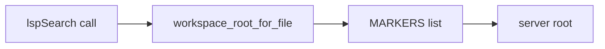
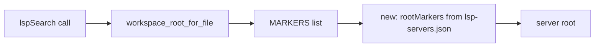
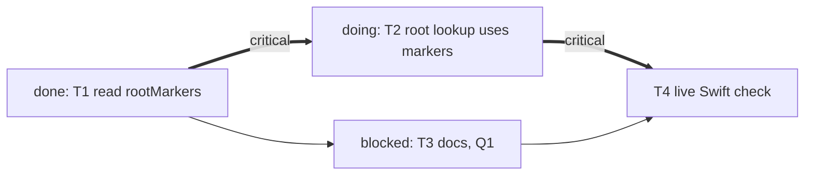

Load when drawing the chosen RFC diagram: naming and labelling rules, the current-and-proposed pair and the task graph example. Which diagram a section needs: [diagrams](diagrams.md).

# Draw RFC diagrams

- Node names come from the glossary, code and tables (`F1`, `T1`, `Q1`).
- Mark state in the label (`new:`, `done:`, `blocked:`), not by color alone; label non-obvious edges.
- Split a big picture into an overview and details. Data true to scale, every number cited, estimates marked; a `*-beta` chart an argument rests on also gets its numbers in a table.
- Check meaning, data and scales yourself; a clean render proves none of them.

Current and proposed, two small diagrams in one section:

A task graph in a revision, as [rfc-trace.mjs](../scripts/rfc-trace.mjs) prints it from a Tasks table with a State column. Paste the block unchanged; to change it, change the table and rerun:

