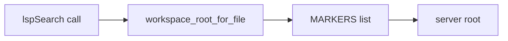
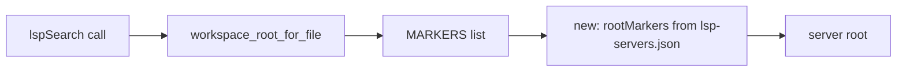
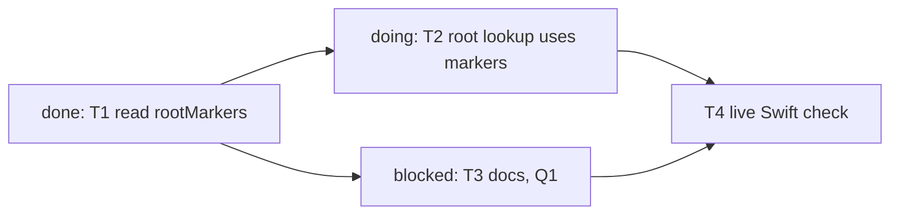

Load when a section needs a flow, diagram, graph or chart. The [Mermaid chooser](report-mermaid.md) owns syntax, the pinned version and families not listed here.

# RFC diagrams

Draw when the reader's question below is real for this RFC; skip it when a table row or one cited line answers it. State the diagram's one message in the sentence before it; prose carries the evidence.

## Choose by the reader's question

| Section | Reader asks | Draw |
|---|---|---|
| Problem and context | Which part could cause this? | `ishikawa-beta` of candidate causes, each with its check |
| Prerequisites | What must land first? | `flowchart` from each `P` to the tasks it unblocks |
| Entities and flows | Which entities exist and how do they relate? | `erDiagram` for stored data and cardinality; `classDiagram` for types and ownership |
| Entities and flows | How does it work today, and where does it fail? | `flowchart` of the current flow; the failing step labelled `fails:` |
| Entities and flows | What changes? | Current and proposed `flowchart` with the same node names; nodes labelled `new:`, `changed:`, `removed:` |
| Entities and flows | Which states can an entity be in? | `stateDiagram-v2`, events and guards on edges |
| Features | What does each consumer do? | `flowchart` of their steps; `journey` when the experience at each step matters |
| Features | Which proposed features first? | `quadrantChart`, axes named, placements marked estimates |
| Proposed design | Who sends what, in what order, and on failure? | `sequenceDiagram` with `alt`/`opt` for failure and retry |
| Proposed design | Which boundaries and services? | `flowchart` with subgraphs; `C4Container` or `architecture-beta` when hosting or trust boundaries decide |
| Proposed design | Dense layered dependencies? | `flowchart` split by layer; a `graph` widget when readers search or follow nodes; `octocode-graph-view` for a repository map |
| Decisions and reasoning | Which option wins on which criterion? | A table; `quadrantChart` when two criteria decide; a `flowchart` decision tree when a condition picks the option |
| Risks and mitigations | What does a failure reach? | `flowchart` from the failure to each affected consumer, containment marked |
| Tasks and rollout | In what order, what runs in parallel? | `flowchart` of `T` IDs, `Depends on` as edges, critical path labelled; a numbered list when nothing branches |
| Tasks and rollout | What is done and what is blocked? (revision) | The same task graph, nodes labelled `done:`, `doing:`, `blocked:` |
| Tasks and rollout | How does the rollout move? | `stateDiagram-v2` of stages, each edge its signal |
| Tasks and rollout | When? | `gantt` only with committed dates or durations; `timeline` for undated phases |
| Validation and success | Did it meet the target? | `chart` bar of baseline, target and measured; `xychart-beta` for a trend |
| Validation and success | Is every feature built and checked? | `requirementDiagram`, only when the tables leave the gap unclear |

Format: `mermaid` for a fixed explanation; `graph` JSON for a network readers search or follow; `chart` JSON for sourced numbers compared exactly ([widgets](report-widgets.md)).

## Draw it right

- Node names come from the glossary, code and tables (`F1`, `T1`, `Q1`).
- Mark state in the label (`new:`, `done:`, `blocked:`), not by color alone; label non-obvious edges.
- Split a big picture into an overview and details. Data true to scale, every number cited, estimates marked; a `*-beta` chart an argument rests on also gets its numbers in a table.
- Check meaning, data and scales yourself; a clean render proves none of them.

Current and proposed, two small diagrams in one section:

A task graph in a revision:

