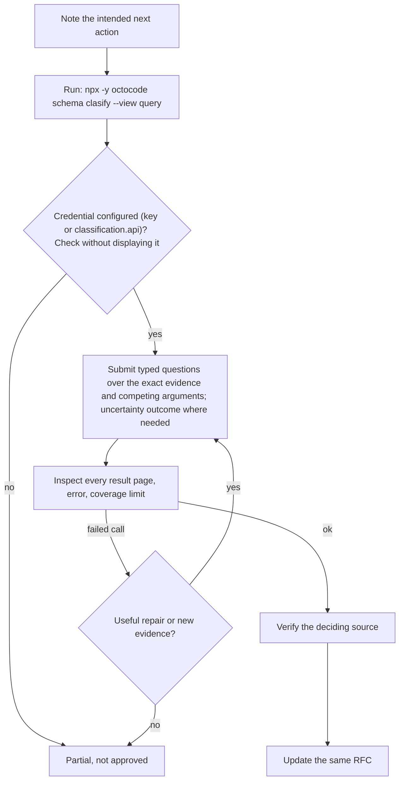

Load when planning evidence, auditing an RFC, or a disagreement survives source review. [output](../output.md) owns structure; `octocode-research` owns tools and verification.

# RFC workflow

## Gather evidence

- Per [checklist area](checklist.md#completeness) that could change the decision: current source, callers, tests; local constraints, prior art, primary docs for options; real consumers and reversible steps for a migration; a dependency's current release, maintained source, license, integration points, limits; a reproducible baseline, and a benchmark when measurement decides.
- Deciding claim: verify in the original source; search snippets are leads.
- Doubtful or conflicting deciding claim: Hypothesis test: claim, strongest rival, distinguishing check, result (confirmed, dismissed, unresolved); unresolved stays an open choice.
- Keep material counterarguments.

## Audit an existing RFC

- Read the proposal and its support; verify the live code it describes.
- Find implemented work, wanted gaps, contradictions, superseded choices; recommend keep, update, or retire, with deciding evidence. Feedback: objection (blocks; states the consequence) vs concern (non-blocking). Shipped work that diverged: After Action Review: intended, happened, why different, next.
- Authorized edits: update substance in place, keep accepted decisions, make the current decision clear; no audit headers, transcripts, diary, or review metadata.
- Archive or delete only within the user's scope; update references.

## Optional clasify review

Only when a consequential disagreement survives source review, no direct check settles it, and a typed judgment could change the next action; ordinary evidence review is the default. `octocode-research` owns `clasify` admission and mechanics.

- Keep RFC revision, criteria, source evidence, proposed answers, and gaps together; [closure rules](checklist.md#track-and-close-questions) still apply.
- Delegated reviewers (when authorized): Delphi: same evidence, independent first positions, then share; keep dissent. Task contract for each: objective a different question, inputs the shared evidence, constraints read-only (you keep write authority and judgment), output a position; keep partial returns.
- Credential: `OCTOCODE_CLASSIFICATION_API` or `classification.api` in `.octocoderc`; use [shared configuration handling](configuration.md) and [live tool availability](octocode-usage.md#availability).

- Confidence is not correctness: verify the deciding source before updating. A provider answer never grants implementation authority.
- Update the same RFC with supported conclusion, dissent, remaining uncertainty; omit requests, receipts, timing, usage.
- Measuring whether assisted review helps: `octocode-eval-benchmark`; no evaluation report in the RFC.

Next: close deciding gaps with the [checklist](checklist.md).
