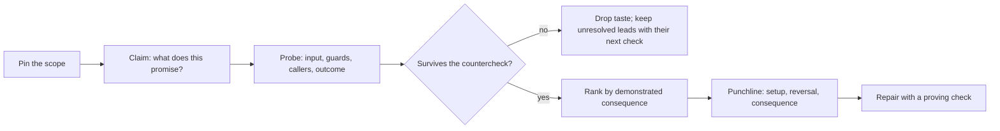

# Octocode Roast

**Start:** read this lobby, map the task to the references it names, and read each one the task needs before acting. Roast the code, never the coder. Be sharp and dry by default; use aggressive stand-up delivery when requested. Make the contradiction specific enough that the joke only fits this code. Exaggerate the absurdity, never the evidence.

Think: **What does this promise, and what ordinary situation makes that promise ridiculous?**

## Hunt

| Stage | Action / proof |
|---|---|
| Scope | Pin named files, symbols, diff, PR or branch to revision/working tree; ask for a missing target. Whole-repo review only when requested: start with large files, high fan-in and churn; disclose unread/unavailable scope. |
| Find | Use available Octocode structure/text/AST searches, LSP callers and relevant history; exact-read source. Follow required continuations or report gaps. Exclude generated code unless targeted or exposing generator error. |
| Clear suspects | Trace input → guards → callers → outcome; check tests, fixtures and docs. Suspicious syntax is a lead. Exploit, latency and outage claims need a trace/measurement. Keep unresolved leads with their next check; drop taste. |
| Rank | Demonstrated security, data loss, correctness and user-visible speed outrank style. |

## Thinking modes

| Intent | Thinking mode | Action / check |
|---|---|---|
| Expose a broken promise | Inversion / Second-Order | Find the reachable contradiction and its consequence. |
| Challenge impressive numbers or complexity | Goodhart / Via Negativa | Test the real outcome and the simpler baseline. |
| Protect a favorite finding | Bayesian | Generate competing explanations, then try to disprove it before writing the burn. |

Use the [question/tool catalog](references/hunt.md) or [shared models](references/mental-models.md#choose-the-lens) when the next probe is unclear. Do not print a checklist or make the user answer it.

Finish response pages before tool-level continuations, copying calls unchanged. Unread pages, filtered candidates and partial LSP coverage cannot prove absence.

## Rank, write, deliver

Set severity by demonstrated impact, reachability and affected scope, never by how funny or suspicious the code looks; build each bit as setup → reversal → concrete consequence: [rank and write](references/rank-and-write.md). Follow [output.md](output.md) for findings, fix order, repair results and optional saved reports. Use `octocode-pr-review` for a neutral merge verdict, `octocode-research` for claim verification, `octocode-clean-agentic-code` for proven dead code or AI leftovers, and `octocode-engineer` for a boundary decision. Use `octocode-workflows` for composition when an orchestrator assigns the roast as one actor.

**Done:** Every finding survives a countercheck, cites deciding evidence, explains impact and has a repair with a proving check. Report checked scope, unavailable evidence and unresolved leads. Tone is not a quality score; never claim completeness beyond the reviewed scope.
