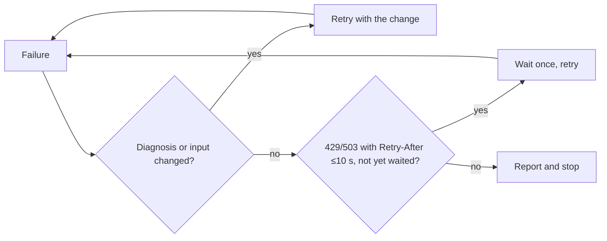

Load when a scrape fails, blocks, times out, or overflows, or when legality, privacy, robots, or accounts matter.

## Policy

- Prefer one URL or an explicit allowlist; fetch only what proves the task.
- Crawls check robots.txt once per origin: a 4xx permits crawling; a transport error or 5xx stops that origin for the run.
- A single explicit URL is user-directed; state that robots was not checked.
- Keep crawl delay on: `--delay-ms <n>`.
- Redact personal data and secrets in summaries, snippets, and reports.

## Failures

| When | Do |
|---|---|
| Hosted key missing | `provider-usage.mjs --check`; keyless route, or ask for authorized `SCRAPING_ANT` setup. |
| Direct `403` or bot block | Browser diagnostic: rendering vs access limit; respect challenges; paid escalation needs approval. |
| Hosted `403` | Stop hosted calls; check sanitized status, credentials, credits, access policy. |
| `refusedHost` (exit 2) or `refused <url>` | Drop and report. User-named local server: rerun with `--allow-private-host`. |
| `sessionExists` (exit 2) | Add `--append`, or omit `--session` for a fresh one. |
| `sessionIncomplete` (exit 1) | Preserve the session artifacts and start a fresh session; an unfinished page or unreadable checkpoint cannot be resumed safely. Completed checkpoints recover automatically with `--append`. |
| `404` | Verify the URL; retry only with a reason. |
| `422` | Print sanitized params; fix or remove the option. |
| `423` anti-bot | Only an authorized route that respects its pacing or access rule. |
| Thin 200 or JS shell | Follow `next.route` ([browser-scraping](browser-scraping.md)); hosted only by explicit choice. |
| Robots disallow, or 5xx on robots | Skip and report; never route around robots with Chrome. |
| `429`/`503` with `Retry-After` | Wait once only if ≤10 seconds; else report and stop. |
| Timeout | Find the cause (connection, rendering, scope); adjust before retrying. |
| Huge output | Follow continuations; size parts with `--chunk-bytes`, `--max-text-bytes`; `--no-raw` drops raw audit. |

## Retries

Bounded retry: a retry needs a changed diagnosis or input; the only wait is one `Retry-After` of ≤10 seconds; anything else is reported and stops (SBAR below).

## On a stop

| Stop | Protocol | Slots |
|---|---|---|
| Finished | BLUF ([output](../output.md)) | Answer, confidence, evidence, gaps |
| Unfinished, someone resumes | Handoff packet | Current state (session folder, pages fetched); evidence; blockers; next action; constraints (authorization, robots, spend); next-call ids (`sessionId`, the `next.*` continuation); no raw logs, page text, or abandoned routes |
| Blocked, needs someone else's action | SBAR | Situation (sanitized status); background (route tried); assessment (evidence); recommendation, as a request (next check or missing authority) |

- A cheaper route may work: [providers](providers.md).
