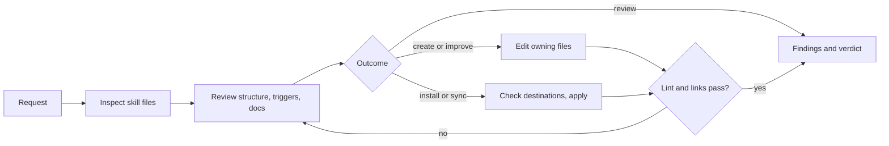

# Octocode Skills

The collection's standard for building skills an agent can discover, follow, and verify.

## What belongs in a skill

Add a field or file only for a real consumer.

| Component | Rule |
|---|---|
| `name` | Matches the folder; stable; changes only with scope; never tied to one example or implementation. |
| `description` | "Load this skill first whenever <concrete triggers>, even if ...; good for <one distinctive capability>." Assertive trigger first (hosts under-trigger); load before asking for missing details. Each intent once, in natural phrasing; no "Not for" list (Related skills in the body routes neighbors); about 300 characters, since every session loads every description; no apostrophes (Pi sends each as `&apos;`). Setup and execution rules in the body. |
| Frontmatter | [Spec](https://agentskills.io/specification): required `name` and `description` (format and length checked by `skill-review.mjs`); optional `license` (name or bundled file), `compatibility` (real environment needs, ≤500 characters), `metadata` (string map, consumer only), experimental `allowed-tools` (space-separated). Prefer portable fields; verify a host extension or `allowed-tools` in that host's docs or loader and state the requirement; never copy one host's metadata, hooks, or permissions into every skill; no invented mandatory metadata. Advanced YAML or publishing: a YAML-aware validator (`skill-review.mjs` checks only common scalars). Public skills (`skills/`) keep `description` on one line holding a JSON string (`description: "..."`): the native build embeds it, and `skill-review.mjs` enforces it. |
| `SKILL.md` lobby | Purpose, one Mermaid flow, sections named for situations or steps, Resources, Related skills, Output route. A single-file skill (`SKILL.md` alone) keeps its output inline and needs no README, output guide, or Resources table. |
| Mermaid | Real flow, branches, retries, or handoffs, with labeled decision edges; none for a simple instruction; file inventories go in route tables. |
| References | Optional detail. First line "Load when <trigger>."; "Next:" last only if the flow continues; flow or decision table only for branching. |
| Resources table | When, Read, Why; routes every reference and runnable script, grouped by consumer when large; no unused files or duplicate guidance. |
| Scripts and hooks | Real task logic only (fetch, render, transform, contract checks); environment lookup and judgment stay in instructions; no thin aliases, fixed-phrase graders, or hooks without a demonstrated event. |
| `output.md` | Usable formats; one authored artifact when it serves; exact fields only for a real downstream consumer. Name a catalog protocol for any output, handoff, or brief ([Write style](#write-style)). Save to `<workspace>/.octocode/<skill-name>/<YYYY-MM-DD>-<slug>.md` (or a same-named folder with a primary file), scratch and captures to its `tmp/`. Ends with `## Saved report` (header, when to save, render, `--manifest`), linking the bundled shared report guidance. |
| Related skills | "Use `<skill>` when ..."; conditional, never a required chain. |
| `README.md` | Purpose, where to start, output, setup; links the lobby, never copies its rules. |
| Configuration | Declare only real dependencies and when each is needed; route lookup and credential handling to [shared configuration](references/configuration.md). |

## Write style

- "When <condition>, <action>"; "because" only when not obvious.
- Link a rule's owner; never restate it.
- Outputs, handoffs, and briefs a skill asks for: name a protocol from the [catalog](references/protocol-catalog.md#catalog) (BLUF, Handoff packet, SBAR, Task contract, Delta update) with slots in the receiver's words; never restate its shape.
- Short bullets and decision tables over paragraphs.
- No personas, all caps, consumer-less word or count limits, research URLs, dates, or run anecdotes; official spec links may stay.
- Deliverables: requested content, rationale, citations, substantive measurements, limitations, in one sectioned document; no transcripts, bookkeeping, run or session IDs, receipts, worker rosters, timestamps, author or status tables, or diaries, including ones templates and renderers add; source dates or versions only where they set applicability.

## Review and refine

1. Read the lobby, supporting files, and affected code; search externally only for an unresolved source ([discover](references/install.md#discover)).
2. Run `node <this-skill>/scripts/skill-review.mjs <skill-or-collection-dir>`; confirm shipped files are reachable from the lobby and packaged (a local ignored file can hide a broken install).
3. Test activation with realistic requests written before editing (varied phrasing, implicit intent, neighbor near-misses, no-skill requests); fix the intent boundary, not keywords. Quick: a small model routes them from names and descriptions (finds confusions; scores above the host). Measured: unused requests through the target host ([skill-activation](../octocode-eval-benchmark/references/skill-activation.md)); record misses and false triggers.
4. Edit the smallest owning surface: findings for a review, fixes plus verification for an improvement; preserve meaningful contracts, useful scripts, concurrent work.
5. Definition of Done: the structural check and changed-script checks pass, commands match live help, standalone install works; report checks not run.

## Rate

- Criteria: activation fit, workflow clarity, resource usefulness, output usability, verification; per material weakness: evidence, repair, and its check.
- Verdict: **Ready**, or **Needs work** when a finding blocks, with the repair (or blocking dependency) as `next`.
- Numeric ratings need a defined evaluation; compare a refinement before and after on the same criteria.
- Lint checks structure, editorial review meaning, activation tests selection; one proves nothing about the others.

## Resources

| When | Read | Why |
|---|---|---|
| Finding, installing, fetching, adapting, syncing | [install](references/install.md) | Surfaces, installers, destinations, fetch gate, recovery |
| Structure and links (`--self-test` checks the checker) | [skill-review.mjs](scripts/skill-review.mjs) | Structural findings |
| Symlinking a local skill to vendors (dry-run first) | [skill-sync.mjs](scripts/skill-sync.mjs) | Provider symlinks |
| Final answer or saved report | [output.md](output.md) | Response shape, header |
| Rendering or listing reports | [render-report.mjs](scripts/render-report.mjs) | Bundled renderer; the repository builds copies from `skills/common` |

## Related skills

- Use `octocode-agentic-prompts` when descriptions, triggers, or rule conflicts need review, or an instruction produces the wrong action.
- Use `octocode-documentation` when the lobby, README, output guide, or references need clarity, accuracy, or structure review.
- Use `octocode-research` when repository evidence or external skill sources need verification.
- Use `octocode-eval-benchmark` when a behavioral or activation claim needs measurement.
- Use [octocode-workflows composition](../octocode-workflows/references/composition.md) when an orchestrator needs to select and sequence actors; direct skill work stays direct.

## Output

Follow [output.md](output.md).
