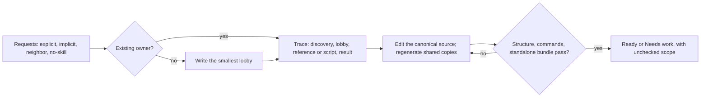

# Octocode Skills

**Start:** read this lobby, map the task to the references it names, and read each one the task needs before acting. Identify the task, intended host and successful result. A review returns findings; creation or improvement edits the canonical source; finding a skill does not authorize installation. The lobby is the body of `SKILL.md`: keep its first useful action and the decision that chooses it visible.

## Decide placement

| Content | Place / action |
|---|---|
| Task-specific deciding question or thinking mode, essential constraint, branch choice or completion signal | Put the short rule in the lobby. Preserve the condition beside its action. |
| Detailed recipe, long question bank, protocol variant or worked example | Link directly from the branch that needs it. Keep the normal route usable without it. |
| The same decision explained twice | Merge at its first needed location; replace the second explanation with a link when needed. |
| A rule used by several standalone skills | Edit its shared owner and regenerate copies. Short routing links and generated copies are intentional. |
| The lobby itself | Follow the [lobby shape](references/write-skills.md#lobby-shape): read-first line and opening, flow, thinking modes, resources, done, in at most 50 lines. |

## Resources

| When | Read or run | Why |
|---|---|---|
| Find an existing skill or decide whether to reuse one | [Find skills](references/find-skills.md) | Search, inspect and recommend without installing |
| Create a skill or repair its description, entry or references | [Write skills](references/write-skills.md) | [Work loop](references/write-skills.md#work-loop) checks, lobby shape, the [lobby template](assets/lobby-template.md) and file naming |
| Review, shorten or validate a skill or collection | [Check skills](references/check-skills.md) | Repetition, prerequisite reads, commands and behavior tests |
| Check structure only | Run [skill-review.mjs](scripts/skill-review.mjs) by its path in this skill folder, with `<target> --json` | Inspect errors and warnings; not an activation test |
| Install, adapt a fetched skill or sync local providers | [Install and sync](references/install.md) | Source inspection, destinations, conflicts and recovery |
| A dependency needs settings or credentials | [Configuration](references/configuration.md) | Resolve only the required configuration |
| Deliver findings, changes or a saved report | [Result formats](output.md) | Readiness, evidence, unchecked scope and optional rendering |

| Intent | Thinking mode | Action / check |
|---|---|---|
| Shorten a lobby | Via Negativa | Move detail only when the common route still reaches every safeguard, command and completion check. |
| Claim an improvement | Goodhart | Fewer lines or a clean structural pass is not activation: compare the same requests before and after. |
| Draw the trigger | Inversion | Write the neighbor and no-skill requests that must not load this skill; check the description rejects them. |

## Done

Return **Ready** or **Needs work**, with findings or changes, checks run and unchecked scope. Distinguish structural evidence, editorial judgment and observed host behavior. Use numerical ratings only with defined criteria. For prompt behavior beyond skill packaging, or measured activation and cost, use `octocode-agentic` when available. It is not required for a structural check.
