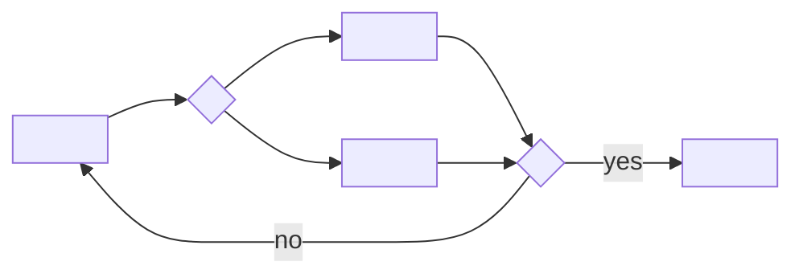

# Lobby template

Copy the block below into a new `SKILL.md`, replace every `<slot>` with verified project behavior and delete the parts the skill does not need. Keep the result at 50 lines or fewer.

`````markdown
---
name: <skill-name>
description: "Use when <recognizable task or situation>. <Distinctive capability and result>. <neighbor-skill> owns <the nearby task this skill does not do>."
---

# <Skill title>

**Start:** read this lobby, map the task to the references it names, and read each one the task needs before acting. <What the skill does, the first action, and the constraint that must be known before it.>



## Thinking modes

| Intent | Thinking mode | Action / check |
|---|---|---|
| <what the agent is trying to do> | <one or two models> | <the action or check the model changes in this skill> |
| <second intent> | <model> | <action or check> |

Definitions: <link the shared mental-models reference>, when one changes the decision.

## Resources

| When | Read or run | Why |
|---|---|---|
| <task branch or trigger> | [<Descriptive name>](references/<task-or-domain>.md) | <what it decides> |
| <deterministic operation> | Run [<script>.mjs](scripts/<script>.mjs) with `<arguments>` | <output and how to check it> |
| Deliver the result | [Output](output.md) | <format, status, destination> |

## Done

<Completion signal: what is verified, what is reported as unchecked.> Neighbors: `<neighbor-skill>` for <its task>.
`````
