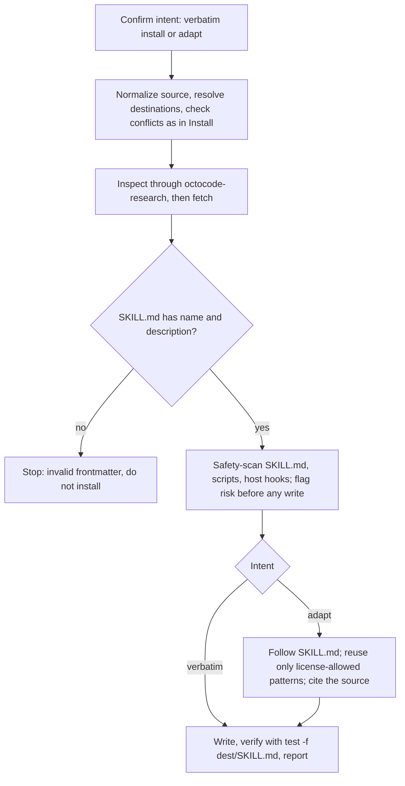

Load when finding, installing, fetching, adapting, or symlinking skills. Ask only for a missing choice or new authority (source, destinations, scope, conflict policy).

# Discover, install, fetch, and sync

## Discover

- Batch reads; web queries: topic plus "agent skill" or "SKILL.md".
- Vary the angle: name (exact, hyphenated, aliases), subject, workflow verbs, ecosystem (agent, IDE, language, MCP), safety (gate, verify, scripts).
- Seeds when sparse: `topic:agent-skills`, `anthropics/skills`, `vercel-labs/skills`, `obra/superpowers`, `microsoft/skills`, `trailofbits/skills`.
- Verify aggregator entries (moderate confidence). Rank by fit, evidence, and host support, not popularity; report gaps.
- Meta-skills (`find-skills`, `skills-discovery`, `skill-creator`) help mid-session; writes wait for the install plan.

```bash
curl -G 'https://www.skills.sh/api/search' --data-urlencode 'q=<search terms>' --data 'limit=100' --compressed
```

Surfaces:
- Keyword or topic: skills.sh search (above), GitHub, and web search in parallel.
- Published or battle-tested: `https://www.skills.sh/<owner>/<repo>/<skill>`.
- Claude Code plugins: `claude-plugins.dev` (REST); marketplace folders: `claudemarketplaces.com`, `mcpmarket.com/tools/skills`.
- Curated: `agentskills.io` (`/clients`), `agentskills.me`.
- Capability tag: `aiskillstore.io/v1/agent/search?capability=`; new skills: `aiskillstore.io/feed/new-skills.json`.
- Microsoft or Azure: `microsoft.github.io/skills`.
- Manifests: `llms.txt` / `llms-full.txt` (agentskills.io, aiskillstore.io, microsoft.github.io/skills); `.claude-plugin/marketplace.json`, `.claude-plugin/plugin.json` (plugin repositories).

Installers:
- `npx -y octocode skill`: preferred ([Install](#install)); fetch a remote skill first ([Fetch](#fetch-a-remote-skill)).
- Third party, check live help: `npx skills add <gh-url> --agent <host> --skill <name>` (symlinks by default); `npx skills-installer install @owner/repo/skill --client <host>`.
- Claude Code native: `/plugin marketplace add`, then `/plugin install`.

## Install

- Check-back: before any write, restate source, destinations, scope, authority, and Definition of Done.
- Normalize the source (`owner/repo/path`, GitHub tree or blob URL, local path); strip a trailing `SKILL.md`.
- Resolve providers, per-provider scope (user, project, custom), project root, and mode from the request and session.
- Read third-party scripts and hooks first (no separate approval).
- Per destination, `ls "<dest>/<skill-name>"`; apply the user's conflict choice.
- Apply with exactly one scope; preview with `--dry-run`; other options in live help:

```bash
npx -y octocode skill install --add <dir> --platform <hosts> --global
npx -y octocode skill install --add <dir> --platform <hosts> --project-dir <repo>
npx -y octocode skill install --add <dir> --path <dest>
```

- `--global`: user scope (general skills); `--project-dir <repo>`: project scope (repository-specific); `--path <dest>`: custom destination.
- `--mode symlink` (default) links vendor destinations to `<octocode-home>/skills/<name>`; `--mode copy` copies; `--mode auto` uses the platform default.
- Verify the install; report per [output](../output.md#response).

Destinations (user under `<home>/`, project under `<repo>/`): claude `.claude/skills/`; cursor `.cursor/skills/`; codex `.agents/skills/`; gemini `.gemini/skills/`; user / project: opencode `.config/opencode/skills/` / `.opencode/skills/`, pi `.pi/agent/skills/` / `.pi/skills/`, copilot `.copilot/skills/` / `.github/skills/`. Other: a custom path the runtime scans (project: confirmed in-repository).

## Fetch a remote skill



Fetch with `npx -y octocode ghCloneRepo '{"queries":[{"owner":"OWNER","repo":"REPO","paths":["PATH"]}]}'` (`"ref":"<ref>"` for a branch or tag; no `paths` for the whole repository; substitute the selected CLI per [configuration](configuration.md#inspect-without-exposing-secrets)); checkout at the result's `location.localPath`. Report per [output](../output.md#response).

- Never silently write or rename fetched scripts or hooks; surface missing or restrictive licenses.
- Intent flips mid-flow: keep the cache, resume at the safety scan or the adapt step.

## Sync a local skill to vendors

- `scripts/skill-sync.mjs`: for a stable local skill you control, or on request; published skills use the install command.
- Read the dry-run plan (no `--approve`) first:

```bash
node scripts/skill-sync.mjs <skill-dir> --platforms top
node scripts/skill-sync.mjs <skill-dir> --platforms top --approve
node scripts/skill-sync.mjs <skill-dir> --platforms claude,cursor --approve --force
node scripts/skill-sync.mjs --list-vendors
```

- `--force` replaces conflicts; the script never prompts.
- `top`: `claude`, `cursor`, `codex`; `all` adds `opencode`, `pi`, `copilot`, `gemini`.

## Recovery

| Failure | Action |
|---|---|
| Discovery, fetch, or source access fails | Check path and access, try another surface or a source the request covers; report the gap |
| Missing parent directory | Create it if the request covers that destination |
| Permission denied | Report the path; offer another scope |
| Partial failure | Keep successes, report per destination, roll back only when asked |
| Invalid frontmatter | Do not install |
