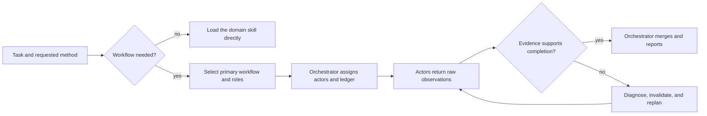

# Octocode Workflows

Choose and compose an authorized workflow; domain skills remain authoritative for their methods, tools, permissions, and output.

## Choose a workflow

- Use the [catalog](references/catalog.md) to select one primary workflow from the missing evidence or outcome, then add an evidence technique or role pattern only when it adds a distinct check.
- Outside an invoked workflow, perform ordinary direct domain tasks with their owner skill; do not add an orchestration wrapper.
- When executing a workflow, use one accountable orchestrator and at least one responsible actor; [composition](references/composition.md#orchestrator-and-actor-contract) owns their RACI duties and sole-ledger contract. A selection alone needs no ledger.
- Honor a user-directed order or actor assignment. Keep sequential work sequential; add an optional actor only within the user's authority and when that actor has a distinct check or required capability.
- Bounded execution and BFS/DFS use one actor; traversal does not fan out. Runtime surgery separates code/architecture and runtime actors.
- Actors do not recursively spawn. The orchestrator may reassign a role only within the user's authority. If a required actor capability is absent, report that execution limitation; do not silently have the orchestrator perform all actor work.

## Composition boundary

Use [composition](references/composition.md) before assigning roles. It defines authority, compact handoffs, sole-ledger ownership, resume, and rejection of needless splits. Use [role patterns](references/role-patterns.md) for concrete duties; metaphors label duties, never personas or extra authority.

For code-boundary work, load `octocode-architect`. A specialist skill owns its domain procedure. `octocode-agents-communication` owns identities, leases, and delivery—not workflow choice.

## Use Octocode across workflows

Every workflow, task family, evidence technique, and role pattern can use Octocode tools. Both the orchestrator and its actors use them directly within their assigned authority; a dedicated Research actor is optional. Prefer Octocode for supported repository, source, history, and package evidence wherever that evidence helps the task.

Use the shared [tool-use map](references/composition.md#octocode-tools-for-every-role) to connect the missing evidence to a capability. Load `octocode-research` for live schemas, exact reads, AST/LSP semantics, and continuations. Select useful calls from the question; workflow coverage does not require exercising every tool.

## Verification and recovery

Use [verification](references/verification.md) for the artifact-identity guard, the five-state ledger, invalidation, uncertain mutations, and evidence-driven replanning. Apply runtime identity only to runtime claims. A specialist's sealed evaluation, browser-mutation, or other safety rule remains stricter than generic recovery.

## Resources

| When | Read | Why |
|---|---|---|
| Select a task family or evidence technique | [catalog](references/catalog.md) | When/why, owner skills, roles, handoff, evidence, recovery, limits |
| Assign roles and tools, merge evidence, hand off, or resume | [composition](references/composition.md) | Shared Octocode capabilities, one orchestrator and ledger contract |
| Choose concrete paired duties or reject a split | [role patterns](references/role-patterns.md) | Thirteen metaphors grouped by procedure |
| Trace context, runtime work, memory, or caches | [resource flow](references/resource-flow.md) | Map → meter → diagnose → repair → replay |
| Audit declared system scope with one traversal actor | [single-actor traversal](references/single-actor-traversal.md) | BFS inventory, DFS traces, explicit coverage |
| Change a running feature through separate code and runtime actors | [runtime surgery](references/runtime-surgery.md) | Feature loop and activation ownership |
| Gather structural or semantic code evidence | [AST and LSP workflows](references/ast-lsp-workflows.md) | Techniques that compose with any execution mode |
| Verify, resume, or recover | [verification](references/verification.md) | Identity, ledger, invalidation, and recovery |
| Save or render a workflow report | [render-report.mjs](scripts/render-report.mjs) | Canonical report renderer |

## Related skills

- Use `octocode-architect` when boundaries, dependency direction, change discipline, or architecture proof decide the work.
- Use `octocode-research` when a code, repository, package, tool schema, or source claim needs evidence.
- Use `octocode-agents-communication` when separate sessions need identity, leases, durable handoffs, or delivery.
- Use `octocode-eval-benchmark` when a workflow or role split must be measured rather than described.

## Output

Follow [output.md](output.md).
