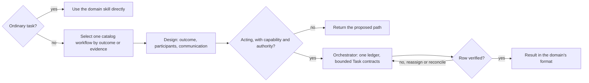

# Octocode Workflows

**Start:** read this lobby, map the task to the references it names, and read each one the task needs before acting. Use the domain skill directly for ordinary tasks. For a workflow selection, choose one primary workflow from the [catalog](references/catalog.md) by the outcome or evidence needed. A selection alone needs no ledger.

## Design the path

| Decide | Record / next action |
|---|---|
| Outcome | Observable result, current state and completion check |
| Participants | Agents, tools, processes, queues, stores, documents or devices; each capability and state owner. Passive objects need a reader/writer. |
| Communication | Messages/artifacts, dependencies and recovery; use [interaction patterns](references/interaction-patterns.md) to choose a topology, then a catalog workflow. |
| Execution | Design returns a proposed path. Acting requires capabilities and authority; roles do not authorize delegation or require extra agents. One agent can work sequentially; disclose reduced independence when relevant. |

| Intent | Thinking mode | Action / check |
|---|---|---|
| Resume or replan | OODA / Bayesian | Reconcile current state, update stale conclusions and choose the next deciding action. |
| Commit an effect | Optionality / Second-Order | Prefer a reversible step and inspect downstream or uncertain effects before retrying. |
| Accept a result | Goodhart / Tail Risk | Verify the intended outcome and failure containment separately. |

| Selected work | Procedure |
|---|---|
| Design a path across agents, tools, services or passive objects | [Interaction patterns](references/interaction-patterns.md): select a topology, specify handoffs, walk success and failure, then choose the execution workflow. |
| Bounded execution or whole-system traversal | Assign one actor. The [BFS/DFS audit](references/single-actor-traversal.md) reconciles the inventory and traces each path without fan-out. |
| Change a running feature | [Runtime surgery](references/runtime-surgery.md) separates the code/architecture actor from the runtime actor that activates and replays the change. |
| Context growth, runtime resources, memory or caches | [Resource flow](references/resource-flow.md) maps the boundary, measures it and replays the correctness check. |
| Actors share one machine and run builds, suites or servers | [Machine budget](references/machine-budget.md): read load, memory and running jobs before each heavy launch; mark, wait on and reclaim processes by owner. |
| Structural or semantic evidence in any workflow | [AST and LSP workflows](references/ast-lsp-workflows.md) distinguish syntax candidates from resolved identities and coverage gaps. |

## Use Octocode across workflows

The orchestrator and every actor may use Octocode directly, within their authority, in any workflow or role. Prefer it for supported repository, source, history and package evidence. Choose the capability from the [tool-use map](references/composition.md#octocode-tools-for-every-role) by the question. Use `octocode-research` for live schemas, exact reads, AST/LSP semantics and continuations. A dedicated research actor is optional.

To act, follow the [execution steps](references/composition.md#execute-an-orchestrated-workflow): one accountable orchestrator, actors never spawn actors, [verification](references/verification.md) owns the ledger states. [Mental models](references/mental-models.md) add a probe; the domain skill keeps its acceptance rules, methods, permissions and output. Load `octocode-engineer` for code boundaries, design trade-offs and change discipline, and `octocode-agentic` for cross-session identity, leases or delivery and to measure a workflow or role split. Otherwise use [output.md](output.md) for a selection, completion or saved handoff and [render-report.mjs](scripts/render-report.mjs) for reports.
